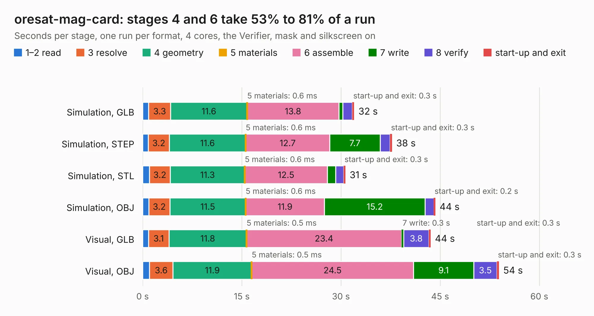

# 2109. oresat-mag-card

Board 2,109 of the 3,110 of [Corpus Testing](../Corpus-Testing.md), on [Corpus Page 20](../CorpusTestingPages/Corpus-Testing-20.md#2109-oresat-mag-card).

| Mode and format | 1–2 read | 3 resolve | 4 geometry | 5 materials | 6 assemble | 7 write | 8 verify | start-up and exit | Total |
|---|---:|---:|---:|---:|---:|---:|---:|---:|---:|
| Simulation, GLB | 0.9 | 3.3 | 11.6 | 0.6&nbsp;ms | 13.8 | 0.6 | 1.4 | 0.3 | 32.0 |
| Simulation, STEP | 0.9 | 3.2 | 11.6 | 0.6&nbsp;ms | 12.7 | 7.7 | 1.5 | 0.3 | 37.7 |
| Simulation, STL | 1.0 | 3.2 | 11.3 | 0.6&nbsp;ms | 12.5 | 1.3 | 1.2 | 0.3 | 30.7 |
| Simulation, OBJ | 0.9 | 3.2 | 11.5 | 0.6&nbsp;ms | 11.9 | 15.2 | 1.3 | 0.2 | 44.3 |
| Visual, GLB | 0.9 | 3.1 | 11.8 | 0.5&nbsp;ms | 23.4 | 0.3 | 3.8 | 0.3 | 43.6 |
| Visual, OBJ | 1.0 | 3.6 | 11.9 | 0.5&nbsp;ms | 24.5 | 9.1 | 3.5 | 0.3 | 53.9 |

<table align="center"><tr><td valign="top">

| Board | Repo: [oresat/oresat-adcs-hardware](https://github.com/oresat/oresat-adcs-hardware) Board: `oresat-mag-card.kicad_pcb` |
|---|---|
| Folder | oresat-mag-card |
| Complexity | 376&nbsp;/&nbsp;1000 (size&nbsp;261, features&nbsp;115) |
| KESE&nbsp;features | through vias, rounded, trapezoid or chamfered pads, drill offsets, filled zones, curved board outline, tracks bare of mask, stack-up, dielectric εr and tanδ, mask and silkscreen colours |
| Tested | 9th November 2026 |
| Copper&nbsp;layers | 4 |
| File&nbsp;format | KiCad 10 (20260206) |
| Parts,&nbsp;tracks,&nbsp;vias | 175, 1,177, 651 |
| Triangles,&nbsp;simulation | 3,666,392 in 197 parts |
| Verifier | PASS in all six runs |

</td><td valign="top">

<table>
<tr><th>File type</th><th>File size</th><th>Peak memory used</th></tr>
<tr><th colspan="3" align="left">Simulation</th></tr>
<tr><td>GLB</td><td align="right">122&nbsp;MB</td><td align="right">1.1&nbsp;GB</td></tr>
<tr><td>STEP</td><td align="right">484&nbsp;MB</td><td align="right">1.5&nbsp;GB</td></tr>
<tr><td>STL</td><td align="right">183&nbsp;MB</td><td align="right">1.1&nbsp;GB</td></tr>
<tr><td>OBJ</td><td align="right">384&nbsp;MB</td><td align="right">2.4&nbsp;GB</td></tr>
<tr><th colspan="3" align="left">Visual</th></tr>
<tr><td>GLB</td><td align="right">74&nbsp;MB</td><td align="right">1.3&nbsp;GB</td></tr>
<tr><td>OBJ</td><td align="right">233&nbsp;MB</td><td align="right">1.6&nbsp;GB</td></tr>
</table>

</td></tr></table>

| Previous | Next |
|:---|---:|
| [2108. oresat-adcs-card](b2108b_oresat-adcs-hardware_oresat-adcs-card.md) | [2110. control-stage](b2110b_oresat-adcs-hardware_oresat-rw-board-rev1-MCXN-control-stage_control-stage.md) |
