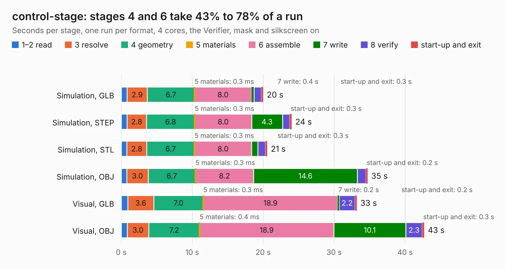

# 2109. control-stage

Board 2,109 of the 3,102 of [Corpus Testing](../Corpus-Testing.md), on [Corpus Page 20](../CorpusTestingPages/Corpus-Testing-20.md#2109-control-stage).

| Mode and format | 1–2 read | 3 resolve | 4 geometry | 5 materials | 6 assemble | 7 write | 8 verify | start-up and exit | Total |
|---|---:|---:|---:|---:|---:|---:|---:|---:|---:|
| Simulation, GLB | 0.8 | 2.9 | 6.7 | 0.3&nbsp;ms | 8.0 | 0.4 | 1.0 | 0.3 | 20.0 |
| Simulation, STEP | 0.8 | 2.8 | 6.8 | 0.3&nbsp;ms | 8.0 | 4.3 | 1.0 | 0.3 | 24.0 |
| Simulation, STL | 0.8 | 2.8 | 6.7 | 0.3&nbsp;ms | 8.0 | 0.9 | 1.1 | 0.3 | 20.6 |
| Simulation, OBJ | 0.8 | 3.0 | 6.7 | 0.3&nbsp;ms | 8.2 | 14.6 | 1.2 | 0.2 | 34.7 |
| Visual, GLB | 0.9 | 3.6 | 7.0 | 0.3&nbsp;ms | 18.9 | 0.2 | 2.2 | 0.2 | 33.2 |
| Visual, OBJ | 0.8 | 3.0 | 7.2 | 0.4&nbsp;ms | 18.9 | 10.1 | 2.3 | 0.3 | 42.7 |

<table align="center"><tr><td valign="top">

| Board | Repo: [oresat/oresat-adcs-hardware](https://github.com/oresat/oresat-adcs-hardware) Board: `control-stage.kicad_pcb` |
|---|---|
| Folder | oresat-rw-board-rev7 / control-stage |
| Complexity | 353&nbsp;/&nbsp;1000 (size&nbsp;258, features&nbsp;95) |
| KESE&nbsp;features | through vias, rounded, trapezoid or chamfered pads, filled zones, TrueType text, stack-up, dielectric εr and tanδ, mask and silkscreen colours |
| Tested | 9th November 2026 |
| Copper&nbsp;layers | 6 |
| File&nbsp;format | KiCad 7 (20221018) |
| Parts,&nbsp;tracks,&nbsp;vias | 74, 917, 524 |
| Triangles,&nbsp;simulation | 2,647,594 in 93 parts |
| Verifier | PASS in all six runs |

</td><td valign="top">

<table>
<tr><th>File type</th><th>File size</th><th>Peak memory used</th></tr>
<tr><th colspan="3" align="left">Simulation</th></tr>
<tr><td>GLB</td><td align="right">89&nbsp;MB</td><td align="right">862&nbsp;MB</td></tr>
<tr><td>STEP</td><td align="right">217&nbsp;MB</td><td align="right">964&nbsp;MB</td></tr>
<tr><td>STL</td><td align="right">132&nbsp;MB</td><td align="right">880&nbsp;MB</td></tr>
<tr><td>OBJ</td><td align="right">281&nbsp;MB</td><td align="right">1.7&nbsp;GB</td></tr>
<tr><th colspan="3" align="left">Visual</th></tr>
<tr><td>GLB</td><td align="right">48&nbsp;MB</td><td align="right">890&nbsp;MB</td></tr>
<tr><td>OBJ</td><td align="right">152&nbsp;MB</td><td align="right">1.1&nbsp;GB</td></tr>
</table>

</td></tr></table>

| Previous | Next |
|:---|---:|
| [2108. as5047p_breakout_rev2](b2108b_oresat-adcs-hardware_as5047p-breakout-rev2.md) | [2110. power-stage](b2110b_oresat-adcs-hardware_power-stage.md) |
