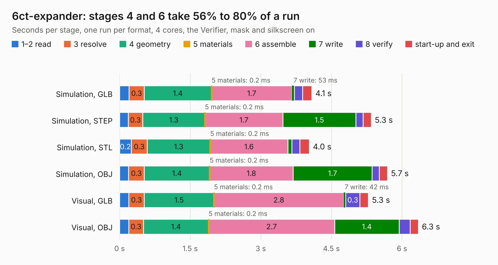

# 2110. 6ct-expander

Board 2,110 of the 3,139 of [Corpus Testing](../Corpus-Testing.md), on [Corpus Page 20](../CorpusTestingPages/Corpus-Testing-20.md#2110-6ct-expander).

| Mode and format | 1–2 read | 3 resolve | 4 geometry | 5 materials | 6 assemble | 7 write | 8 verify | start-up and exit | Total |
|---|---:|---:|---:|---:|---:|---:|---:|---:|---:|
| Simulation, GLB | 0.2 | 0.3 | 1.4 | 0.2&nbsp;ms | 1.7 | 53&nbsp;ms | 0.2 | 0.2 | 4.1 |
| Simulation, STEP | 0.2 | 0.3 | 1.3 | 0.2&nbsp;ms | 1.7 | 1.5 | 0.2 | 0.2 | 5.3 |
| Simulation, STL | 0.2 | 0.3 | 1.3 | 0.2&nbsp;ms | 1.6 | 89&nbsp;ms | 0.2 | 0.2 | 4.0 |
| Simulation, OBJ | 0.2 | 0.3 | 1.4 | 0.2&nbsp;ms | 1.8 | 1.7 | 0.2 | 0.2 | 5.7 |
| Visual, GLB | 0.2 | 0.3 | 1.5 | 0.2&nbsp;ms | 2.8 | 42&nbsp;ms | 0.3 | 0.2 | 5.3 |
| Visual, OBJ | 0.2 | 0.3 | 1.4 | 0.2&nbsp;ms | 2.7 | 1.4 | 0.2 | 0.2 | 6.3 |

<table align="center"><tr><td valign="top">

| Board | Repo: [openenergymonitor/emon32](https://github.com/openenergymonitor/emon32) Board: `6ct-expander.kicad_pcb` |
|---|---|
| Folder | pcb / 6ct-expander |
| Complexity | 223&nbsp;/&nbsp;1000 (size&nbsp;153, features&nbsp;70) |
| KESE&nbsp;features | through vias, custom pads, rounded, trapezoid or chamfered pads, filled zones, copper drawings |
| Tested | 9th November 2026 |
| Copper&nbsp;layers | 2 |
| File&nbsp;format | KiCad 9 (20241229) |
| Parts,&nbsp;tracks,&nbsp;vias | 56, 141, 45 |
| Triangles,&nbsp;simulation | 358,758 in 45 parts |
| Verifier | PASS in all six runs |

</td><td valign="top">

<table>
<tr><th>File type</th><th>File size</th><th>Peak memory used</th></tr>
<tr><th colspan="3" align="left">Simulation</th></tr>
<tr><td>GLB</td><td align="right">12&nbsp;MB</td><td align="right">280&nbsp;MB</td></tr>
<tr><td>STEP</td><td align="right">59&nbsp;MB</td><td align="right">321&nbsp;MB</td></tr>
<tr><td>STL</td><td align="right">18&nbsp;MB</td><td align="right">277&nbsp;MB</td></tr>
<tr><td>OBJ</td><td align="right">36&nbsp;MB</td><td align="right">308&nbsp;MB</td></tr>
<tr><th colspan="3" align="left">Visual</th></tr>
<tr><td>GLB</td><td align="right">10&nbsp;MB</td><td align="right">313&nbsp;MB</td></tr>
<tr><td>OBJ</td><td align="right">29&nbsp;MB</td><td align="right">317&nbsp;MB</td></tr>
</table>

</td></tr></table>

| Previous | Next |
|:---|---:|
| [2109. osw-light](b2109b_open-smartwatch-light_osw-light.md) | [2111. emonPi3](b2111b_emon32_emonPi3.md) |
