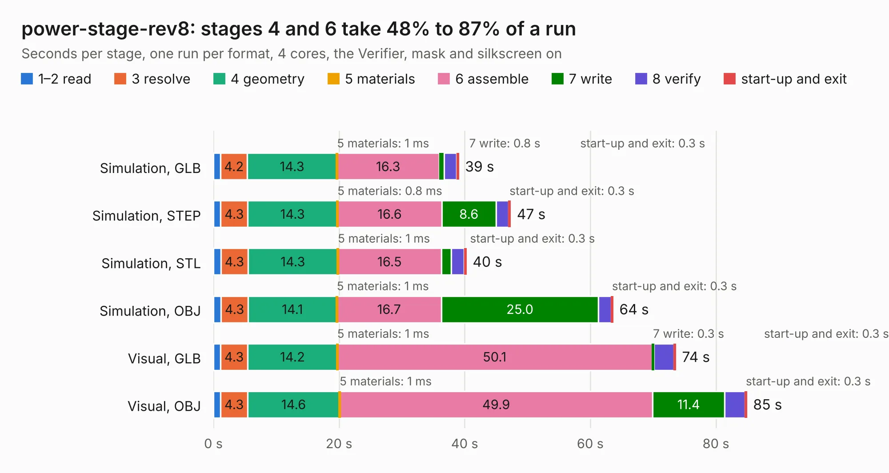

# 2110. power-stage-rev8

Board 2,110 of the 3,109 of [Corpus Testing](../Corpus-Testing.md), on [Corpus Page 20](../CorpusTestingPages/Corpus-Testing-20.md#2110-power-stage-rev8).

| Mode and format | 1–2 read | 3 resolve | 4 geometry | 5 materials | 6 assemble | 7 write | 8 verify | start-up and exit | Total |
|---|---:|---:|---:|---:|---:|---:|---:|---:|---:|
| Simulation, GLB | 1.2 | 4.2 | 14.3 | 1&nbsp;ms | 16.3 | 0.8 | 2.0 | 0.3 | 39.1 |
| Simulation, STEP | 1.2 | 4.3 | 14.3 | 0.8&nbsp;ms | 16.6 | 8.6 | 2.0 | 0.3 | 47.3 |
| Simulation, STL | 1.2 | 4.3 | 14.3 | 1&nbsp;ms | 16.5 | 1.6 | 2.1 | 0.3 | 40.3 |
| Simulation, OBJ | 1.2 | 4.3 | 14.1 | 1&nbsp;ms | 16.7 | 25.0 | 2.0 | 0.3 | 63.6 |
| Visual, GLB | 1.1 | 4.3 | 14.2 | 1&nbsp;ms | 50.1 | 0.3 | 3.1 | 0.3 | 73.6 |
| Visual, OBJ | 1.1 | 4.3 | 14.6 | 1&nbsp;ms | 49.9 | 11.4 | 3.2 | 0.3 | 84.9 |

<table align="center"><tr><td valign="top">

| Board | Repo: [oresat/oresat-adcs-hardware](https://github.com/oresat/oresat-adcs-hardware) Board: `power-stage-rev8.kicad_pcb` |
|---|---|
| Folder | oresat-rw-board-rev2-MCXN / power-stage-rev8 |
| Complexity | 435&nbsp;/&nbsp;1000 (size&nbsp;285, features&nbsp;150) |
| KESE&nbsp;features | through vias, padstacks, rounded, trapezoid or chamfered pads, arc tracks, filled zones, TrueType text, stack-up, dielectric εr and tanδ, copper finish |
| Tested | 9th November 2026 |
| Copper&nbsp;layers | 6 |
| File&nbsp;format | KiCad 10 (20260206) |
| Parts,&nbsp;tracks,&nbsp;vias | 213, 1,035, 686 |
| Triangles,&nbsp;simulation | 4,212,664 in 271 parts |
| Verifier | PASS in all six runs |

</td><td valign="top">

<table>
<tr><th>File type</th><th>File size</th><th>Peak memory used</th></tr>
<tr><th colspan="3" align="left">Simulation</th></tr>
<tr><td>GLB</td><td align="right">140&nbsp;MB</td><td align="right">1.1&nbsp;GB</td></tr>
<tr><td>STEP</td><td align="right">463&nbsp;MB</td><td align="right">1.4&nbsp;GB</td></tr>
<tr><td>STL</td><td align="right">211&nbsp;MB</td><td align="right">1.1&nbsp;GB</td></tr>
<tr><td>OBJ</td><td align="right">442&nbsp;MB</td><td align="right">2.7&nbsp;GB</td></tr>
<tr><th colspan="3" align="left">Visual</th></tr>
<tr><td>GLB</td><td align="right">66&nbsp;MB</td><td align="right">1.4&nbsp;GB</td></tr>
<tr><td>OBJ</td><td align="right">206&nbsp;MB</td><td align="right">1.6&nbsp;GB</td></tr>
</table>

</td></tr></table>

| Previous | Next |
|:---|---:|
| [2109. control-stage](b2109b_oresat-adcs-hardware_oresat-rw-board-rev1-MCXN-control-stage_control-stage.md) | [2111. controller_rev5.0_flat](b2111b_oresat-adcs-hardware_controller-rev5-0-flat.md) |
