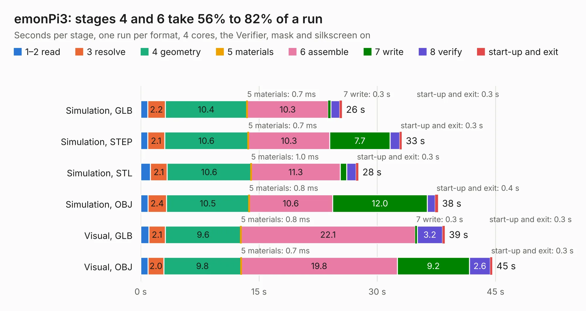

# 2111 emonPi3

Board 2,111 of the 3,138 of [Corpus Testing](../Corpus-Testing.md), on [Corpus Page 20](../CorpusTestingPages/Corpus-Testing-20.md#2111-emonpi3).

| Mode and format | 1–2 read | 3 resolve | 4 geometry | 5 materials | 6 assemble | 7 write | 8 verify | start-up and exit | Total |
|---|---:|---:|---:|---:|---:|---:|---:|---:|---:|
| Simulation, GLB | 0.9 | 2.2 | 10.4 | 0.7&nbsp;ms | 10.3 | 0.3 | 1.1 | 0.3 | 25.5 |
| Simulation, STEP | 0.9 | 2.1 | 10.6 | 0.7&nbsp;ms | 10.3 | 7.7 | 1.2 | 0.3 | 33.1 |
| Simulation, STL | 1.2 | 2.1 | 10.6 | 1.0&nbsp;ms | 11.3 | 0.8 | 1.2 | 0.3 | 27.6 |
| Simulation, OBJ | 0.9 | 2.4 | 10.5 | 0.8&nbsp;ms | 10.6 | 12.0 | 1.0 | 0.4 | 37.7 |
| Visual, GLB | 1.0 | 2.1 | 9.6 | 0.8&nbsp;ms | 22.1 | 0.3 | 3.2 | 0.3 | 38.6 |
| Visual, OBJ | 0.9 | 2.0 | 9.8 | 0.7&nbsp;ms | 19.8 | 9.2 | 2.6 | 0.3 | 44.6 |

<table align="center"><tr><td valign="top">

| Board | Repo: [openenergymonitor/emon32](https://github.com/openenergymonitor/emon32) Board: `emonPi3.kicad_pcb` |
|---|---|
| Folder | pcb / emonpi3 |
| Complexity | 405&nbsp;/&nbsp;1000 (size&nbsp;250, features&nbsp;155) |
| KESE&nbsp;features | through vias, slotted holes, custom pads, rounded, trapezoid or chamfered pads, filled zones, copper drawings, knockout text, TrueType text, stack-up, dielectric εr and tanδ, copper finish |
| Tested | 9th November 2026 |
| Copper&nbsp;layers | 4 |
| File&nbsp;format | KiCad 7 (20221018) |
| Parts,&nbsp;tracks,&nbsp;vias | 151, 933, 260 |
| Triangles,&nbsp;simulation | 2,361,186 in 148 parts |
| Verifier | PASS in all six runs |

</td><td valign="top">

<table>
<tr><th>File type</th><th>File size</th><th>Peak memory used</th></tr>
<tr><th colspan="3" align="left">Simulation</th></tr>
<tr><td>GLB</td><td align="right">80&nbsp;MB</td><td align="right">897&nbsp;MB</td></tr>
<tr><td>STEP</td><td align="right">407&nbsp;MB</td><td align="right">1.2&nbsp;GB</td></tr>
<tr><td>STL</td><td align="right">118&nbsp;MB</td><td align="right">934&nbsp;MB</td></tr>
<tr><td>OBJ</td><td align="right">246&nbsp;MB</td><td align="right">1.6&nbsp;GB</td></tr>
<tr><th colspan="3" align="left">Visual</th></tr>
<tr><td>GLB</td><td align="right">59&nbsp;MB</td><td align="right">1.2&nbsp;GB</td></tr>
<tr><td>OBJ</td><td align="right">181&nbsp;MB</td><td align="right">1.3&nbsp;GB</td></tr>
</table>

</td></tr></table>

| Previous | Next |
|:---|---:|
| [2110 6ct-expander](b2110b_emon32_6ct-expander.md) | [2112 OpenHW DevKit](b2112b_core-v-mcu-devkit_OpenHW-DevKit.md) |
