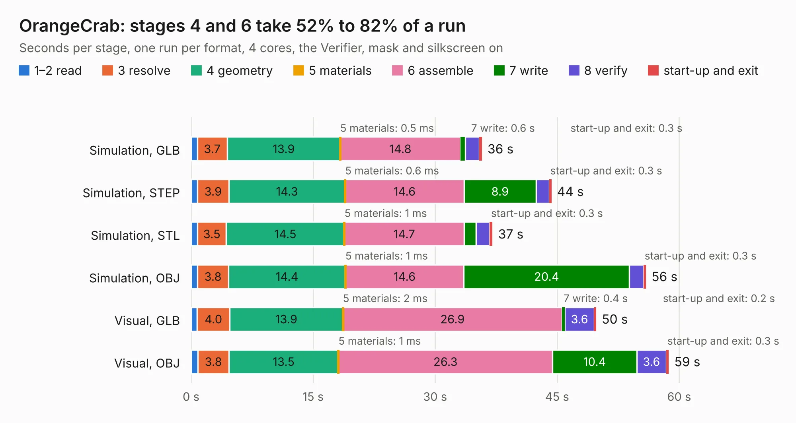

# 2115. OrangeCrab

Board 2,115 of the 3,122 of [Corpus Testing](../Corpus-Testing.md), on [Corpus Page 20](../CorpusTestingPages/Corpus-Testing-20.md#2115-orangecrab).

| Mode and format | 1–2 read | 3 resolve | 4 geometry | 5 materials | 6 assemble | 7 write | 8 verify | start-up and exit | Total |
|---|---:|---:|---:|---:|---:|---:|---:|---:|---:|
| Simulation, GLB | 0.8 | 3.7 | 13.9 | 0.5&nbsp;ms | 14.8 | 0.6 | 1.7 | 0.3 | 35.7 |
| Simulation, STEP | 0.8 | 3.9 | 14.3 | 0.6&nbsp;ms | 14.6 | 8.9 | 1.6 | 0.3 | 44.3 |
| Simulation, STL | 0.8 | 3.5 | 14.5 | 1&nbsp;ms | 14.7 | 1.5 | 1.7 | 0.3 | 37.0 |
| Simulation, OBJ | 0.8 | 3.8 | 14.4 | 1&nbsp;ms | 14.6 | 20.4 | 1.7 | 0.3 | 55.9 |
| Visual, GLB | 0.8 | 4.0 | 13.9 | 2&nbsp;ms | 26.9 | 0.4 | 3.6 | 0.2 | 49.8 |
| Visual, OBJ | 0.9 | 3.8 | 13.5 | 1&nbsp;ms | 26.3 | 10.4 | 3.6 | 0.3 | 58.7 |

<table align="center"><tr><td valign="top">

| Board | Repo: [orangecrab-fpga/orangecrab-hardware](https://github.com/orangecrab-fpga/orangecrab-hardware) Board: `OrangeCrab.kicad_pcb` |
|---|---|
| Folder | hardware / orangecrab_r0.1 |
| Complexity | 403&nbsp;/&nbsp;1000 (size&nbsp;303, features&nbsp;100) |
| KESE&nbsp;features | through vias, slotted holes, custom pads, rounded, trapezoid or chamfered pads, filled zones, copper drawings, copper text, curved board outline |
| Tested | 9th November 2026 |
| Copper&nbsp;layers | 6 |
| File&nbsp;format | KiCad 5 (20171130) |
| Parts,&nbsp;tracks,&nbsp;vias | 141, 6,919, 449 |
| Triangles,&nbsp;simulation | 4,238,478 in 192 parts |
| Verifier | PASS in all six runs |

</td><td valign="top">

<table>
<tr><th>File type</th><th>File size</th><th>Peak memory used</th></tr>
<tr><th colspan="3" align="left">Simulation</th></tr>
<tr><td>GLB</td><td align="right">146&nbsp;MB</td><td align="right">1.2&nbsp;GB</td></tr>
<tr><td>STEP</td><td align="right">609&nbsp;MB</td><td align="right">1.5&nbsp;GB</td></tr>
<tr><td>STL</td><td align="right">212&nbsp;MB</td><td align="right">1.3&nbsp;GB</td></tr>
<tr><td>OBJ</td><td align="right">453&nbsp;MB</td><td align="right">2.7&nbsp;GB</td></tr>
<tr><th colspan="3" align="left">Visual</th></tr>
<tr><td>GLB</td><td align="right">73&nbsp;MB</td><td align="right">1.3&nbsp;GB</td></tr>
<tr><td>OBJ</td><td align="right">233&nbsp;MB</td><td align="right">1.6&nbsp;GB</td></tr>
</table>

</td></tr></table>

| Previous | Next |
|:---|---:|
| [2114. z-limit](b2114b_lumenpnp_z-limit.md) | [2116. OrangeCrab](b2116b_orangecrab-hardware_hardware-orangecrab-r0-2-1_OrangeCrab.md) |
