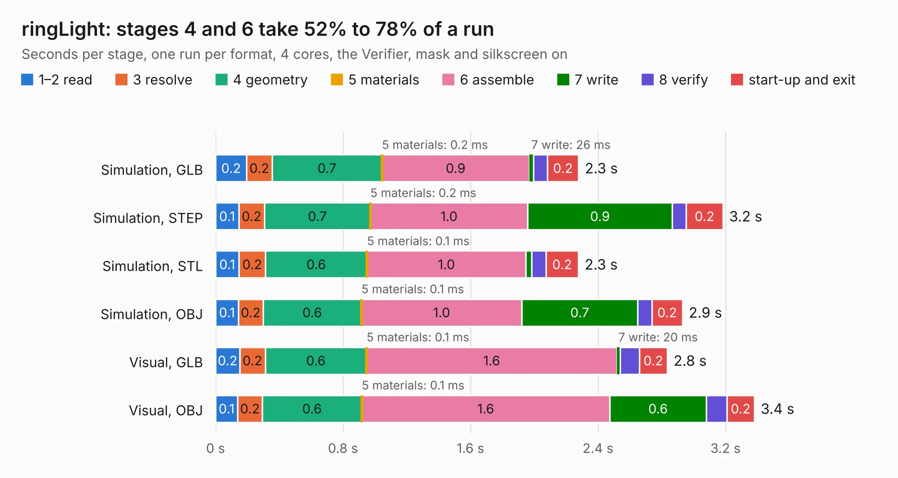

# 2117. ringLight

Board 2,117 of the 3,131 of [Corpus Testing](../Corpus-Testing.md), on [Corpus Page 20](../CorpusTestingPages/Corpus-Testing-20.md#2117-ringlight).

| Mode and format | 1–2 read | 3 resolve | 4 geometry | 5 materials | 6 assemble | 7 write | 8 verify | start-up and exit | Total |
|---|---:|---:|---:|---:|---:|---:|---:|---:|---:|
| Simulation, GLB | 0.2 | 0.2 | 0.7 | 0.2&nbsp;ms | 0.9 | 26&nbsp;ms | 88&nbsp;ms | 0.2 | 2.3 |
| Simulation, STEP | 0.1 | 0.2 | 0.7 | 0.2&nbsp;ms | 1.0 | 0.9 | 88&nbsp;ms | 0.2 | 3.2 |
| Simulation, STL | 0.1 | 0.2 | 0.6 | 0.1&nbsp;ms | 1.0 | 36&nbsp;ms | 91&nbsp;ms | 0.2 | 2.3 |
| Simulation, OBJ | 0.1 | 0.2 | 0.6 | 0.1&nbsp;ms | 1.0 | 0.7 | 90&nbsp;ms | 0.2 | 2.9 |
| Visual, GLB | 0.2 | 0.2 | 0.6 | 0.1&nbsp;ms | 1.6 | 20&nbsp;ms | 0.1 | 0.2 | 2.8 |
| Visual, OBJ | 0.1 | 0.2 | 0.6 | 0.1&nbsp;ms | 1.6 | 0.6 | 0.1 | 0.2 | 3.4 |

<table align="center"><tr><td valign="top">

| Board | Repo: [opulo-inc/lumenpnp](https://github.com/opulo-inc/lumenpnp) Board: `ringLight.kicad_pcb` |
|---|---|
| Folder | src / PCB / ringLight |
| Complexity | 222&nbsp;/&nbsp;1000 (size&nbsp;137, features&nbsp;85) |
| KESE&nbsp;features | through vias, rounded, trapezoid or chamfered pads, filled zones, curved board outline, stack-up, dielectric εr and tanδ |
| Tested | 9th November 2026 |
| Copper&nbsp;layers | 2 |
| File&nbsp;format | KiCad 6 (20211014) |
| Parts,&nbsp;tracks,&nbsp;vias | 21, 142, 17 |
| Triangles,&nbsp;simulation | 179,692 in 25 parts |
| Verifier | PASS in all six runs |

</td><td valign="top">

<table>
<tr><th>File type</th><th>File size</th><th>Peak memory used</th></tr>
<tr><th colspan="3" align="left">Simulation</th></tr>
<tr><td>GLB</td><td align="right">6.4&nbsp;MB</td><td align="right">219&nbsp;MB</td></tr>
<tr><td>STEP</td><td align="right">36&nbsp;MB</td><td align="right">237&nbsp;MB</td></tr>
<tr><td>STL</td><td align="right">9.0&nbsp;MB</td><td align="right">219&nbsp;MB</td></tr>
<tr><td>OBJ</td><td align="right">18&nbsp;MB</td><td align="right">219&nbsp;MB</td></tr>
<tr><th colspan="3" align="left">Visual</th></tr>
<tr><td>GLB</td><td align="right">5.4&nbsp;MB</td><td align="right">218&nbsp;MB</td></tr>
<tr><td>OBJ</td><td align="right">15&nbsp;MB</td><td align="right">215&nbsp;MB</td></tr>
</table>

</td></tr></table>

| Previous | Next |
|:---|---:|
| [2116. pi-interface](b2116b_lumenpnp_pi-interface.md) | [2118. x-cable-chain-support](b2118b_lumenpnp_x-cable-chain-support.md) |
