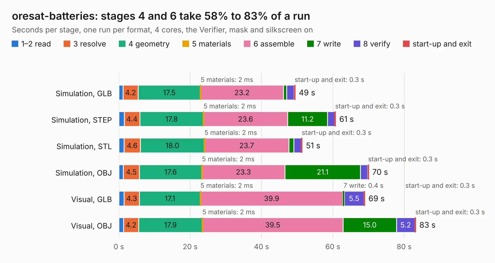

# 2118. oresat-batteries

Board 2,118 of the 3,101 of [Corpus Testing](../Corpus-Testing.md), on [Corpus Page 20](../CorpusTestingPages/Corpus-Testing-20.md#2118-oresat-batteries).

| Mode and format | 1–2 read | 3 resolve | 4 geometry | 5 materials | 6 assemble | 7 write | 8 verify | start-up and exit | Total |
|---|---:|---:|---:|---:|---:|---:|---:|---:|---:|
| Simulation, GLB | 1.2 | 4.2 | 17.5 | 2&nbsp;ms | 23.2 | 0.9 | 2.1 | 0.3 | 49.5 |
| Simulation, STEP | 1.5 | 4.4 | 17.8 | 2&nbsp;ms | 23.6 | 11.2 | 2.0 | 0.3 | 60.8 |
| Simulation, STL | 1.4 | 4.6 | 18.0 | 2&nbsp;ms | 23.7 | 1.4 | 2.1 | 0.3 | 51.5 |
| Simulation, OBJ | 1.3 | 4.5 | 17.6 | 2&nbsp;ms | 23.3 | 21.1 | 2.1 | 0.3 | 70.1 |
| Visual, GLB | 1.5 | 4.3 | 17.1 | 2&nbsp;ms | 39.9 | 0.4 | 5.5 | 0.3 | 69.0 |
| Visual, OBJ | 1.3 | 4.2 | 17.9 | 2&nbsp;ms | 39.5 | 15.0 | 5.2 | 0.3 | 83.3 |

<table align="center"><tr><td valign="top">

| Board | Repo: [oresat/oresat-batteries](https://github.com/oresat/oresat-batteries) Board: `oresat-batteries.kicad_pcb` |
|---|---|
| Folder | oresat-battery-card |
| Complexity | 410&nbsp;/&nbsp;1000 (size&nbsp;270, features&nbsp;140) |
| KESE&nbsp;features | through vias, slotted holes, custom pads, rounded, trapezoid or chamfered pads, drill offsets, filled zones, copper drawings, stack-up, dielectric εr and tanδ, copper finish, mask and silkscreen colours |
| Tested | 9th November 2026 |
| Copper&nbsp;layers | 4 |
| File&nbsp;format | KiCad 10 (20260206) |
| Parts,&nbsp;tracks,&nbsp;vias | 277, 2,229, 566 |
| Triangles,&nbsp;simulation | 4,578,120 in 287 parts |
| Verifier | PASS in all six runs |

</td><td valign="top">

<table>
<tr><th>File type</th><th>File size</th><th>Peak memory used</th></tr>
<tr><th colspan="3" align="left">Simulation</th></tr>
<tr><td>GLB</td><td align="right">157&nbsp;MB</td><td align="right">1.4&nbsp;GB</td></tr>
<tr><td>STEP</td><td align="right">697&nbsp;MB</td><td align="right">1.8&nbsp;GB</td></tr>
<tr><td>STL</td><td align="right">229&nbsp;MB</td><td align="right">1.4&nbsp;GB</td></tr>
<tr><td>OBJ</td><td align="right">494&nbsp;MB</td><td align="right">3.0&nbsp;GB</td></tr>
<tr><th colspan="3" align="left">Visual</th></tr>
<tr><td>GLB</td><td align="right">104&nbsp;MB</td><td align="right">1.7&nbsp;GB</td></tr>
<tr><td>OBJ</td><td align="right">334&nbsp;MB</td><td align="right">2.2&nbsp;GB</td></tr>
</table>

</td></tr></table>

| Previous | Next |
|:---|---:|
| [2117. oresat-backplane-3u](b2117b_oresat-backplane_oresat-backplane-3u.md) | [2119. oresat-c3](b2119b_oresat-c3-hardware_oresat-c3.md) |
