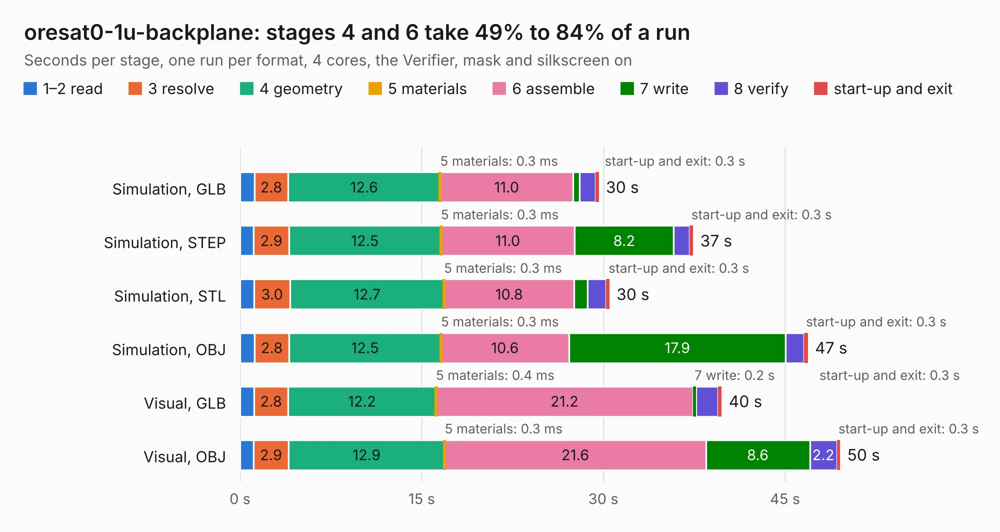

# 2119. oresat0-1u-backplane

Board 2,119 of the 3,108 of [Corpus Testing](../Corpus-Testing.md), on [Corpus Page 20](../CorpusTestingPages/Corpus-Testing-20.md#2119-oresat0-1u-backplane).

| Mode and format | 1–2 read | 3 resolve | 4 geometry | 5 materials | 6 assemble | 7 write | 8 verify | start-up and exit | Total |
|---|---:|---:|---:|---:|---:|---:|---:|---:|---:|
| Simulation, GLB | 1.2 | 2.8 | 12.6 | 0.3&nbsp;ms | 11.0 | 0.5 | 1.3 | 0.3 | 29.6 |
| Simulation, STEP | 1.1 | 2.9 | 12.5 | 0.3&nbsp;ms | 11.0 | 8.2 | 1.3 | 0.3 | 37.4 |
| Simulation, STL | 1.2 | 3.0 | 12.7 | 0.3&nbsp;ms | 10.8 | 1.1 | 1.5 | 0.3 | 30.5 |
| Simulation, OBJ | 1.2 | 2.8 | 12.5 | 0.3&nbsp;ms | 10.6 | 17.9 | 1.5 | 0.3 | 46.9 |
| Visual, GLB | 1.2 | 2.8 | 12.2 | 0.4&nbsp;ms | 21.2 | 0.2 | 1.8 | 0.3 | 39.8 |
| Visual, OBJ | 1.1 | 2.9 | 12.9 | 0.3&nbsp;ms | 21.6 | 8.6 | 2.2 | 0.3 | 49.5 |

<table align="center"><tr><td valign="top">

| Board | Repo: [oresat/oresat-backplane](https://github.com/oresat/oresat-backplane) Board: `oresat0-1u-backplane.kicad_pcb` |
|---|---|
| Folder | 1U / KiCad / oresat0-1u-backplane |
| Complexity | 313&nbsp;/&nbsp;1000 (size&nbsp;193, features&nbsp;120) |
| KESE&nbsp;features | through vias, custom pads, rounded, trapezoid or chamfered pads, drill offsets, filled zones, copper drawings, curved board outline, stack-up, dielectric εr and tanδ |
| Tested | 9th November 2026 |
| Copper&nbsp;layers | 4 |
| File&nbsp;format | KiCad 6 (20211014) |
| Parts,&nbsp;tracks,&nbsp;vias | 38, 808, 245 |
| Triangles,&nbsp;simulation | 3,116,812 in 59 parts |
| Verifier | PASS in all six runs |

</td><td valign="top">

<table>
<tr><th>File type</th><th>File size</th><th>Peak memory used</th></tr>
<tr><th colspan="3" align="left">Simulation</th></tr>
<tr><td>GLB</td><td align="right">105&nbsp;MB</td><td align="right">974&nbsp;MB</td></tr>
<tr><td>STEP</td><td align="right">441&nbsp;MB</td><td align="right">1.1&nbsp;GB</td></tr>
<tr><td>STL</td><td align="right">156&nbsp;MB</td><td align="right">934&nbsp;MB</td></tr>
<tr><td>OBJ</td><td align="right">330&nbsp;MB</td><td align="right">2.1&nbsp;GB</td></tr>
<tr><th colspan="3" align="left">Visual</th></tr>
<tr><td>GLB</td><td align="right">51&nbsp;MB</td><td align="right">1.1&nbsp;GB</td></tr>
<tr><td>OBJ</td><td align="right">157&nbsp;MB</td><td align="right">1.2&nbsp;GB</td></tr>
</table>

</td></tr></table>

| Previous | Next |
|:---|---:|
| [2118. oresat-backplane-1u](b2118b_oresat-backplane_oresat-backplane-1u.md) | [2120. oresat-backplane-2u](b2120b_oresat-backplane_2U-generic-2u_oresat-backplane-2u.md) |
