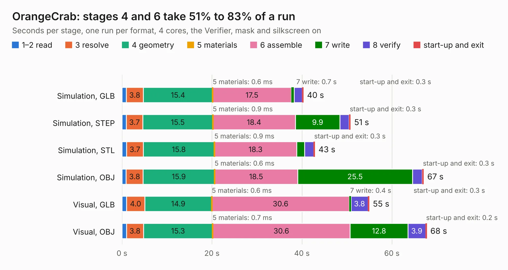

# 2121. OrangeCrab

Board 2,121 of the 3,130 of [Corpus Testing](../Corpus-Testing.md), on [Corpus Page 20](../CorpusTestingPages/Corpus-Testing-20.md#2121-orangecrab).

| Mode and format | 1–2 read | 3 resolve | 4 geometry | 5 materials | 6 assemble | 7 write | 8 verify | start-up and exit | Total |
|---|---:|---:|---:|---:|---:|---:|---:|---:|---:|
| Simulation, GLB | 0.9 | 3.8 | 15.4 | 0.6&nbsp;ms | 17.5 | 0.7 | 1.8 | 0.3 | 40.3 |
| Simulation, STEP | 0.9 | 3.7 | 15.5 | 0.9&nbsp;ms | 18.4 | 9.9 | 2.0 | 0.3 | 50.8 |
| Simulation, STL | 1.0 | 3.7 | 15.8 | 0.9&nbsp;ms | 18.3 | 1.7 | 2.0 | 0.3 | 42.9 |
| Simulation, OBJ | 0.9 | 3.8 | 15.9 | 0.6&nbsp;ms | 18.5 | 25.5 | 2.2 | 0.3 | 67.1 |
| Visual, GLB | 1.0 | 4.0 | 14.9 | 0.6&nbsp;ms | 30.6 | 0.4 | 3.8 | 0.3 | 55.0 |
| Visual, OBJ | 1.0 | 3.8 | 15.3 | 0.7&nbsp;ms | 30.6 | 12.8 | 3.9 | 0.2 | 67.7 |

<table align="center"><tr><td valign="top">

| Board | Repo: [orangecrab-fpga/orangecrab-hardware](https://github.com/orangecrab-fpga/orangecrab-hardware) Board: `OrangeCrab.kicad_pcb` |
|---|---|
| Folder | hardware / orangecrab_r0.2.1 |
| Complexity | 404&nbsp;/&nbsp;1000 (size&nbsp;304, features&nbsp;100) |
| KESE&nbsp;features | through vias, slotted holes, custom pads, rounded, trapezoid or chamfered pads, filled zones, copper drawings, copper text, curved board outline |
| Tested | 9th November 2026 |
| Copper&nbsp;layers | 6 |
| File&nbsp;format | KiCad 5 (20171130) |
| Parts,&nbsp;tracks,&nbsp;vias | 142, 7,280, 441 |
| Triangles,&nbsp;simulation | 4,397,740 in 188 parts |
| Verifier | PASS in all six runs |

</td><td valign="top">

<table>
<tr><th>File type</th><th>File size</th><th>Peak memory used</th></tr>
<tr><th colspan="3" align="left">Simulation</th></tr>
<tr><td>GLB</td><td align="right">151&nbsp;MB</td><td align="right">1.1&nbsp;GB</td></tr>
<tr><td>STEP</td><td align="right">636&nbsp;MB</td><td align="right">1.5&nbsp;GB</td></tr>
<tr><td>STL</td><td align="right">220&nbsp;MB</td><td align="right">1.2&nbsp;GB</td></tr>
<tr><td>OBJ</td><td align="right">470&nbsp;MB</td><td align="right">2.8&nbsp;GB</td></tr>
<tr><th colspan="3" align="left">Visual</th></tr>
<tr><td>GLB</td><td align="right">77&nbsp;MB</td><td align="right">1.5&nbsp;GB</td></tr>
<tr><td>OBJ</td><td align="right">245&nbsp;MB</td><td align="right">1.7&nbsp;GB</td></tr>
</table>

</td></tr></table>

| Previous | Next |
|:---|---:|
| [2120. OrangeCrab](b2120b_orangecrab-hardware_hardware-orangecrab-r0-1_OrangeCrab.md) | [2122. OrangeCrab](b2122b_orangecrab-hardware_hardware-orangecrab-r0-2_OrangeCrab.md) |
