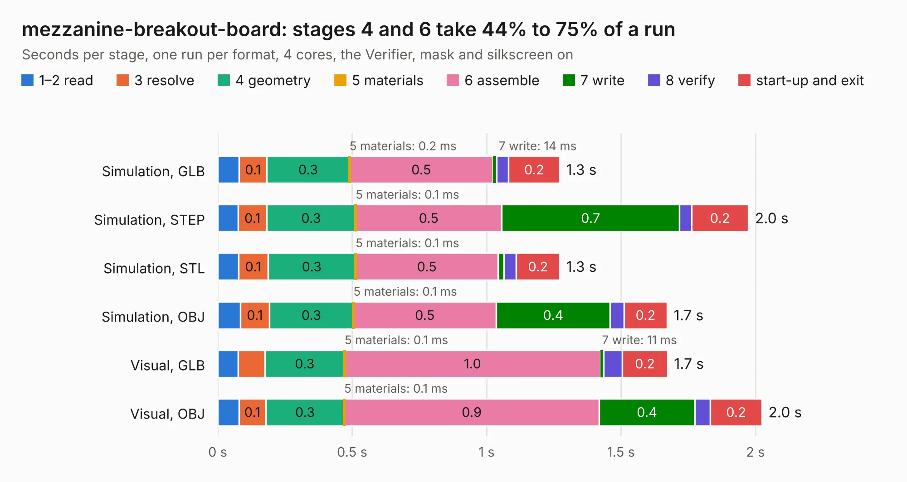

# 2121. mezzanine-breakout-board

Board 2,121 of the 3,126 of [Corpus Testing](../Corpus-Testing.md), on [Corpus Page 20](../CorpusTestingPages/Corpus-Testing-20.md#2121-mezzanine-breakout-board).

| Mode and format | 1–2 read | 3 resolve | 4 geometry | 5 materials | 6 assemble | 7 write | 8 verify | start-up and exit | Total |
|---|---:|---:|---:|---:|---:|---:|---:|---:|---:|
| Simulation, GLB | 80&nbsp;ms | 0.1 | 0.3 | 0.2&nbsp;ms | 0.5 | 14&nbsp;ms | 44&nbsp;ms | 0.2 | 1.3 |
| Simulation, STEP | 77&nbsp;ms | 0.1 | 0.3 | 0.1&nbsp;ms | 0.5 | 0.7 | 46&nbsp;ms | 0.2 | 2.0 |
| Simulation, STL | 77&nbsp;ms | 0.1 | 0.3 | 0.1&nbsp;ms | 0.5 | 21&nbsp;ms | 47&nbsp;ms | 0.2 | 1.3 |
| Simulation, OBJ | 85&nbsp;ms | 0.1 | 0.3 | 0.1&nbsp;ms | 0.5 | 0.4 | 51&nbsp;ms | 0.2 | 1.7 |
| Visual, GLB | 76&nbsp;ms | 99&nbsp;ms | 0.3 | 0.1&nbsp;ms | 1.0 | 11&nbsp;ms | 70&nbsp;ms | 0.2 | 1.7 |
| Visual, OBJ | 79&nbsp;ms | 0.1 | 0.3 | 0.1&nbsp;ms | 0.9 | 0.4 | 58&nbsp;ms | 0.2 | 2.0 |

<table align="center"><tr><td valign="top">

| Board | Repo: [oresat/oresat-adcs-hardware](https://github.com/oresat/oresat-adcs-hardware) Board: `mezzanine-breakout-board.kicad_pcb` |
|---|---|
| Folder | mezzanine-breakout-board |
| Complexity | 197&nbsp;/&nbsp;1000 (size&nbsp;92, features&nbsp;105) |
| KESE&nbsp;features | through vias, rounded, trapezoid or chamfered pads, filled zones, curved board outline, stack-up, dielectric εr and tanδ, copper finish, mask and silkscreen colours |
| Tested | 9th November 2026 |
| Copper&nbsp;layers | 2 |
| File&nbsp;format | KiCad 8 (20240108) |
| Parts,&nbsp;tracks,&nbsp;vias | 2, 31, 5 |
| Triangles,&nbsp;simulation | 88,076 in 19 parts |
| Verifier | PASS in all six runs |

</td><td valign="top">

<table>
<tr><th>File type</th><th>File size</th><th>Peak memory used</th></tr>
<tr><th colspan="3" align="left">Simulation</th></tr>
<tr><td>GLB</td><td align="right">3.0&nbsp;MB</td><td align="right">178&nbsp;MB</td></tr>
<tr><td>STEP</td><td align="right">12&nbsp;MB</td><td align="right">186&nbsp;MB</td></tr>
<tr><td>STL</td><td align="right">4.4&nbsp;MB</td><td align="right">176&nbsp;MB</td></tr>
<tr><td>OBJ</td><td align="right">8.5&nbsp;MB</td><td align="right">178&nbsp;MB</td></tr>
<tr><th colspan="3" align="left">Visual</th></tr>
<tr><td>GLB</td><td align="right">2.1&nbsp;MB</td><td align="right">152&nbsp;MB</td></tr>
<tr><td>OBJ</td><td align="right">5.8&nbsp;MB</td><td align="right">152&nbsp;MB</td></tr>
</table>

</td></tr></table>

| Previous | Next |
|:---|---:|
| [2120. OrangeCrab](b2120b_orangecrab-hardware_hardware-orangecrab-r0-2_OrangeCrab.md) | [2122. mezzanine-flex-board](b2122b_oresat-adcs-hardware_mezzanine-flex-board.md) |
