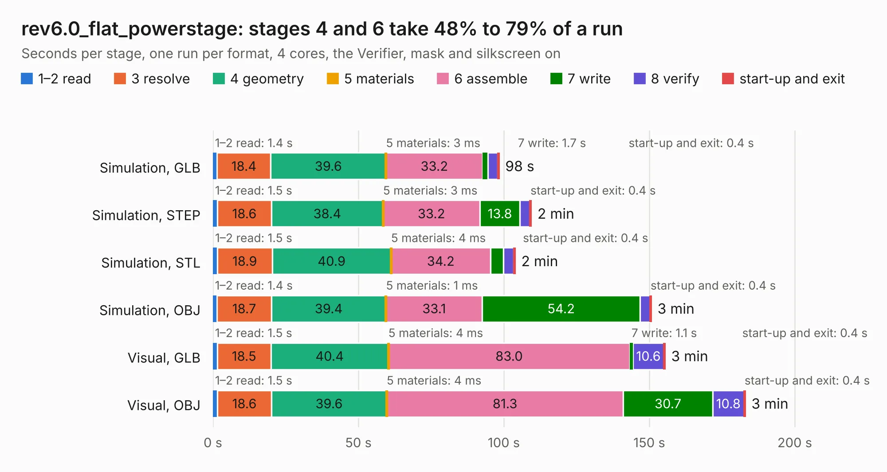

# 2121. rev6.0_flat_powerstage

Board 2,121 of the 3,117 of [Corpus Testing](../Corpus-Testing.md), on [Corpus Page 20](../CorpusTestingPages/Corpus-Testing-20.md#2121-rev60_flat_powerstage).

| Mode and format | 1–2 read | 3 resolve | 4 geometry | 5 materials | 6 assemble | 7 write | 8 verify | start-up and exit | Total |
|---|---:|---:|---:|---:|---:|---:|---:|---:|---:|
| Simulation, GLB | 1.4 | 18.4 | 39.6 | 3&nbsp;ms | 33.2 | 1.7 | 3.5 | 0.4 | 98.3 |
| Simulation, STEP | 1.5 | 18.6 | 38.4 | 3&nbsp;ms | 33.2 | 13.8 | 3.4 | 0.4 | 109.4 |
| Simulation, STL | 1.5 | 18.9 | 40.9 | 4&nbsp;ms | 34.2 | 4.5 | 3.5 | 0.4 | 103.8 |
| Simulation, OBJ | 1.4 | 18.7 | 39.4 | 1&nbsp;ms | 33.1 | 54.2 | 3.5 | 0.4 | 150.6 |
| Visual, GLB | 1.5 | 18.5 | 40.4 | 4&nbsp;ms | 83.0 | 1.1 | 10.6 | 0.4 | 155.4 |
| Visual, OBJ | 1.5 | 18.6 | 39.6 | 4&nbsp;ms | 81.3 | 30.7 | 10.8 | 0.4 | 182.9 |

<table align="center"><tr><td valign="top">

| Board | Repo: [oresat/oresat-adcs-hardware](https://github.com/oresat/oresat-adcs-hardware) Board: `rev6.0_flat_powerstage.kicad_pcb` |
|---|---|
| Folder | oresat-rw-board-rev6 / rev6.0_flat_powerstage |
| Complexity | 324&nbsp;/&nbsp;1000 (size&nbsp;249, features&nbsp;75) |
| KESE&nbsp;features | through vias, rounded, trapezoid or chamfered pads, filled zones, stack-up, dielectric εr and tanδ |
| Tested | 9th November 2026 |
| Copper&nbsp;layers | 4 |
| File&nbsp;format | KiCad 6 (20211014) |
| Parts,&nbsp;tracks,&nbsp;vias | 201, 931, 4,881 |
| Triangles,&nbsp;simulation | 9,968,238 in 126 parts |
| Verifier | PASS in all six runs |

</td><td valign="top">

<table>
<tr><th>File type</th><th>File size</th><th>Peak memory used</th></tr>
<tr><th colspan="3" align="left">Simulation</th></tr>
<tr><td>GLB</td><td align="right">314&nbsp;MB</td><td align="right">2.8&nbsp;GB</td></tr>
<tr><td>STEP</td><td align="right">588&nbsp;MB</td><td align="right">3.5&nbsp;GB</td></tr>
<tr><td>STL</td><td align="right">498&nbsp;MB</td><td align="right">2.8&nbsp;GB</td></tr>
<tr><td>OBJ</td><td align="right">1.0&nbsp;GB</td><td align="right">6.0&nbsp;GB</td></tr>
<tr><th colspan="3" align="left">Visual</th></tr>
<tr><td>GLB</td><td align="right">202&nbsp;MB</td><td align="right">3.3&nbsp;GB</td></tr>
<tr><td>OBJ</td><td align="right">658&nbsp;MB</td><td align="right">4.2&nbsp;GB</td></tr>
</table>

</td></tr></table>

| Previous | Next |
|:---|---:|
| [2120. rev6.0_flat_controlstage](b2120b_oresat-adcs-hardware_rev6-0-flat-controlstage.md) | [2122. as5047p_breakout](b2122b_oresat-adcs-hardware_as5047p-breakout.md) |
