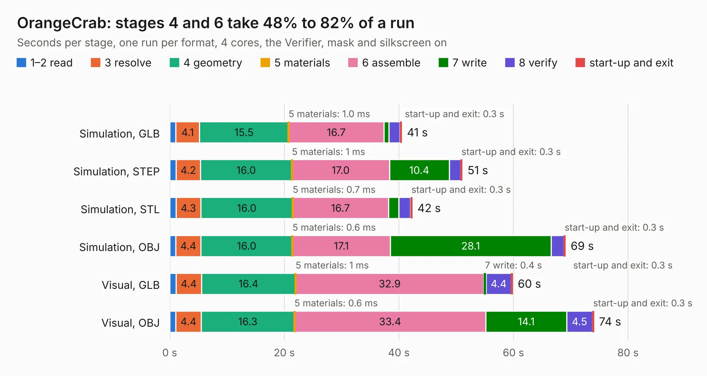

# 2122. OrangeCrab

Board 2,122 of the 3,130 of [Corpus Testing](../Corpus-Testing.md), on [Corpus Page 20](../CorpusTestingPages/Corpus-Testing-20.md#2122-orangecrab).

| Mode and format | 1–2 read | 3 resolve | 4 geometry | 5 materials | 6 assemble | 7 write | 8 verify | start-up and exit | Total |
|---|---:|---:|---:|---:|---:|---:|---:|---:|---:|
| Simulation, GLB | 1.1 | 4.1 | 15.5 | 1.0&nbsp;ms | 16.7 | 0.9 | 1.9 | 0.3 | 40.5 |
| Simulation, STEP | 1.1 | 4.2 | 16.0 | 1&nbsp;ms | 17.0 | 10.4 | 2.0 | 0.3 | 51.1 |
| Simulation, STL | 1.1 | 4.3 | 16.0 | 0.7&nbsp;ms | 16.7 | 1.8 | 2.0 | 0.3 | 42.4 |
| Simulation, OBJ | 1.1 | 4.4 | 16.0 | 0.6&nbsp;ms | 17.1 | 28.1 | 2.2 | 0.3 | 69.1 |
| Visual, GLB | 1.1 | 4.4 | 16.4 | 1&nbsp;ms | 32.9 | 0.4 | 4.4 | 0.3 | 59.9 |
| Visual, OBJ | 1.1 | 4.4 | 16.3 | 0.6&nbsp;ms | 33.4 | 14.1 | 4.5 | 0.3 | 74.1 |

<table align="center"><tr><td valign="top">

| Board | Repo: [orangecrab-fpga/orangecrab-hardware](https://github.com/orangecrab-fpga/orangecrab-hardware) Board: `OrangeCrab.kicad_pcb` |
|---|---|
| Folder | hardware / orangecrab_r0.2 |
| Complexity | 405&nbsp;/&nbsp;1000 (size&nbsp;305, features&nbsp;100) |
| KESE&nbsp;features | through vias, slotted holes, custom pads, rounded, trapezoid or chamfered pads, filled zones, copper drawings, copper text, curved board outline |
| Tested | 9th November 2026 |
| Copper&nbsp;layers | 6 |
| File&nbsp;format | KiCad 5 (20171130) |
| Parts,&nbsp;tracks,&nbsp;vias | 144, 7,537, 459 |
| Triangles,&nbsp;simulation | 4,445,274 in 185 parts |
| Verifier | PASS in all six runs |

</td><td valign="top">

<table>
<tr><th>File type</th><th>File size</th><th>Peak memory used</th></tr>
<tr><th colspan="3" align="left">Simulation</th></tr>
<tr><td>GLB</td><td align="right">153&nbsp;MB</td><td align="right">1.3&nbsp;GB</td></tr>
<tr><td>STEP</td><td align="right">651&nbsp;MB</td><td align="right">1.6&nbsp;GB</td></tr>
<tr><td>STL</td><td align="right">222&nbsp;MB</td><td align="right">1.4&nbsp;GB</td></tr>
<tr><td>OBJ</td><td align="right">475&nbsp;MB</td><td align="right">2.9&nbsp;GB</td></tr>
<tr><th colspan="3" align="left">Visual</th></tr>
<tr><td>GLB</td><td align="right">79&nbsp;MB</td><td align="right">1.5&nbsp;GB</td></tr>
<tr><td>OBJ</td><td align="right">252&nbsp;MB</td><td align="right">1.6&nbsp;GB</td></tr>
</table>

</td></tr></table>

| Previous | Next |
|:---|---:|
| [2121. OrangeCrab](b2121b_orangecrab-hardware_hardware-orangecrab-r0-2-1_OrangeCrab.md) | [2123. mezzanine-breakout-board](b2123b_oresat-adcs-hardware_mezzanine-breakout-board.md) |
