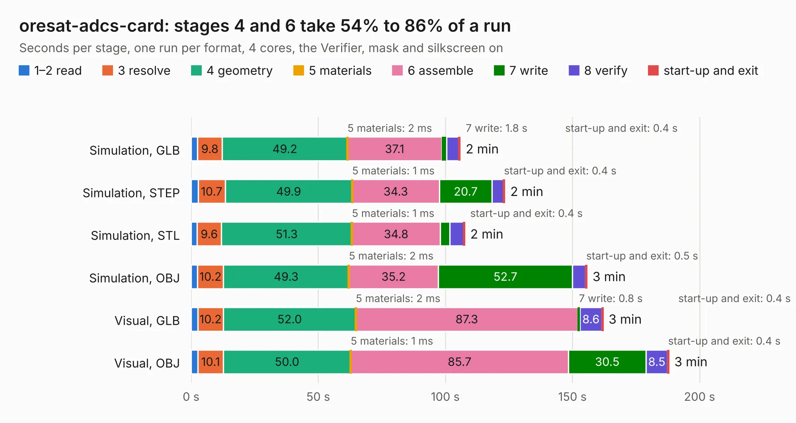

# 2122. oresat-adcs-card

Board 2,122 of the 3,124 of [Corpus Testing](../Corpus-Testing.md), on [Corpus Page 20](../CorpusTestingPages/Corpus-Testing-20.md#2122-oresat-adcs-card).

| Mode and format | 1–2 read | 3 resolve | 4 geometry | 5 materials | 6 assemble | 7 write | 8 verify | start-up and exit | Total |
|---|---:|---:|---:|---:|---:|---:|---:|---:|---:|
| Simulation, GLB | 2.5 | 9.8 | 49.2 | 2&nbsp;ms | 37.1 | 1.8 | 4.9 | 0.4 | 105.8 |
| Simulation, STEP | 2.8 | 10.7 | 49.9 | 1&nbsp;ms | 34.3 | 20.7 | 4.5 | 0.4 | 123.3 |
| Simulation, STL | 2.4 | 9.6 | 51.3 | 1&nbsp;ms | 34.8 | 3.8 | 5.3 | 0.4 | 107.6 |
| Simulation, OBJ | 2.5 | 10.2 | 49.3 | 2&nbsp;ms | 35.2 | 52.7 | 5.2 | 0.5 | 155.7 |
| Visual, GLB | 2.6 | 10.2 | 52.0 | 2&nbsp;ms | 87.3 | 0.8 | 8.6 | 0.4 | 162.0 |
| Visual, OBJ | 2.6 | 10.1 | 50.0 | 1&nbsp;ms | 85.7 | 30.5 | 8.5 | 0.4 | 187.9 |

<table align="center"><tr><td valign="top">

| Board | Repo: [oresat/oresat-adcs-hardware](https://github.com/oresat/oresat-adcs-hardware) Board: `oresat-adcs-card.kicad_pcb` |
|---|---|
| Folder | oresat-adcs-card |
| Complexity | 334&nbsp;/&nbsp;1000 (size&nbsp;244, features&nbsp;90) |
| KESE&nbsp;features | through vias, rounded, trapezoid or chamfered pads, drill offsets, filled zones, stack-up, dielectric εr and tanδ, mask and silkscreen colours |
| Tested | 9th November 2026 |
| Copper&nbsp;layers | 4 |
| File&nbsp;format | KiCad 8 (20240108) |
| Parts,&nbsp;tracks,&nbsp;vias | 456, 3,064, 1,130 |
| Triangles,&nbsp;simulation | 7,666,848 in 369 parts |
| Verifier | PASS in all six runs |

</td><td valign="top">

<table>
<tr><th>File type</th><th>File size</th><th>Peak memory used</th></tr>
<tr><th colspan="3" align="left">Simulation</th></tr>
<tr><td>GLB</td><td align="right">261&nbsp;MB</td><td align="right">2.0&nbsp;GB</td></tr>
<tr><td>STEP</td><td align="right">1.2&nbsp;GB</td><td align="right">2.8&nbsp;GB</td></tr>
<tr><td>STL</td><td align="right">383&nbsp;MB</td><td align="right">2.1&nbsp;GB</td></tr>
<tr><td>OBJ</td><td align="right">829&nbsp;MB</td><td align="right">5.0&nbsp;GB</td></tr>
<tr><th colspan="3" align="left">Visual</th></tr>
<tr><td>GLB</td><td align="right">166&nbsp;MB</td><td align="right">2.7&nbsp;GB</td></tr>
<tr><td>OBJ</td><td align="right">532&nbsp;MB</td><td align="right">3.4&nbsp;GB</td></tr>
</table>

</td></tr></table>

| Previous | Next |
|:---|---:|
| [2121. mezzanine-flex-board](b2121b_oresat-adcs-hardware_mezzanine-flex-board.md) | [2123. oresat-mag-card](b2123b_oresat-adcs-hardware_oresat-mag-card.md) |
