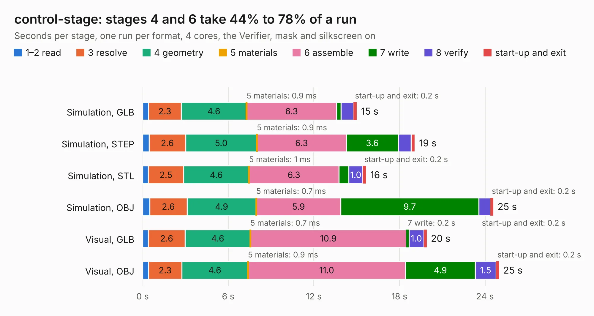

# 2122. control-stage

Board 2,122 of the 3,122 of [Corpus Testing](../Corpus-Testing.md), on [Corpus Page 20](../CorpusTestingPages/Corpus-Testing-20.md#2122-control-stage).

| Mode and format | 1–2 read | 3 resolve | 4 geometry | 5 materials | 6 assemble | 7 write | 8 verify | start-up and exit | Total |
|---|---:|---:|---:|---:|---:|---:|---:|---:|---:|
| Simulation, GLB | 0.4 | 2.3 | 4.6 | 0.9&nbsp;ms | 6.3 | 0.3 | 0.9 | 0.2 | 15.0 |
| Simulation, STEP | 0.5 | 2.6 | 5.0 | 0.9&nbsp;ms | 6.3 | 3.6 | 0.9 | 0.3 | 19.1 |
| Simulation, STL | 0.4 | 2.5 | 4.6 | 1&nbsp;ms | 6.3 | 0.7 | 1.0 | 0.2 | 15.7 |
| Simulation, OBJ | 0.5 | 2.6 | 4.9 | 0.7&nbsp;ms | 5.9 | 9.7 | 0.8 | 0.2 | 24.6 |
| Visual, GLB | 0.4 | 2.6 | 4.6 | 0.7&nbsp;ms | 10.9 | 0.2 | 1.0 | 0.2 | 19.9 |
| Visual, OBJ | 0.4 | 2.3 | 4.6 | 0.9&nbsp;ms | 11.0 | 4.9 | 1.5 | 0.2 | 25.0 |

<table align="center"><tr><td valign="top">

| Board | Repo: [oresat/oresat-adcs-hardware](https://github.com/oresat/oresat-adcs-hardware) Board: `control-stage.kicad_pcb` |
|---|---|
| Folder | oresat-rw-board-rev1-MCXN / control-stage |
| Complexity | 349&nbsp;/&nbsp;1000 (size&nbsp;259, features&nbsp;90) |
| KESE&nbsp;features | through vias, slotted holes, rounded, trapezoid or chamfered pads, filled zones, stack-up, dielectric εr and tanδ, mask and silkscreen colours |
| Tested | 9th November 2026 |
| Copper&nbsp;layers | 6 |
| File&nbsp;format | KiCad 9 (20241229) |
| Parts,&nbsp;tracks,&nbsp;vias | 93, 830, 485 |
| Triangles,&nbsp;simulation | 2,345,640 in 131 parts |
| Verifier | PASS in all six runs |

</td><td valign="top">

<table>
<tr><th>File type</th><th>File size</th><th>Peak memory used</th></tr>
<tr><th colspan="3" align="left">Simulation</th></tr>
<tr><td>GLB</td><td align="right">79&nbsp;MB</td><td align="right">829&nbsp;MB</td></tr>
<tr><td>STEP</td><td align="right">210&nbsp;MB</td><td align="right">948&nbsp;MB</td></tr>
<tr><td>STL</td><td align="right">117&nbsp;MB</td><td align="right">806&nbsp;MB</td></tr>
<tr><td>OBJ</td><td align="right">249&nbsp;MB</td><td align="right">1.5&nbsp;GB</td></tr>
<tr><th colspan="3" align="left">Visual</th></tr>
<tr><td>GLB</td><td align="right">38&nbsp;MB</td><td align="right">789&nbsp;MB</td></tr>
<tr><td>OBJ</td><td align="right">122&nbsp;MB</td><td align="right">929&nbsp;MB</td></tr>
</table>

</td></tr></table>

| Previous | Next |
|:---|---:|
| [2121. oresat-mag-card](b2121b_oresat-adcs-hardware_oresat-mag-card.md) | [2123. power-stage-rev8](b2123b_oresat-adcs-hardware_power-stage-rev8.md) |
