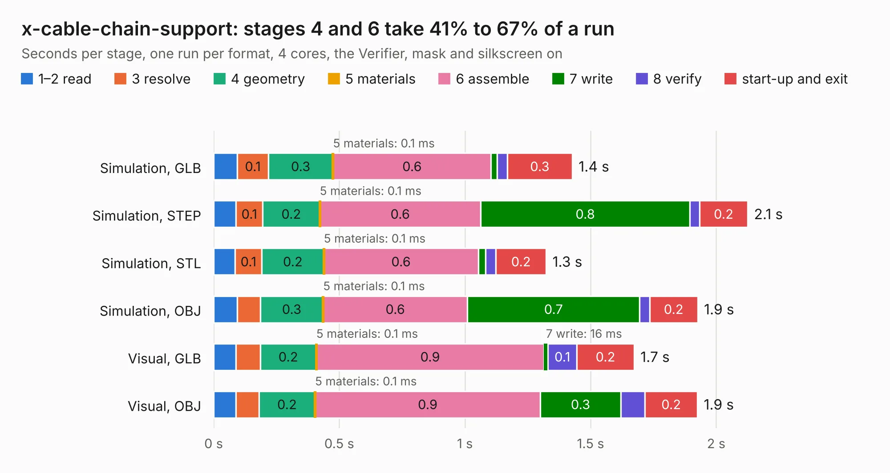

# 2123 x-cable-chain-support

Board 2,123 of the 3,138 of [Corpus Testing](../Corpus-Testing.md), on [Corpus Page 20](../CorpusTestingPages/Corpus-Testing-20.md#2123-x-cable-chain-support).

| Mode and format | 1–2 read | 3 resolve | 4 geometry | 5 materials | 6 assemble | 7 write | 8 verify | start-up and exit | Total |
|---|---:|---:|---:|---:|---:|---:|---:|---:|---:|
| Simulation, GLB | 95&nbsp;ms | 0.1 | 0.3 | 0.1&nbsp;ms | 0.6 | 25&nbsp;ms | 40&nbsp;ms | 0.3 | 1.4 |
| Simulation, STEP | 89&nbsp;ms | 0.1 | 0.2 | 0.1&nbsp;ms | 0.6 | 0.8 | 39&nbsp;ms | 0.2 | 2.1 |
| Simulation, STL | 86&nbsp;ms | 0.1 | 0.2 | 0.1&nbsp;ms | 0.6 | 29&nbsp;ms | 41&nbsp;ms | 0.2 | 1.3 |
| Simulation, OBJ | 95&nbsp;ms | 91&nbsp;ms | 0.3 | 0.1&nbsp;ms | 0.6 | 0.7 | 40&nbsp;ms | 0.2 | 1.9 |
| Visual, GLB | 88&nbsp;ms | 98&nbsp;ms | 0.2 | 0.1&nbsp;ms | 0.9 | 16&nbsp;ms | 0.1 | 0.2 | 1.7 |
| Visual, OBJ | 88&nbsp;ms | 93&nbsp;ms | 0.2 | 0.1&nbsp;ms | 0.9 | 0.3 | 96&nbsp;ms | 0.2 | 1.9 |

<table align="center"><tr><td valign="top">

| Board | Repo: [opulo-inc/lumenpnp](https://github.com/opulo-inc/lumenpnp) Board: `x-cable-chain-support.kicad_pcb` |
|---|---|
| Folder | src / PCB / x-cable-chain-support |
| Complexity | 92&nbsp;/&nbsp;1000 (size&nbsp;17, features&nbsp;75) |
| KESE&nbsp;features | filled zones, curved board outline, TrueType text, stack-up, dielectric εr and tanδ |
| Tested | 9th November 2026 |
| Copper&nbsp;layers | 2 |
| File&nbsp;format | KiCad 8 (20240108) |
| Parts,&nbsp;tracks,&nbsp;vias | 0, 0, 0 |
| Triangles,&nbsp;simulation | 110,860 in 9 parts |
| Note | no components |
| Verifier | PASS in all six runs |

</td><td valign="top">

<table>
<tr><th>File type</th><th>File size</th><th>Peak memory used</th></tr>
<tr><th colspan="3" align="left">Simulation</th></tr>
<tr><td>GLB</td><td align="right">4.3&nbsp;MB</td><td align="right">179&nbsp;MB</td></tr>
<tr><td>STEP</td><td align="right">25&nbsp;MB</td><td align="right">195&nbsp;MB</td></tr>
<tr><td>STL</td><td align="right">5.5&nbsp;MB</td><td align="right">179&nbsp;MB</td></tr>
<tr><td>OBJ</td><td align="right">12&nbsp;MB</td><td align="right">169&nbsp;MB</td></tr>
<tr><th colspan="3" align="left">Visual</th></tr>
<tr><td>GLB</td><td align="right">2.3&nbsp;MB</td><td align="right">134&nbsp;MB</td></tr>
<tr><td>OBJ</td><td align="right">6.2&nbsp;MB</td><td align="right">135&nbsp;MB</td></tr>
</table>

</td></tr></table>

| Previous | Next |
|:---|---:|
| [2122 ringLight](b2122b_lumenpnp_ringLight.md) | [2124 xy-limit](b2124b_lumenpnp_xy-limit.md) |
