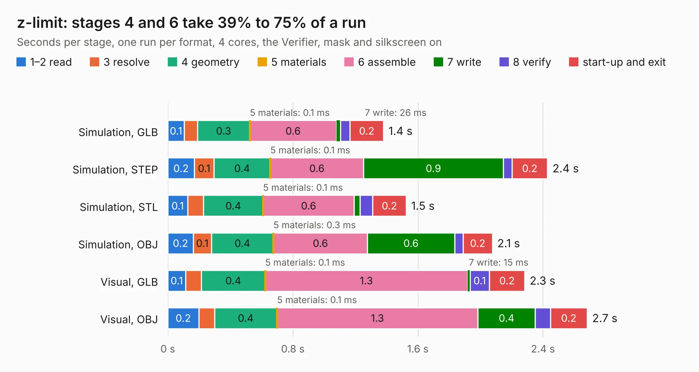

# 2125 z-limit

Board 2,125 of the 3,138 of [Corpus Testing](../Corpus-Testing.md), on [Corpus Page 20](../CorpusTestingPages/Corpus-Testing-20.md#2125-z-limit).

| Mode and format | 1–2 read | 3 resolve | 4 geometry | 5 materials | 6 assemble | 7 write | 8 verify | start-up and exit | Total |
|---|---:|---:|---:|---:|---:|---:|---:|---:|---:|
| Simulation, GLB | 0.1 | 84&nbsp;ms | 0.3 | 0.1&nbsp;ms | 0.6 | 26&nbsp;ms | 60&nbsp;ms | 0.2 | 1.4 |
| Simulation, STEP | 0.2 | 0.1 | 0.4 | 0.1&nbsp;ms | 0.6 | 0.9 | 56&nbsp;ms | 0.2 | 2.4 |
| Simulation, STL | 0.1 | 0.1 | 0.4 | 0.1&nbsp;ms | 0.6 | 37&nbsp;ms | 81&nbsp;ms | 0.2 | 1.5 |
| Simulation, OBJ | 0.2 | 0.1 | 0.4 | 0.3&nbsp;ms | 0.6 | 0.6 | 54&nbsp;ms | 0.2 | 2.1 |
| Visual, GLB | 0.1 | 0.1 | 0.4 | 0.1&nbsp;ms | 1.3 | 15&nbsp;ms | 0.1 | 0.2 | 2.3 |
| Visual, OBJ | 0.2 | 0.1 | 0.4 | 0.1&nbsp;ms | 1.3 | 0.4 | 97&nbsp;ms | 0.2 | 2.7 |

<table align="center"><tr><td valign="top">

| Board | Repo: [opulo-inc/lumenpnp](https://github.com/opulo-inc/lumenpnp) Board: `z-limit.kicad_pcb` |
|---|---|
| Folder | src / PCB / z-limit |
| Complexity | 171&nbsp;/&nbsp;1000 (size&nbsp;101, features&nbsp;70) |
| KESE&nbsp;features | through vias, rounded, trapezoid or chamfered pads, filled zones, curved board outline, TrueType text |
| Tested | 9th November 2026 |
| Copper&nbsp;layers | 2 |
| File&nbsp;format | KiCad 8 (20240108) |
| Parts,&nbsp;tracks,&nbsp;vias | 3, 30, 13 |
| Triangles,&nbsp;simulation | 107,692 in 17 parts |
| Verifier | PASS in all six runs |

</td><td valign="top">

<table>
<tr><th>File type</th><th>File size</th><th>Peak memory used</th></tr>
<tr><th colspan="3" align="left">Simulation</th></tr>
<tr><td>GLB</td><td align="right">3.8&nbsp;MB</td><td align="right">190&nbsp;MB</td></tr>
<tr><td>STEP</td><td align="right">18&nbsp;MB</td><td align="right">196&nbsp;MB</td></tr>
<tr><td>STL</td><td align="right">5.4&nbsp;MB</td><td align="right">185&nbsp;MB</td></tr>
<tr><td>OBJ</td><td align="right">11&nbsp;MB</td><td align="right">189&nbsp;MB</td></tr>
<tr><th colspan="3" align="left">Visual</th></tr>
<tr><td>GLB</td><td align="right">3.0&nbsp;MB</td><td align="right">156&nbsp;MB</td></tr>
<tr><td>OBJ</td><td align="right">8.3&nbsp;MB</td><td align="right">158&nbsp;MB</td></tr>
</table>

</td></tr></table>

| Previous | Next |
|:---|---:|
| [2124 xy-limit](b2124b_lumenpnp_xy-limit.md) | [2126 OrangeCrab](b2126b_orangecrab-hardware_hardware-orangecrab-r0-1_OrangeCrab.md) |
