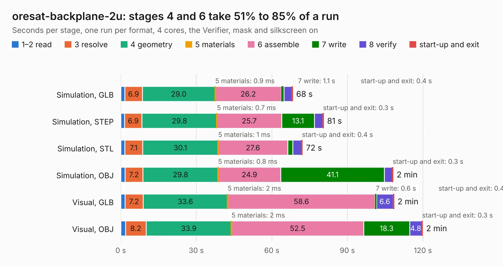

# 2125. oresat-backplane-2u

Board 2,125 of the 3,111 of [Corpus Testing](../Corpus-Testing.md), on [Corpus Page 20](../CorpusTestingPages/Corpus-Testing-20.md#2125-oresat-backplane-2u).

| Mode and format | 1–2 read | 3 resolve | 4 geometry | 5 materials | 6 assemble | 7 write | 8 verify | start-up and exit | Total |
|---|---:|---:|---:|---:|---:|---:|---:|---:|---:|
| Simulation, GLB | 1.6 | 6.9 | 29.0 | 0.9&nbsp;ms | 26.2 | 1.1 | 3.1 | 0.4 | 68.3 |
| Simulation, STEP | 1.5 | 6.9 | 29.8 | 0.7&nbsp;ms | 25.7 | 13.1 | 3.3 | 0.3 | 80.5 |
| Simulation, STL | 1.6 | 7.1 | 30.1 | 1&nbsp;ms | 27.6 | 2.1 | 3.4 | 0.4 | 72.1 |
| Simulation, OBJ | 1.7 | 7.2 | 29.8 | 0.8&nbsp;ms | 24.9 | 41.1 | 3.2 | 0.3 | 108.2 |
| Visual, GLB | 1.7 | 7.2 | 33.6 | 2&nbsp;ms | 58.6 | 0.6 | 6.6 | 0.4 | 108.5 |
| Visual, OBJ | 1.9 | 8.2 | 33.9 | 2&nbsp;ms | 52.5 | 18.3 | 4.8 | 0.3 | 119.9 |

<table align="center"><tr><td valign="top">

| Board | Repo: [oresat/oresat-backplane](https://github.com/oresat/oresat-backplane) Board: `oresat-backplane-2u.kicad_pcb` |
|---|---|
| Folder | 2U / oresat1 |
| Complexity | 370&nbsp;/&nbsp;1000 (size&nbsp;215, features&nbsp;155) |
| KESE&nbsp;features | through vias, custom pads, rounded, trapezoid or chamfered pads, drill offsets, arc tracks, filled zones, copper drawings, curved board outline, stack-up, dielectric εr and tanδ, copper finish, mask and silkscreen colours |
| Tested | 9th November 2026 |
| Copper&nbsp;layers | 4 |
| File&nbsp;format | KiCad 10 (20260206) |
| Parts,&nbsp;tracks,&nbsp;vias | 53, 1,119, 1,172 |
| Triangles,&nbsp;simulation | 6,573,172 in 56 parts |
| Verifier | PASS in all six runs |

</td><td valign="top">

<table>
<tr><th>File type</th><th>File size</th><th>Peak memory used</th></tr>
<tr><th colspan="3" align="left">Simulation</th></tr>
<tr><td>GLB</td><td align="right">223&nbsp;MB</td><td align="right">2.0&nbsp;GB</td></tr>
<tr><td>STEP</td><td align="right">768&nbsp;MB</td><td align="right">2.4&nbsp;GB</td></tr>
<tr><td>STL</td><td align="right">329&nbsp;MB</td><td align="right">2.0&nbsp;GB</td></tr>
<tr><td>OBJ</td><td align="right">708&nbsp;MB</td><td align="right">4.3&nbsp;GB</td></tr>
<tr><th colspan="3" align="left">Visual</th></tr>
<tr><td>GLB</td><td align="right">107&nbsp;MB</td><td align="right">1.9&nbsp;GB</td></tr>
<tr><td>OBJ</td><td align="right">346&nbsp;MB</td><td align="right">2.2&nbsp;GB</td></tr>
</table>

</td></tr></table>

| Previous | Next |
|:---|---:|
| [2124. oresat-backplane-2u](b2124b_oresat-backplane_2U-oresat0-5_oresat-backplane-2u.md) | [2126. esi-backplane-3u](b2126b_oresat-backplane_esi-backplane-3u.md) |
