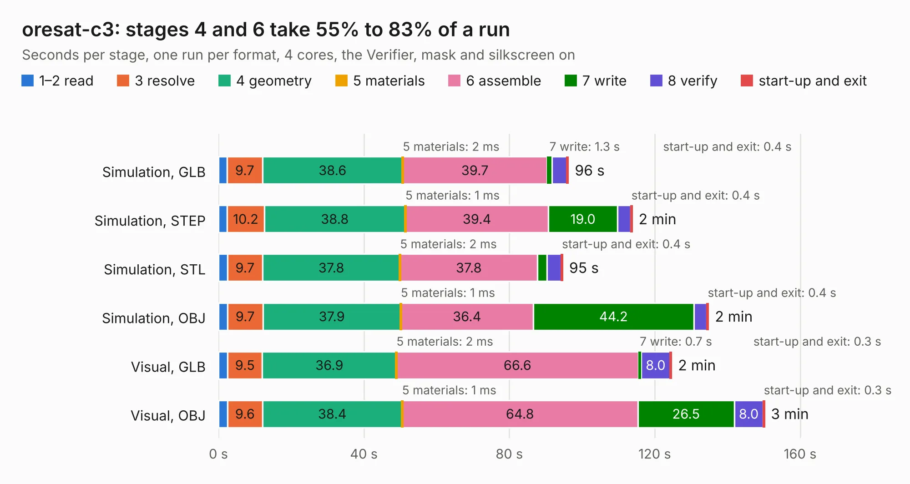

# 2125. oresat-c3

Board 2,125 of the 3,107 of [Corpus Testing](../Corpus-Testing.md), on [Corpus Page 20](../CorpusTestingPages/Corpus-Testing-20.md#2125-oresat-c3).

| Mode and format | 1–2 read | 3 resolve | 4 geometry | 5 materials | 6 assemble | 7 write | 8 verify | start-up and exit | Total |
|---|---:|---:|---:|---:|---:|---:|---:|---:|---:|
| Simulation, GLB | 2.4 | 9.7 | 38.6 | 2&nbsp;ms | 39.7 | 1.3 | 4.1 | 0.4 | 96.2 |
| Simulation, STEP | 2.4 | 10.2 | 38.8 | 1&nbsp;ms | 39.4 | 19.0 | 3.7 | 0.4 | 113.8 |
| Simulation, STL | 2.5 | 9.7 | 37.8 | 2&nbsp;ms | 37.8 | 2.6 | 3.9 | 0.4 | 94.7 |
| Simulation, OBJ | 2.5 | 9.7 | 37.9 | 1&nbsp;ms | 36.4 | 44.2 | 3.7 | 0.4 | 134.8 |
| Visual, GLB | 2.5 | 9.5 | 36.9 | 2&nbsp;ms | 66.6 | 0.7 | 8.0 | 0.3 | 124.6 |
| Visual, OBJ | 2.5 | 9.6 | 38.4 | 1&nbsp;ms | 64.8 | 26.5 | 8.0 | 0.3 | 150.2 |

<table align="center"><tr><td valign="top">

| Board | Repo: [oresat/oresat-c3-hardware](https://github.com/oresat/oresat-c3-hardware) Board: `oresat-c3.kicad_pcb` |
|---|---|
| Folder | oresat-c3-card |
| Complexity | 449&nbsp;/&nbsp;1000 (size&nbsp;304, features&nbsp;145) |
| KESE&nbsp;features | through vias, custom pads, rounded, trapezoid or chamfered pads, drill offsets, arc tracks, filled zones, copper drawings, tracks bare of mask, stack-up, dielectric εr and tanδ, mask and silkscreen colours |
| Tested | 9th November 2026 |
| Copper&nbsp;layers | 4 |
| File&nbsp;format | KiCad 10 (20260206) |
| Parts,&nbsp;tracks,&nbsp;vias | 347, 2,992, 1,380 |
| Triangles,&nbsp;simulation | 7,494,014 in 560 parts |
| Verifier | PASS in all six runs |

</td><td valign="top">

<table>
<tr><th>File type</th><th>File size</th><th>Peak memory used</th></tr>
<tr><th colspan="3" align="left">Simulation</th></tr>
<tr><td>GLB</td><td align="right">255&nbsp;MB</td><td align="right">2.1&nbsp;GB</td></tr>
<tr><td>STEP</td><td align="right">1.0&nbsp;GB</td><td align="right">2.9&nbsp;GB</td></tr>
<tr><td>STL</td><td align="right">375&nbsp;MB</td><td align="right">2.1&nbsp;GB</td></tr>
<tr><td>OBJ</td><td align="right">809&nbsp;MB</td><td align="right">4.8&nbsp;GB</td></tr>
<tr><th colspan="3" align="left">Visual</th></tr>
<tr><td>GLB</td><td align="right">164&nbsp;MB</td><td align="right">2.6&nbsp;GB</td></tr>
<tr><td>OBJ</td><td align="right">532&nbsp;MB</td><td align="right">3.4&nbsp;GB</td></tr>
</table>

</td></tr></table>

| Previous | Next |
|:---|---:|
| [2124. oresat-batteries](b2124b_oresat-batteries_oresat-batteries.md) | [2126. amp-PA-GRF5504-with-detect](b2126b_oresat-c3-rf_amp-PA-GRF5504-with-detect.md) |
