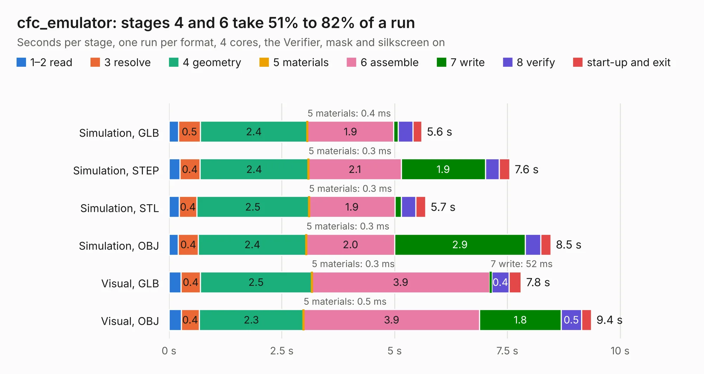

# 2127. cfc_emulator

Board 2,127 of the 3,107 of [Corpus Testing](../Corpus-Testing.md), on [Corpus Page 20](../CorpusTestingPages/Corpus-Testing-20.md#2127-cfc_emulator).

| Mode and format | 1–2 read | 3 resolve | 4 geometry | 5 materials | 6 assemble | 7 write | 8 verify | start-up and exit | Total |
|---|---:|---:|---:|---:|---:|---:|---:|---:|---:|
| Simulation, GLB | 0.2 | 0.5 | 2.4 | 0.4&nbsp;ms | 1.9 | 0.1 | 0.3 | 0.2 | 5.6 |
| Simulation, STEP | 0.2 | 0.4 | 2.4 | 0.3&nbsp;ms | 2.1 | 1.9 | 0.3 | 0.2 | 7.6 |
| Simulation, STL | 0.2 | 0.4 | 2.5 | 0.3&nbsp;ms | 1.9 | 0.1 | 0.3 | 0.2 | 5.7 |
| Simulation, OBJ | 0.2 | 0.4 | 2.4 | 0.3&nbsp;ms | 2.0 | 2.9 | 0.3 | 0.2 | 8.5 |
| Visual, GLB | 0.3 | 0.4 | 2.5 | 0.3&nbsp;ms | 3.9 | 52&nbsp;ms | 0.4 | 0.3 | 7.8 |
| Visual, OBJ | 0.3 | 0.4 | 2.3 | 0.5&nbsp;ms | 3.9 | 1.8 | 0.5 | 0.2 | 9.4 |

<table align="center"><tr><td valign="top">

| Board | Repo: [oresat/oresat-cfc-hardware](https://github.com/oresat/oresat-cfc-hardware) Board: `cfc_emulator.kicad_pcb` |
|---|---|
| Folder | cfc-emulator |
| Complexity | 222&nbsp;/&nbsp;1000 (size&nbsp;142, features&nbsp;80) |
| KESE&nbsp;features | through vias, rounded, trapezoid or chamfered pads, filled zones, stack-up, dielectric εr and tanδ, mask and silkscreen colours |
| Tested | 9th November 2026 |
| Copper&nbsp;layers | 2 |
| File&nbsp;format | KiCad 6 (20210424) |
| Parts,&nbsp;tracks,&nbsp;vias | 23, 202, 18 |
| Triangles,&nbsp;simulation | 540,340 in 74 parts |
| Verifier | PASS in all six runs |

</td><td valign="top">

<table>
<tr><th>File type</th><th>File size</th><th>Peak memory used</th></tr>
<tr><th colspan="3" align="left">Simulation</th></tr>
<tr><td>GLB</td><td align="right">18&nbsp;MB</td><td align="right">305&nbsp;MB</td></tr>
<tr><td>STEP</td><td align="right">84&nbsp;MB</td><td align="right">368&nbsp;MB</td></tr>
<tr><td>STL</td><td align="right">27&nbsp;MB</td><td align="right">303&nbsp;MB</td></tr>
<tr><td>OBJ</td><td align="right">54&nbsp;MB</td><td align="right">411&nbsp;MB</td></tr>
<tr><th colspan="3" align="left">Visual</th></tr>
<tr><td>GLB</td><td align="right">12&nbsp;MB</td><td align="right">344&nbsp;MB</td></tr>
<tr><td>OBJ</td><td align="right">34&nbsp;MB</td><td align="right">345&nbsp;MB</td></tr>
</table>

</td></tr></table>

| Previous | Next |
|:---|---:|
| [2126. amp-PA-GRF5504-with-detect](b2126b_oresat-c3-rf_amp-PA-GRF5504-with-detect.md) | [2128. cfc-minibackplane](b2128b_oresat-cfc-hardware_cfc-minibackplane.md) |
