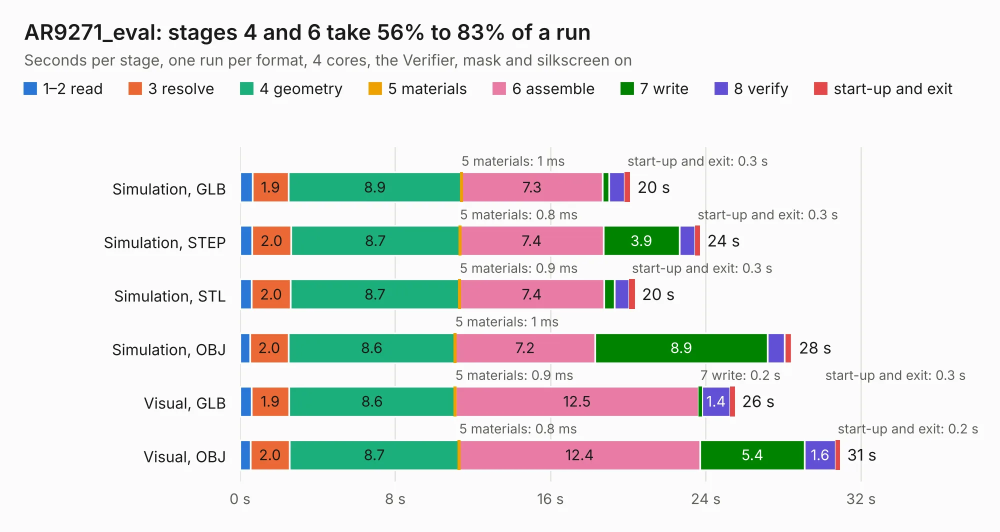

# 2127. AR9271_eval

Board 2,127 of the 3,102 of [Corpus Testing](../Corpus-Testing.md), on [Corpus Page 20](../CorpusTestingPages/Corpus-Testing-20.md#2127-ar9271_eval).

| Mode and format | 1–2 read | 3 resolve | 4 geometry | 5 materials | 6 assemble | 7 write | 8 verify | start-up and exit | Total |
|---|---:|---:|---:|---:|---:|---:|---:|---:|---:|
| Simulation, GLB | 0.6 | 1.9 | 8.9 | 1&nbsp;ms | 7.3 | 0.3 | 0.8 | 0.3 | 20.1 |
| Simulation, STEP | 0.6 | 2.0 | 8.7 | 0.8&nbsp;ms | 7.4 | 3.9 | 0.8 | 0.3 | 23.7 |
| Simulation, STL | 0.6 | 2.0 | 8.7 | 0.9&nbsp;ms | 7.4 | 0.6 | 0.7 | 0.3 | 20.3 |
| Simulation, OBJ | 0.5 | 2.0 | 8.6 | 1&nbsp;ms | 7.2 | 8.9 | 0.9 | 0.4 | 28.4 |
| Visual, GLB | 0.6 | 1.9 | 8.6 | 0.9&nbsp;ms | 12.5 | 0.2 | 1.4 | 0.3 | 25.5 |
| Visual, OBJ | 0.5 | 2.0 | 8.7 | 0.8&nbsp;ms | 12.4 | 5.4 | 1.6 | 0.2 | 30.9 |

<table align="center"><tr><td valign="top">

| Board | Repo: [oresat/oresat-dxwifi-hardware](https://github.com/oresat/oresat-dxwifi-hardware) Board: `AR9271_eval.kicad_pcb` |
|---|---|
| Folder | AR9271_eval / AR9271_eval / AR9271_eval |
| Complexity | 293&nbsp;/&nbsp;1000 (size&nbsp;248, features&nbsp;45) |
| KESE&nbsp;features | through vias, rounded, trapezoid or chamfered pads, filled zones |
| Tested | 9th November 2026 |
| Copper&nbsp;layers | 4 |
| File&nbsp;format | KiCad 9 (20241229) |
| Parts,&nbsp;tracks,&nbsp;vias | 125, 745, 346 |
| Triangles,&nbsp;simulation | 1,765,668 in 93 parts |
| Verifier | PASS in all six runs |

</td><td valign="top">

<table>
<tr><th>File type</th><th>File size</th><th>Peak memory used</th></tr>
<tr><th colspan="3" align="left">Simulation</th></tr>
<tr><td>GLB</td><td align="right">62&nbsp;MB</td><td align="right">669&nbsp;MB</td></tr>
<tr><td>STEP</td><td align="right">243&nbsp;MB</td><td align="right">841&nbsp;MB</td></tr>
<tr><td>STL</td><td align="right">88&nbsp;MB</td><td align="right">657&nbsp;MB</td></tr>
<tr><td>OBJ</td><td align="right">186&nbsp;MB</td><td align="right">1.2&nbsp;GB</td></tr>
<tr><th colspan="3" align="left">Visual</th></tr>
<tr><td>GLB</td><td align="right">38&nbsp;MB</td><td align="right">797&nbsp;MB</td></tr>
<tr><td>OBJ</td><td align="right">114&nbsp;MB</td><td align="right">910&nbsp;MB</td></tr>
</table>

</td></tr></table>

| Previous | Next |
|:---|---:|
| [2126. oresat-diode-test-card](b2126b_oresat-diode-test-card_oresat-diode-test-card.md) | [2128. Bidirectional_Amp](b2128b_oresat-dxwifi-hardware_Bidirectional-Amp.md) |
