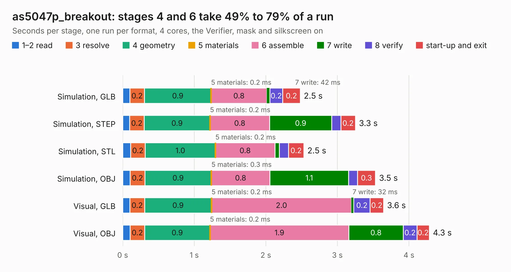

# 2128. as5047p_breakout

Board 2,128 of the 3,123 of [Corpus Testing](../Corpus-Testing.md), on [Corpus Page 20](../CorpusTestingPages/Corpus-Testing-20.md#2128-as5047p_breakout).

| Mode and format | 1–2 read | 3 resolve | 4 geometry | 5 materials | 6 assemble | 7 write | 8 verify | start-up and exit | Total |
|---|---:|---:|---:|---:|---:|---:|---:|---:|---:|
| Simulation, GLB | 98&nbsp;ms | 0.2 | 0.9 | 0.2&nbsp;ms | 0.8 | 42&nbsp;ms | 0.2 | 0.2 | 2.5 |
| Simulation, STEP | 95&nbsp;ms | 0.2 | 0.9 | 0.2&nbsp;ms | 0.8 | 0.9 | 0.1 | 0.2 | 3.3 |
| Simulation, STL | 0.1 | 0.2 | 1.0 | 0.2&nbsp;ms | 0.8 | 63&nbsp;ms | 0.1 | 0.2 | 2.5 |
| Simulation, OBJ | 0.1 | 0.2 | 0.9 | 0.3&nbsp;ms | 0.8 | 1.1 | 0.1 | 0.3 | 3.5 |
| Visual, GLB | 0.1 | 0.2 | 0.9 | 0.2&nbsp;ms | 2.0 | 32&nbsp;ms | 0.2 | 0.2 | 3.6 |
| Visual, OBJ | 0.1 | 0.2 | 0.9 | 0.2&nbsp;ms | 1.9 | 0.8 | 0.2 | 0.2 | 4.3 |

<table align="center"><tr><td valign="top">

| Board | Repo: [oresat/oresat-adcs-hardware](https://github.com/oresat/oresat-adcs-hardware) Board: `as5047p_breakout.kicad_pcb` |
|---|---|
| Folder | oresat-rw-board-rev7 / as5047p_breakout |
| Complexity | 172&nbsp;/&nbsp;1000 (size&nbsp;127, features&nbsp;45) |
| KESE&nbsp;features | through vias, rounded, trapezoid or chamfered pads, filled zones |
| Tested | 9th November 2026 |
| Copper&nbsp;layers | 2 |
| File&nbsp;format | KiCad 7 (20221018) |
| Parts,&nbsp;tracks,&nbsp;vias | 6, 51, 60 |
| Triangles,&nbsp;simulation | 273,762 in 24 parts |
| Verifier | PASS in all six runs |

</td><td valign="top">

<table>
<tr><th>File type</th><th>File size</th><th>Peak memory used</th></tr>
<tr><th colspan="3" align="left">Simulation</th></tr>
<tr><td>GLB</td><td align="right">9.3&nbsp;MB</td><td align="right">232&nbsp;MB</td></tr>
<tr><td>STEP</td><td align="right">34&nbsp;MB</td><td align="right">238&nbsp;MB</td></tr>
<tr><td>STL</td><td align="right">14&nbsp;MB</td><td align="right">221&nbsp;MB</td></tr>
<tr><td>OBJ</td><td align="right">27&nbsp;MB</td><td align="right">234&nbsp;MB</td></tr>
<tr><th colspan="3" align="left">Visual</th></tr>
<tr><td>GLB</td><td align="right">5.9&nbsp;MB</td><td align="right">219&nbsp;MB</td></tr>
<tr><td>OBJ</td><td align="right">17&nbsp;MB</td><td align="right">226&nbsp;MB</td></tr>
</table>

</td></tr></table>

| Previous | Next |
|:---|---:|
| [2127. rev6.0_flat_powerstage](b2127b_oresat-adcs-hardware_rev6-0-flat-powerstage.md) | [2129. as5047p_breakout_rev2](b2129b_oresat-adcs-hardware_as5047p-breakout-rev2.md) |
