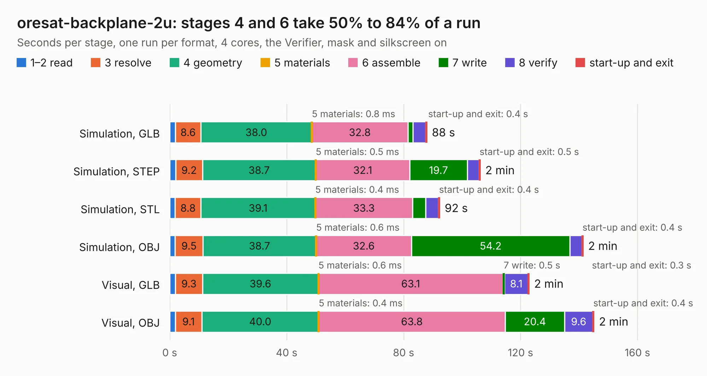

# 2130. oresat-backplane-2u

Board 2,130 of the 3,118 of [Corpus Testing](../Corpus-Testing.md), on [Corpus Page 20](../CorpusTestingPages/Corpus-Testing-20.md#2130-oresat-backplane-2u).

| Mode and format | 1–2 read | 3 resolve | 4 geometry | 5 materials | 6 assemble | 7 write | 8 verify | start-up and exit | Total |
|---|---:|---:|---:|---:|---:|---:|---:|---:|---:|
| Simulation, GLB | 2.0 | 8.6 | 38.0 | 0.8&nbsp;ms | 32.8 | 1.7 | 4.4 | 0.4 | 88.0 |
| Simulation, STEP | 2.0 | 9.2 | 38.7 | 0.5&nbsp;ms | 32.1 | 19.7 | 4.0 | 0.5 | 106.2 |
| Simulation, STL | 1.9 | 8.8 | 39.1 | 0.4&nbsp;ms | 33.3 | 4.4 | 4.4 | 0.4 | 92.3 |
| Simulation, OBJ | 1.9 | 9.5 | 38.7 | 0.6&nbsp;ms | 32.6 | 54.2 | 4.1 | 0.4 | 141.4 |
| Visual, GLB | 2.0 | 9.3 | 39.6 | 0.6&nbsp;ms | 63.1 | 0.5 | 8.1 | 0.3 | 122.9 |
| Visual, OBJ | 1.9 | 9.1 | 40.0 | 0.4&nbsp;ms | 63.8 | 20.4 | 9.6 | 0.4 | 145.1 |

<table align="center"><tr><td valign="top">

| Board | Repo: [oresat/oresat-backplane](https://github.com/oresat/oresat-backplane) Board: `oresat-backplane-2u.kicad_pcb` |
|---|---|
| Folder | 2U / generic-2u |
| Complexity | 343&nbsp;/&nbsp;1000 (size&nbsp;213, features&nbsp;130) |
| KESE&nbsp;features | through vias, custom pads, rounded, trapezoid or chamfered pads, drill offsets, filled zones, copper drawings, copper text, curved board outline, stack-up, dielectric εr and tanδ |
| Tested | 9th November 2026 |
| Copper&nbsp;layers | 4 |
| File&nbsp;format | KiCad 6 (20211014) |
| Parts,&nbsp;tracks,&nbsp;vias | 52, 923, 1,103 |
| Triangles,&nbsp;simulation | 9,769,928 in 46 parts |
| Verifier | PASS in all six runs |

</td><td valign="top">

<table>
<tr><th>File type</th><th>File size</th><th>Peak memory used</th></tr>
<tr><th colspan="3" align="left">Simulation</th></tr>
<tr><td>GLB</td><td align="right">324&nbsp;MB</td><td align="right">2.8&nbsp;GB</td></tr>
<tr><td>STEP</td><td align="right">1.3&nbsp;GB</td><td align="right">3.3&nbsp;GB</td></tr>
<tr><td>STL</td><td align="right">489&nbsp;MB</td><td align="right">2.7&nbsp;GB</td></tr>
<tr><td>OBJ</td><td align="right">1.0&nbsp;GB</td><td align="right">6.2&nbsp;GB</td></tr>
<tr><th colspan="3" align="left">Visual</th></tr>
<tr><td>GLB</td><td align="right">145&nbsp;MB</td><td align="right">2.6&nbsp;GB</td></tr>
<tr><td>OBJ</td><td align="right">464&nbsp;MB</td><td align="right">3.0&nbsp;GB</td></tr>
</table>

</td></tr></table>

| Previous | Next |
|:---|---:|
| [2129. oresat0-1u-backplane](b2129b_oresat-backplane_oresat0-1u-backplane.md) | [2131. oresat-backplane-2u](b2131b_oresat-backplane_2U-oresat0-5_oresat-backplane-2u.md) |
