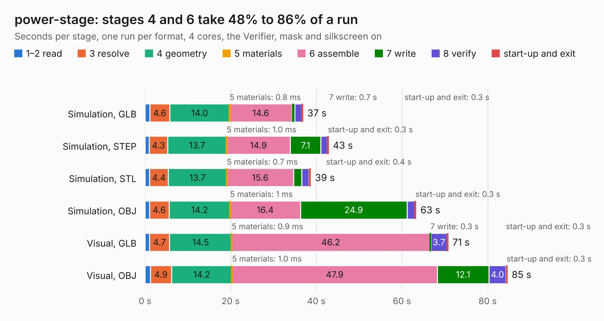

# 2132. power-stage

Board 2,132 of the 3,124 of [Corpus Testing](../Corpus-Testing.md), on [Corpus Page 20](../CorpusTestingPages/Corpus-Testing-20.md#2132-power-stage).

| Mode and format | 1–2 read | 3 resolve | 4 geometry | 5 materials | 6 assemble | 7 write | 8 verify | start-up and exit | Total |
|---|---:|---:|---:|---:|---:|---:|---:|---:|---:|
| Simulation, GLB | 1.1 | 4.6 | 14.0 | 0.8&nbsp;ms | 14.6 | 0.7 | 1.6 | 0.3 | 36.9 |
| Simulation, STEP | 1.0 | 4.3 | 13.7 | 1.0&nbsp;ms | 14.9 | 7.1 | 1.6 | 0.3 | 42.9 |
| Simulation, STL | 1.1 | 4.4 | 13.7 | 0.7&nbsp;ms | 15.6 | 1.9 | 1.7 | 0.4 | 38.7 |
| Simulation, OBJ | 1.0 | 4.6 | 14.2 | 1&nbsp;ms | 16.4 | 24.9 | 1.8 | 0.3 | 63.3 |
| Visual, GLB | 1.0 | 4.7 | 14.5 | 0.9&nbsp;ms | 46.2 | 0.3 | 3.7 | 0.3 | 70.8 |
| Visual, OBJ | 1.3 | 4.9 | 14.2 | 1.0&nbsp;ms | 47.9 | 12.1 | 4.0 | 0.3 | 84.6 |

<table align="center"><tr><td valign="top">

| Board | Repo: [oresat/oresat-adcs-hardware](https://github.com/oresat/oresat-adcs-hardware) Board: `power-stage.kicad_pcb` |
|---|---|
| Folder | oresat-rw-board-rev7 / power-stage |
| Complexity | 326&nbsp;/&nbsp;1000 (size&nbsp;231, features&nbsp;95) |
| KESE&nbsp;features | through vias, rounded, trapezoid or chamfered pads, filled zones, TrueType text, stack-up, dielectric εr and tanδ, mask and silkscreen colours |
| Tested | 9th November 2026 |
| Copper&nbsp;layers | 6 |
| File&nbsp;format | KiCad 7 (20221018) |
| Parts,&nbsp;tracks,&nbsp;vias | 137, 1,171, 840 |
| Triangles,&nbsp;simulation | 3,991,868 in 89 parts |
| Verifier | PASS in all six runs |

</td><td valign="top">

<table>
<tr><th>File type</th><th>File size</th><th>Peak memory used</th></tr>
<tr><th colspan="3" align="left">Simulation</th></tr>
<tr><td>GLB</td><td align="right">130&nbsp;MB</td><td align="right">1.1&nbsp;GB</td></tr>
<tr><td>STEP</td><td align="right">352&nbsp;MB</td><td align="right">1.3&nbsp;GB</td></tr>
<tr><td>STL</td><td align="right">200&nbsp;MB</td><td align="right">1.2&nbsp;GB</td></tr>
<tr><td>OBJ</td><td align="right">432&nbsp;MB</td><td align="right">2.6&nbsp;GB</td></tr>
<tr><th colspan="3" align="left">Visual</th></tr>
<tr><td>GLB</td><td align="right">64&nbsp;MB</td><td align="right">1.3&nbsp;GB</td></tr>
<tr><td>OBJ</td><td align="right">207&nbsp;MB</td><td align="right">1.4&nbsp;GB</td></tr>
</table>

</td></tr></table>

| Previous | Next |
|:---|---:|
| [2131. control-stage](b2131b_oresat-adcs-hardware_oresat-rw-board-rev7-control-stage_control-stage.md) | [2133. oresat-rw-card](b2133b_oresat-adcs-hardware_oresat-rw-card.md) |
