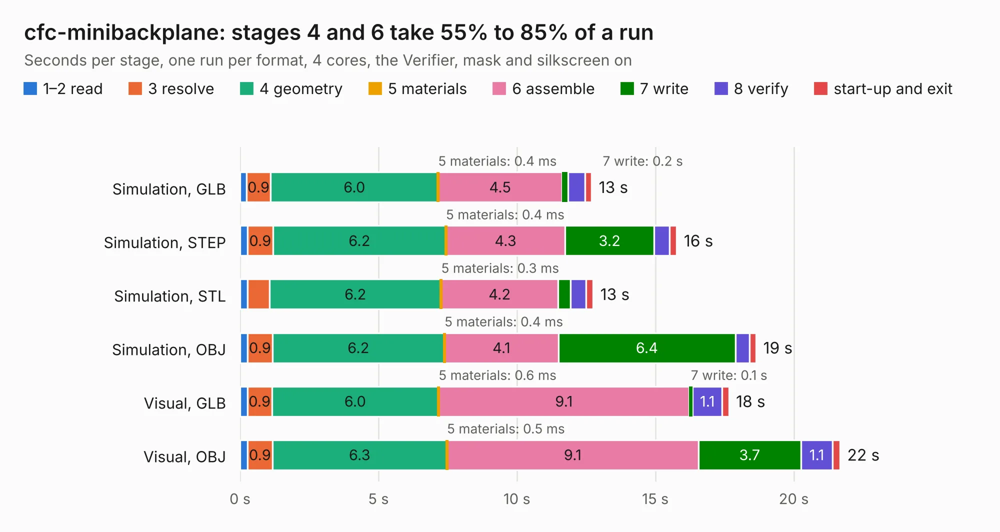

# 2133. cfc-minibackplane

Board 2,133 of the 3,112 of [Corpus Testing](../Corpus-Testing.md), on [Corpus Page 20](../CorpusTestingPages/Corpus-Testing-20.md#2133-cfc-minibackplane).

| Mode and format | 1–2 read | 3 resolve | 4 geometry | 5 materials | 6 assemble | 7 write | 8 verify | start-up and exit | Total |
|---|---:|---:|---:|---:|---:|---:|---:|---:|---:|
| Simulation, GLB | 0.2 | 0.9 | 6.0 | 0.4&nbsp;ms | 4.5 | 0.2 | 0.6 | 0.2 | 12.7 |
| Simulation, STEP | 0.3 | 0.9 | 6.2 | 0.4&nbsp;ms | 4.3 | 3.2 | 0.6 | 0.3 | 15.8 |
| Simulation, STL | 0.3 | 0.8 | 6.2 | 0.3&nbsp;ms | 4.2 | 0.4 | 0.6 | 0.3 | 12.8 |
| Simulation, OBJ | 0.3 | 0.9 | 6.2 | 0.4&nbsp;ms | 4.1 | 6.4 | 0.5 | 0.2 | 18.6 |
| Visual, GLB | 0.3 | 0.9 | 6.0 | 0.6&nbsp;ms | 9.1 | 0.1 | 1.1 | 0.2 | 17.7 |
| Visual, OBJ | 0.3 | 0.9 | 6.3 | 0.5&nbsp;ms | 9.1 | 3.7 | 1.1 | 0.3 | 21.7 |

<table align="center"><tr><td valign="top">

| Board | Repo: [oresat/oresat-cfc-hardware](https://github.com/oresat/oresat-cfc-hardware) Board: `cfc-minibackplane.kicad_pcb` |
|---|---|
| Folder | cfc-minibackplane |
| Complexity | 232&nbsp;/&nbsp;1000 (size&nbsp;147, features&nbsp;85) |
| KESE&nbsp;features | through vias, rounded, trapezoid or chamfered pads, drill offsets, filled zones, stack-up, dielectric εr and tanδ |
| Tested | 9th November 2026 |
| Copper&nbsp;layers | 2 |
| File&nbsp;format | KiCad 7 (20221018) |
| Parts,&nbsp;tracks,&nbsp;vias | 33, 219, 19 |
| Triangles,&nbsp;simulation | 1,343,314 in 65 parts |
| Verifier | PASS in all six runs |

</td><td valign="top">

<table>
<tr><th>File type</th><th>File size</th><th>Peak memory used</th></tr>
<tr><th colspan="3" align="left">Simulation</th></tr>
<tr><td>GLB</td><td align="right">46&nbsp;MB</td><td align="right">501&nbsp;MB</td></tr>
<tr><td>STEP</td><td align="right">230&nbsp;MB</td><td align="right">619&nbsp;MB</td></tr>
<tr><td>STL</td><td align="right">67&nbsp;MB</td><td align="right">523&nbsp;MB</td></tr>
<tr><td>OBJ</td><td align="right">140&nbsp;MB</td><td align="right">925&nbsp;MB</td></tr>
<tr><th colspan="3" align="left">Visual</th></tr>
<tr><td>GLB</td><td align="right">27&nbsp;MB</td><td align="right">663&nbsp;MB</td></tr>
<tr><td>OBJ</td><td align="right">80&nbsp;MB</td><td align="right">688&nbsp;MB</td></tr>
</table>

</td></tr></table>

| Previous | Next |
|:---|---:|
| [2132. cfc_emulator](b2132b_oresat-cfc-hardware_cfc-emulator.md) | [2134. cfc-processor](b2134b_oresat-cfc-hardware_cfc-processor.md) |
