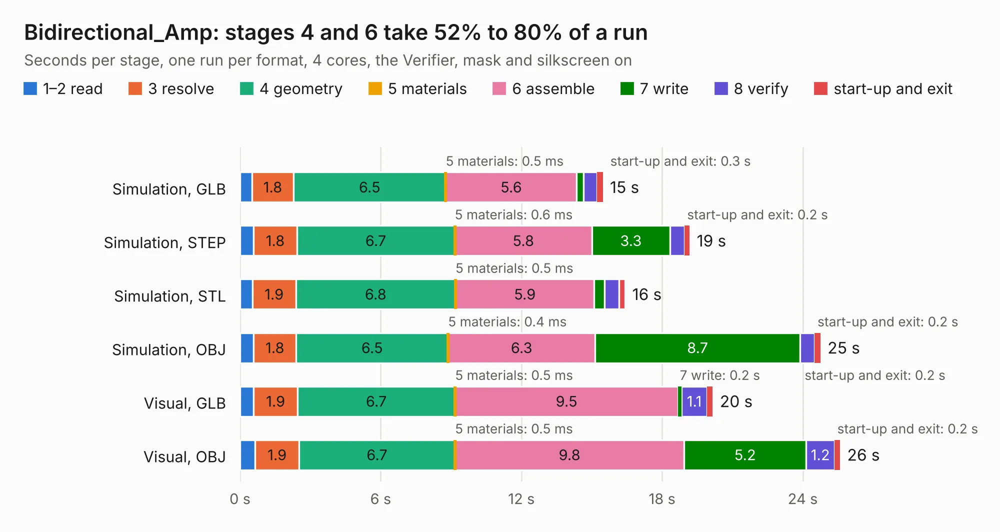

# 2133. Bidirectional_Amp

Board 2,133 of the 3,107 of [Corpus Testing](../Corpus-Testing.md), on [Corpus Page 20](../CorpusTestingPages/Corpus-Testing-20.md#2133-bidirectional_amp).

| Mode and format | 1–2 read | 3 resolve | 4 geometry | 5 materials | 6 assemble | 7 write | 8 verify | start-up and exit | Total |
|---|---:|---:|---:|---:|---:|---:|---:|---:|---:|
| Simulation, GLB | 0.5 | 1.8 | 6.5 | 0.5&nbsp;ms | 5.6 | 0.3 | 0.6 | 0.3 | 15.5 |
| Simulation, STEP | 0.6 | 1.8 | 6.7 | 0.6&nbsp;ms | 5.8 | 3.3 | 0.6 | 0.2 | 19.2 |
| Simulation, STL | 0.5 | 1.9 | 6.8 | 0.5&nbsp;ms | 5.9 | 0.4 | 0.6 | 0.3 | 16.4 |
| Simulation, OBJ | 0.6 | 1.8 | 6.5 | 0.4&nbsp;ms | 6.3 | 8.7 | 0.6 | 0.2 | 24.8 |
| Visual, GLB | 0.6 | 1.9 | 6.7 | 0.5&nbsp;ms | 9.5 | 0.2 | 1.1 | 0.2 | 20.2 |
| Visual, OBJ | 0.6 | 1.9 | 6.7 | 0.5&nbsp;ms | 9.8 | 5.2 | 1.2 | 0.2 | 25.6 |

<table align="center"><tr><td valign="top">

| Board | Repo: [oresat/oresat-dxwifi-hardware](https://github.com/oresat/oresat-dxwifi-hardware) Board: `Bidirectional_Amp.kicad_pcb` |
|---|---|
| Folder | bi-directional-amp-board_V2 / KiCad |
| Complexity | 275&nbsp;/&nbsp;1000 (size&nbsp;205, features&nbsp;70) |
| KESE&nbsp;features | through vias, rounded, trapezoid or chamfered pads, arc tracks, filled zones, curved board outline |
| Tested | 9th November 2026 |
| Copper&nbsp;layers | 4 |
| File&nbsp;format | KiCad 8 (20240108) |
| Parts,&nbsp;tracks,&nbsp;vias | 101, 356, 445 |
| Triangles,&nbsp;simulation | 1,663,490 in 66 parts |
| Verifier | PASS in all six runs |

</td><td valign="top">

<table>
<tr><th>File type</th><th>File size</th><th>Peak memory used</th></tr>
<tr><th colspan="3" align="left">Simulation</th></tr>
<tr><td>GLB</td><td align="right">58&nbsp;MB</td><td align="right">756&nbsp;MB</td></tr>
<tr><td>STEP</td><td align="right">178&nbsp;MB</td><td align="right">809&nbsp;MB</td></tr>
<tr><td>STL</td><td align="right">83&nbsp;MB</td><td align="right">722&nbsp;MB</td></tr>
<tr><td>OBJ</td><td align="right">174&nbsp;MB</td><td align="right">1.1&nbsp;GB</td></tr>
<tr><th colspan="3" align="left">Visual</th></tr>
<tr><td>GLB</td><td align="right">32&nbsp;MB</td><td align="right">706&nbsp;MB</td></tr>
<tr><td>OBJ</td><td align="right">98&nbsp;MB</td><td align="right">762&nbsp;MB</td></tr>
</table>

</td></tr></table>

| Previous | Next |
|:---|---:|
| [2132. AR9271_eval](b2132b_oresat-dxwifi-hardware_AR9271-eval.md) | [2134. oresat-live-card](b2134b_oresat-dxwifi-hardware_oresat-live-card.md) |
