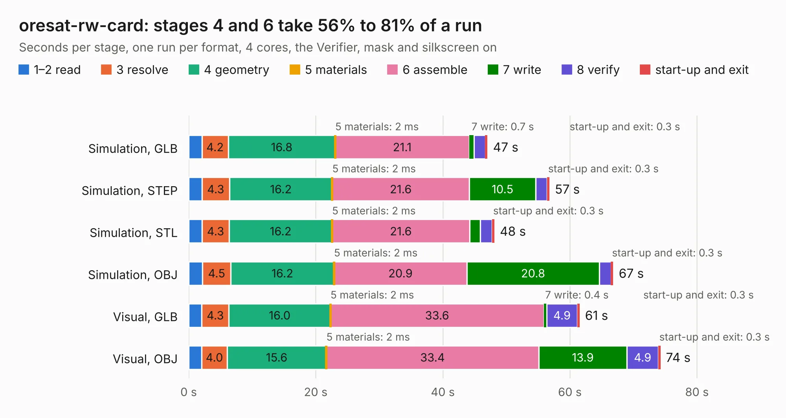

# 2134. oresat-rw-card

Board 2,134 of the 3,127 of [Corpus Testing](../Corpus-Testing.md), on [Corpus Page 20](../CorpusTestingPages/Corpus-Testing-20.md#2134-oresat-rw-card).

| Mode and format | 1–2 read | 3 resolve | 4 geometry | 5 materials | 6 assemble | 7 write | 8 verify | start-up and exit | Total |
|---|---:|---:|---:|---:|---:|---:|---:|---:|---:|
| Simulation, GLB | 2.1 | 4.2 | 16.8 | 2&nbsp;ms | 21.1 | 0.7 | 1.8 | 0.3 | 47.0 |
| Simulation, STEP | 2.1 | 4.3 | 16.2 | 2&nbsp;ms | 21.6 | 10.5 | 1.8 | 0.3 | 56.7 |
| Simulation, STL | 2.1 | 4.3 | 16.2 | 2&nbsp;ms | 21.6 | 1.7 | 1.9 | 0.3 | 48.1 |
| Simulation, OBJ | 2.2 | 4.5 | 16.2 | 2&nbsp;ms | 20.9 | 20.8 | 1.8 | 0.3 | 66.8 |
| Visual, GLB | 2.0 | 4.3 | 16.0 | 2&nbsp;ms | 33.6 | 0.4 | 4.9 | 0.3 | 61.5 |
| Visual, OBJ | 2.1 | 4.0 | 15.6 | 2&nbsp;ms | 33.4 | 13.9 | 4.9 | 0.3 | 74.2 |

<table align="center"><tr><td valign="top">

| Board | Repo: [oresat/oresat-adcs-hardware](https://github.com/oresat/oresat-adcs-hardware) Board: `oresat-rw-card.kicad_pcb` |
|---|---|
| Folder | oresat-rw-card |
| Complexity | 342&nbsp;/&nbsp;1000 (size&nbsp;227, features&nbsp;115) |
| KESE&nbsp;features | through vias, rounded, trapezoid or chamfered pads, drill offsets, filled zones, curved board outline, stack-up, dielectric εr and tanδ, copper finish, mask and silkscreen colours |
| Tested | 9th November 2026 |
| Copper&nbsp;layers | 4 |
| File&nbsp;format | KiCad 10 (20260206) |
| Parts,&nbsp;tracks,&nbsp;vias | 267, 1,651, 575 |
| Triangles,&nbsp;simulation | 4,214,454 in 244 parts |
| Verifier | PASS in all six runs |

</td><td valign="top">

<table>
<tr><th>File type</th><th>File size</th><th>Peak memory used</th></tr>
<tr><th colspan="3" align="left">Simulation</th></tr>
<tr><td>GLB</td><td align="right">146&nbsp;MB</td><td align="right">1.4&nbsp;GB</td></tr>
<tr><td>STEP</td><td align="right">627&nbsp;MB</td><td align="right">1.6&nbsp;GB</td></tr>
<tr><td>STL</td><td align="right">211&nbsp;MB</td><td align="right">1.3&nbsp;GB</td></tr>
<tr><td>OBJ</td><td align="right">457&nbsp;MB</td><td align="right">2.8&nbsp;GB</td></tr>
<tr><th colspan="3" align="left">Visual</th></tr>
<tr><td>GLB</td><td align="right">99&nbsp;MB</td><td align="right">1.6&nbsp;GB</td></tr>
<tr><td>OBJ</td><td align="right">314&nbsp;MB</td><td align="right">2.1&nbsp;GB</td></tr>
</table>

</td></tr></table>

| Previous | Next |
|:---|---:|
| [2133. power-stage](b2133b_oresat-adcs-hardware_power-stage.md) | [2135. oresat-backplane-1u](b2135b_oresat-backplane_oresat-backplane-1u.md) |
