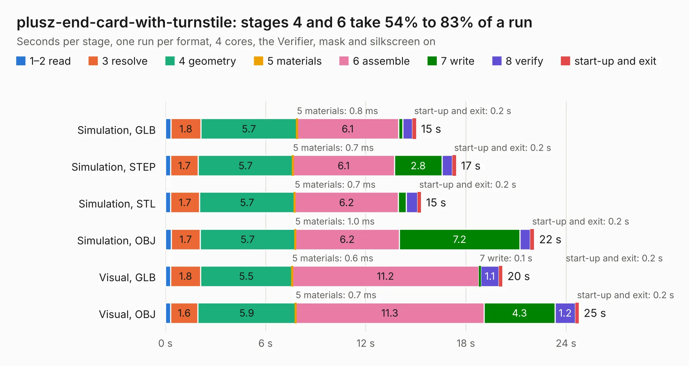

# 2134. plusz-end-card-with-turnstile

Board 2,134 of the 3,102 of [Corpus Testing](../Corpus-Testing.md), on [Corpus Page 20](../CorpusTestingPages/Corpus-Testing-20.md#2134-plusz-end-card-with-turnstile).

| Mode and format | 1–2 read | 3 resolve | 4 geometry | 5 materials | 6 assemble | 7 write | 8 verify | start-up and exit | Total |
|---|---:|---:|---:|---:|---:|---:|---:|---:|---:|
| Simulation, GLB | 0.3 | 1.8 | 5.7 | 0.8&nbsp;ms | 6.1 | 0.2 | 0.6 | 0.2 | 15.0 |
| Simulation, STEP | 0.3 | 1.7 | 5.7 | 0.7&nbsp;ms | 6.1 | 2.8 | 0.6 | 0.2 | 17.4 |
| Simulation, STL | 0.3 | 1.7 | 5.7 | 0.7&nbsp;ms | 6.2 | 0.5 | 0.7 | 0.2 | 15.3 |
| Simulation, OBJ | 0.3 | 1.7 | 5.7 | 1.0&nbsp;ms | 6.2 | 7.2 | 0.6 | 0.2 | 22.1 |
| Visual, GLB | 0.3 | 1.8 | 5.5 | 0.6&nbsp;ms | 11.2 | 0.1 | 1.1 | 0.2 | 20.2 |
| Visual, OBJ | 0.3 | 1.6 | 5.9 | 0.7&nbsp;ms | 11.3 | 4.3 | 1.2 | 0.2 | 24.8 |

<table align="center"><tr><td valign="top">

| Board | Repo: [oresat/oresat-end-cards](https://github.com/oresat/oresat-end-cards) Board: `plusz-end-card-with-turnstile.kicad_pcb` |
|---|---|
| Folder | oresat0-plusz-end-card / card |
| Complexity | 313&nbsp;/&nbsp;1000 (size&nbsp;193, features&nbsp;120) |
| KESE&nbsp;features | through vias, rounded, trapezoid or chamfered pads, drill offsets, arc tracks, filled zones, stack-up, dielectric εr and tanδ, copper finish, mask and silkscreen colours |
| Tested | 9th November 2026 |
| Copper&nbsp;layers | 4 |
| File&nbsp;format | KiCad 10 (20260206) |
| Parts,&nbsp;tracks,&nbsp;vias | 27, 280, 513 |
| Triangles,&nbsp;simulation | 1,879,500 in 75 parts |
| Verifier | PASS in all six runs |

</td><td valign="top">

<table>
<tr><th>File type</th><th>File size</th><th>Peak memory used</th></tr>
<tr><th colspan="3" align="left">Simulation</th></tr>
<tr><td>GLB</td><td align="right">64&nbsp;MB</td><td align="right">721&nbsp;MB</td></tr>
<tr><td>STEP</td><td align="right">197&nbsp;MB</td><td align="right">838&nbsp;MB</td></tr>
<tr><td>STL</td><td align="right">94&nbsp;MB</td><td align="right">717&nbsp;MB</td></tr>
<tr><td>OBJ</td><td align="right">197&nbsp;MB</td><td align="right">1.3&nbsp;GB</td></tr>
<tr><th colspan="3" align="left">Visual</th></tr>
<tr><td>GLB</td><td align="right">35&nbsp;MB</td><td align="right">786&nbsp;MB</td></tr>
<tr><td>OBJ</td><td align="right">108&nbsp;MB</td><td align="right">814&nbsp;MB</td></tr>
</table>

</td></tr></table>

| Previous | Next |
|:---|---:|
| [2133. esi-plusz-end-card](b2133b_oresat-end-cards_esi-plusz-end-card.md) | [2135. plusz-end-card-with-turnstile-mezzanine](b2135b_oresat-end-cards_plusz-end-card-with-turnstile-mezzanine.md) |
