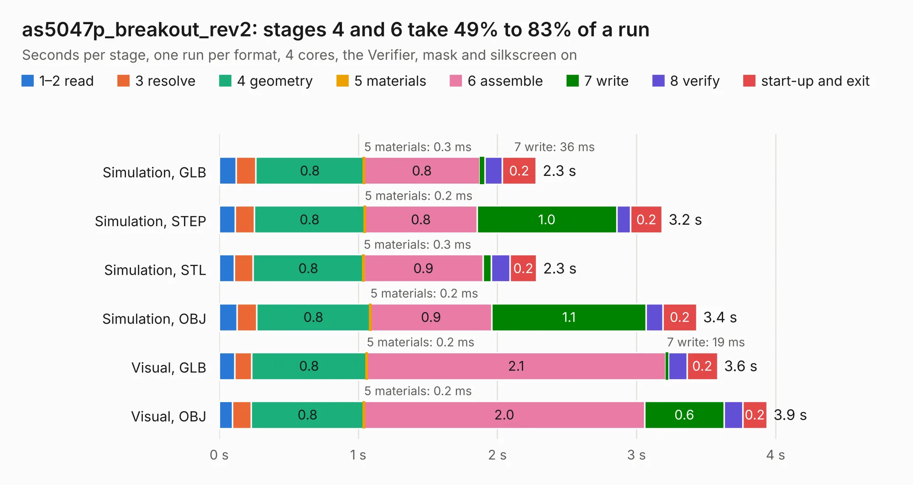

# 2135. as5047p_breakout_rev2

Board 2,135 of the 3,132 of [Corpus Testing](../Corpus-Testing.md), on [Corpus Page 20](../CorpusTestingPages/Corpus-Testing-20.md#2135-as5047p_breakout_rev2).

| Mode and format | 1–2 read | 3 resolve | 4 geometry | 5 materials | 6 assemble | 7 write | 8 verify | start-up and exit | Total |
|---|---:|---:|---:|---:|---:|---:|---:|---:|---:|
| Simulation, GLB | 0.1 | 0.1 | 0.8 | 0.3&nbsp;ms | 0.8 | 36&nbsp;ms | 0.1 | 0.2 | 2.3 |
| Simulation, STEP | 0.1 | 0.1 | 0.8 | 0.2&nbsp;ms | 0.8 | 1.0 | 0.1 | 0.2 | 3.2 |
| Simulation, STL | 0.1 | 0.1 | 0.8 | 0.3&nbsp;ms | 0.9 | 58&nbsp;ms | 0.1 | 0.2 | 2.3 |
| Simulation, OBJ | 0.1 | 0.1 | 0.8 | 0.2&nbsp;ms | 0.9 | 1.1 | 0.1 | 0.2 | 3.4 |
| Visual, GLB | 0.1 | 0.1 | 0.8 | 0.2&nbsp;ms | 2.1 | 19&nbsp;ms | 0.1 | 0.2 | 3.6 |
| Visual, OBJ | 96&nbsp;ms | 0.1 | 0.8 | 0.2&nbsp;ms | 2.0 | 0.6 | 0.1 | 0.2 | 3.9 |

<table align="center"><tr><td valign="top">

| Board | Repo: [oresat/oresat-adcs-hardware](https://github.com/oresat/oresat-adcs-hardware) Board: `as5047p_breakout_rev2.kicad_pcb` |
|---|---|
| Folder | oresat-rw-board-rev7 / as5047p_breakout_rev2 |
| Complexity | 144&nbsp;/&nbsp;1000 (size&nbsp;114, features&nbsp;30) |
| KESE&nbsp;features | rounded, trapezoid or chamfered pads, filled zones |
| Tested | 9th November 2026 |
| Copper&nbsp;layers | 2 |
| File&nbsp;format | KiCad 7 (20221018) |
| Parts,&nbsp;tracks,&nbsp;vias | 8, 88, 0 |
| Triangles,&nbsp;simulation | 224,936 in 32 parts |
| Verifier | PASS in all six runs |

</td><td valign="top">

<table>
<tr><th>File type</th><th>File size</th><th>Peak memory used</th></tr>
<tr><th colspan="3" align="left">Simulation</th></tr>
<tr><td>GLB</td><td align="right">7.6&nbsp;MB</td><td align="right">213&nbsp;MB</td></tr>
<tr><td>STEP</td><td align="right">33&nbsp;MB</td><td align="right">233&nbsp;MB</td></tr>
<tr><td>STL</td><td align="right">11&nbsp;MB</td><td align="right">205&nbsp;MB</td></tr>
<tr><td>OBJ</td><td align="right">22&nbsp;MB</td><td align="right">205&nbsp;MB</td></tr>
<tr><th colspan="3" align="left">Visual</th></tr>
<tr><td>GLB</td><td align="right">4.2&nbsp;MB</td><td align="right">196&nbsp;MB</td></tr>
<tr><td>OBJ</td><td align="right">12&nbsp;MB</td><td align="right">198&nbsp;MB</td></tr>
</table>

</td></tr></table>

| Previous | Next |
|:---|---:|
| [2134. as5047p_breakout](b2134b_oresat-adcs-hardware_as5047p-breakout.md) | [2136. control-stage](b2136b_oresat-adcs-hardware_oresat-rw-board-rev7-control-stage_control-stage.md) |
