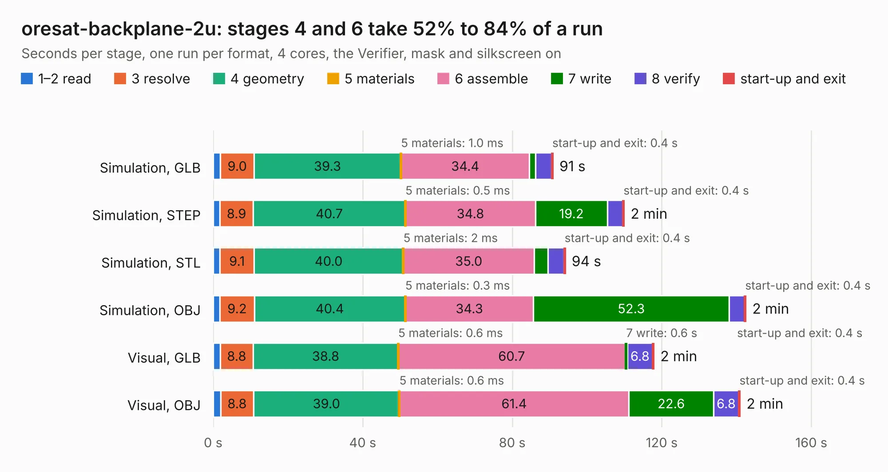

# 2138. oresat-backplane-2u

Board 2,138 of the 3,128 of [Corpus Testing](../Corpus-Testing.md), on [Corpus Page 20](../CorpusTestingPages/Corpus-Testing-20.md#2138-oresat-backplane-2u).

| Mode and format | 1–2 read | 3 resolve | 4 geometry | 5 materials | 6 assemble | 7 write | 8 verify | start-up and exit | Total |
|---|---:|---:|---:|---:|---:|---:|---:|---:|---:|
| Simulation, GLB | 1.9 | 9.0 | 39.3 | 1.0&nbsp;ms | 34.4 | 1.6 | 4.3 | 0.4 | 90.9 |
| Simulation, STEP | 1.8 | 8.9 | 40.7 | 0.5&nbsp;ms | 34.8 | 19.2 | 4.1 | 0.4 | 110.0 |
| Simulation, STL | 1.8 | 9.1 | 40.0 | 2&nbsp;ms | 35.0 | 3.6 | 4.3 | 0.4 | 94.2 |
| Simulation, OBJ | 1.8 | 9.2 | 40.4 | 0.3&nbsp;ms | 34.3 | 52.3 | 4.1 | 0.4 | 142.5 |
| Visual, GLB | 1.9 | 8.8 | 38.8 | 0.6&nbsp;ms | 60.7 | 0.6 | 6.8 | 0.4 | 117.9 |
| Visual, OBJ | 2.0 | 8.8 | 39.0 | 0.6&nbsp;ms | 61.4 | 22.6 | 6.8 | 0.4 | 141.0 |

<table align="center"><tr><td valign="top">

| Board | Repo: [oresat/oresat-backplane](https://github.com/oresat/oresat-backplane) Board: `oresat-backplane-2u.kicad_pcb` |
|---|---|
| Folder | 2U / oresat0.5 |
| Complexity | 349&nbsp;/&nbsp;1000 (size&nbsp;214, features&nbsp;135) |
| KESE&nbsp;features | through vias, custom pads, rounded, trapezoid or chamfered pads, drill offsets, arc tracks, filled zones, copper drawings, curved board outline, stack-up, dielectric εr and tanδ |
| Tested | 9th November 2026 |
| Copper&nbsp;layers | 4 |
| File&nbsp;format | KiCad 9 (20241229) |
| Parts,&nbsp;tracks,&nbsp;vias | 59, 731, 1,153 |
| Triangles,&nbsp;simulation | 7,981,954 in 48 parts |
| Verifier | PASS in all six runs |

</td><td valign="top">

<table>
<tr><th>File type</th><th>File size</th><th>Peak memory used</th></tr>
<tr><th colspan="3" align="left">Simulation</th></tr>
<tr><td>GLB</td><td align="right">265&nbsp;MB</td><td align="right">2.3&nbsp;GB</td></tr>
<tr><td>STEP</td><td align="right">976&nbsp;MB</td><td align="right">2.8&nbsp;GB</td></tr>
<tr><td>STL</td><td align="right">399&nbsp;MB</td><td align="right">2.3&nbsp;GB</td></tr>
<tr><td>OBJ</td><td align="right">853&nbsp;MB</td><td align="right">5.1&nbsp;GB</td></tr>
<tr><th colspan="3" align="left">Visual</th></tr>
<tr><td>GLB</td><td align="right">128&nbsp;MB</td><td align="right">2.3&nbsp;GB</td></tr>
<tr><td>OBJ</td><td align="right">410&nbsp;MB</td><td align="right">2.7&nbsp;GB</td></tr>
</table>

</td></tr></table>

| Previous | Next |
|:---|---:|
| [2137. oresat-backplane-2u](b2137b_oresat-backplane_2U-generic-2u_oresat-backplane-2u.md) | [2139. oresat-backplane-2u](b2139b_oresat-backplane_2U-oresat1_oresat-backplane-2u.md) |
