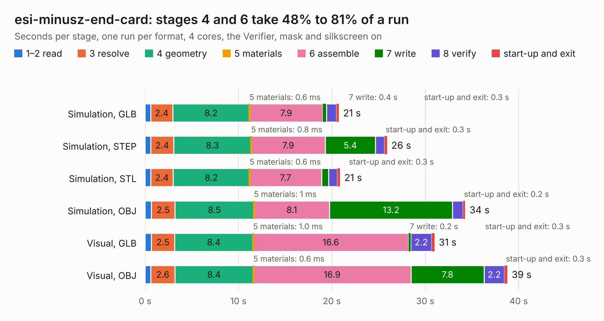

# 2138. esi-minusz-end-card

Board 2,138 of the 3,108 of [Corpus Testing](../Corpus-Testing.md), on [Corpus Page 20](../CorpusTestingPages/Corpus-Testing-20.md#2138-esi-minusz-end-card).

| Mode and format | 1–2 read | 3 resolve | 4 geometry | 5 materials | 6 assemble | 7 write | 8 verify | start-up and exit | Total |
|---|---:|---:|---:|---:|---:|---:|---:|---:|---:|
| Simulation, GLB | 0.6 | 2.4 | 8.2 | 0.6&nbsp;ms | 7.9 | 0.4 | 1.1 | 0.3 | 20.8 |
| Simulation, STEP | 0.6 | 2.4 | 8.3 | 0.8&nbsp;ms | 7.9 | 5.4 | 1.0 | 0.3 | 25.9 |
| Simulation, STL | 0.6 | 2.4 | 8.2 | 0.6&nbsp;ms | 7.7 | 0.7 | 1.0 | 0.3 | 20.9 |
| Simulation, OBJ | 0.7 | 2.5 | 8.5 | 1&nbsp;ms | 8.1 | 13.2 | 1.1 | 0.2 | 34.3 |
| Visual, GLB | 0.7 | 2.5 | 8.4 | 1.0&nbsp;ms | 16.6 | 0.2 | 2.2 | 0.3 | 31.0 |
| Visual, OBJ | 0.6 | 2.6 | 8.4 | 0.6&nbsp;ms | 16.9 | 7.8 | 2.2 | 0.3 | 38.8 |

<table align="center"><tr><td valign="top">

| Board | Repo: [oresat/oresat-end-cards](https://github.com/oresat/oresat-end-cards) Board: `esi-minusz-end-card.kicad_pcb` |
|---|---|
| Folder | esi-minusz-end-card |
| Complexity | 385&nbsp;/&nbsp;1000 (size&nbsp;205, features&nbsp;180) |
| KESE&nbsp;features | through vias, slotted holes, custom pads, rounded, trapezoid or chamfered pads, drill offsets, arc tracks, filled zones, copper drawings, curved board outline, tracks bare of mask, stack-up, dielectric εr and tanδ, copper finish, mask and silkscreen colours |
| Tested | 9th November 2026 |
| Copper&nbsp;layers | 4 |
| File&nbsp;format | KiCad 10 (20260206) |
| Parts,&nbsp;tracks,&nbsp;vias | 67, 674, 490 |
| Triangles,&nbsp;simulation | 2,180,030 in 89 parts |
| Verifier | PASS in all six runs |

</td><td valign="top">

<table>
<tr><th>File type</th><th>File size</th><th>Peak memory used</th></tr>
<tr><th colspan="3" align="left">Simulation</th></tr>
<tr><td>GLB</td><td align="right">74&nbsp;MB</td><td align="right">907&nbsp;MB</td></tr>
<tr><td>STEP</td><td align="right">258&nbsp;MB</td><td align="right">954&nbsp;MB</td></tr>
<tr><td>STL</td><td align="right">109&nbsp;MB</td><td align="right">882&nbsp;MB</td></tr>
<tr><td>OBJ</td><td align="right">229&nbsp;MB</td><td align="right">1.5&nbsp;GB</td></tr>
<tr><th colspan="3" align="left">Visual</th></tr>
<tr><td>GLB</td><td align="right">44&nbsp;MB</td><td align="right">859&nbsp;MB</td></tr>
<tr><td>OBJ</td><td align="right">137&nbsp;MB</td><td align="right">982&nbsp;MB</td></tr>
</table>

</td></tr></table>

| Previous | Next |
|:---|---:|
| [2137. balun-eval-board](b2137b_oresat-end-cards_balun-eval-board.md) | [2139. esi-plusz-end-card](b2139b_oresat-end-cards_esi-plusz-end-card.md) |
