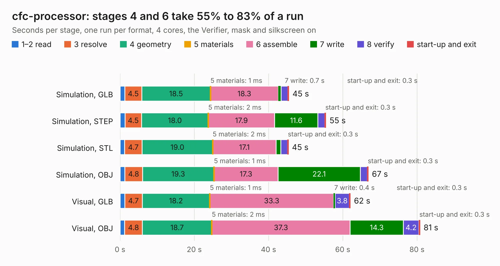

# 2140. cfc-processor

Board 2,140 of the 3,118 of [Corpus Testing](../Corpus-Testing.md), on [Corpus Page 20](../CorpusTestingPages/Corpus-Testing-20.md#2140-cfc-processor).

| Mode and format | 1–2 read | 3 resolve | 4 geometry | 5 materials | 6 assemble | 7 write | 8 verify | start-up and exit | Total |
|---|---:|---:|---:|---:|---:|---:|---:|---:|---:|
| Simulation, GLB | 1.3 | 4.5 | 18.5 | 1&nbsp;ms | 18.3 | 0.7 | 1.8 | 0.3 | 45.5 |
| Simulation, STEP | 1.3 | 4.5 | 18.0 | 2&nbsp;ms | 17.9 | 11.6 | 1.9 | 0.3 | 55.5 |
| Simulation, STL | 1.2 | 4.7 | 19.0 | 2&nbsp;ms | 17.1 | 1.3 | 1.8 | 0.3 | 45.4 |
| Simulation, OBJ | 1.3 | 4.8 | 19.3 | 1&nbsp;ms | 17.3 | 22.1 | 1.9 | 0.3 | 66.9 |
| Visual, GLB | 1.3 | 4.7 | 18.2 | 1&nbsp;ms | 33.3 | 0.4 | 3.8 | 0.3 | 62.1 |
| Visual, OBJ | 1.2 | 4.8 | 18.7 | 2&nbsp;ms | 37.3 | 14.3 | 4.2 | 0.3 | 80.8 |

<table align="center"><tr><td valign="top">

| Board | Repo: [oresat/oresat-cfc-hardware](https://github.com/oresat/oresat-cfc-hardware) Board: `cfc-processor.kicad_pcb` |
|---|---|
| Folder | cfc-processor-card-v2 |
| Complexity | 403&nbsp;/&nbsp;1000 (size&nbsp;283, features&nbsp;120) |
| KESE&nbsp;features | through vias, rounded, trapezoid or chamfered pads, drill offsets, arc tracks, filled zones, stack-up, dielectric εr and tanδ, copper finish, mask and silkscreen colours |
| Tested | 9th November 2026 |
| Copper&nbsp;layers | 4 |
| File&nbsp;format | KiCad 10 (20260206) |
| Parts,&nbsp;tracks,&nbsp;vias | 163, 2,385, 501 |
| Triangles,&nbsp;simulation | 3,912,120 in 430 parts |
| Verifier | PASS in all six runs |

</td><td valign="top">

<table>
<tr><th>File type</th><th>File size</th><th>Peak memory used</th></tr>
<tr><th colspan="3" align="left">Simulation</th></tr>
<tr><td>GLB</td><td align="right">133&nbsp;MB</td><td align="right">1.3&nbsp;GB</td></tr>
<tr><td>STEP</td><td align="right">567&nbsp;MB</td><td align="right">1.6&nbsp;GB</td></tr>
<tr><td>STL</td><td align="right">196&nbsp;MB</td><td align="right">1.3&nbsp;GB</td></tr>
<tr><td>OBJ</td><td align="right">419&nbsp;MB</td><td align="right">2.6&nbsp;GB</td></tr>
<tr><th colspan="3" align="left">Visual</th></tr>
<tr><td>GLB</td><td align="right">84&nbsp;MB</td><td align="right">1.4&nbsp;GB</td></tr>
<tr><td>OBJ</td><td align="right">270&nbsp;MB</td><td align="right">1.8&nbsp;GB</td></tr>
</table>

</td></tr></table>

| Previous | Next |
|:---|---:|
| [2139. cfc-minibackplane](b2139b_oresat-cfc-hardware_cfc-minibackplane.md) | [2141. cfc-sensor-card](b2141b_oresat-cfc-hardware_cfc-sensor-card.md) |
