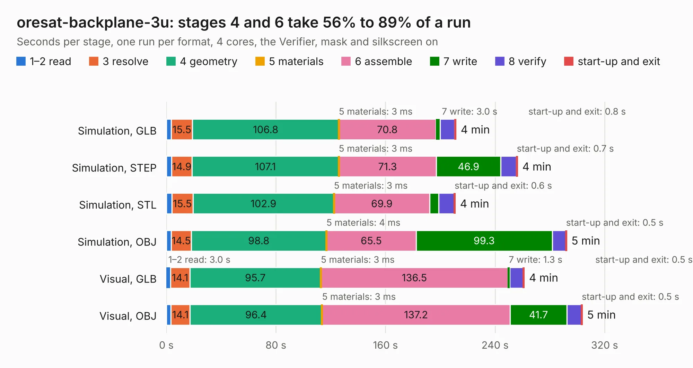

# 2141. oresat-backplane-3u

Board 2,141 of the 3,126 of [Corpus Testing](../Corpus-Testing.md), on [Corpus Page 20](../CorpusTestingPages/Corpus-Testing-20.md#2141-oresat-backplane-3u).

| Mode and format | 1–2 read | 3 resolve | 4 geometry | 5 materials | 6 assemble | 7 write | 8 verify | start-up and exit | Total |
|---|---:|---:|---:|---:|---:|---:|---:|---:|---:|
| Simulation, GLB | 3.6 | 15.5 | 106.8 | 3&nbsp;ms | 70.8 | 3.0 | 10.7 | 0.8 | 211.3 |
| Simulation, STEP | 3.8 | 14.9 | 107.1 | 3&nbsp;ms | 71.3 | 46.9 | 11.5 | 0.7 | 256.3 |
| Simulation, STL | 4.0 | 15.5 | 102.9 | 3&nbsp;ms | 69.9 | 6.5 | 11.3 | 0.6 | 210.8 |
| Simulation, OBJ | 3.7 | 14.5 | 98.8 | 4&nbsp;ms | 65.5 | 99.3 | 9.9 | 0.5 | 292.1 |
| Visual, GLB | 3.0 | 14.1 | 95.7 | 3&nbsp;ms | 136.5 | 1.3 | 10.0 | 0.5 | 261.2 |
| Visual, OBJ | 3.2 | 14.1 | 96.4 | 3&nbsp;ms | 137.2 | 41.7 | 10.5 | 0.5 | 303.6 |

<table align="center"><tr><td valign="top">

| Board | Repo: [oresat/oresat-backplane](https://github.com/oresat/oresat-backplane) Board: `oresat-backplane-3u.kicad_pcb` |
|---|---|
| Folder | 3U / oresat-backplane-3u |
| Complexity | 358&nbsp;/&nbsp;1000 (size&nbsp;218, features&nbsp;140) |
| KESE&nbsp;features | through vias, custom pads, rounded, trapezoid or chamfered pads, drill offsets, filled zones, copper drawings, curved board outline, stack-up, dielectric εr and tanδ, copper finish, mask and silkscreen colours |
| Tested | 9th November 2026 |
| Copper&nbsp;layers | 4 |
| File&nbsp;format | KiCad 9 (20241229) |
| Parts,&nbsp;tracks,&nbsp;vias | 189, 2,348, 25 |
| Triangles,&nbsp;simulation | 14,995,974 in 526 parts |
| Verifier | PASS in all six runs |

</td><td valign="top">

<table>
<tr><th>File type</th><th>File size</th><th>Peak memory used</th></tr>
<tr><th colspan="3" align="left">Simulation</th></tr>
<tr><td>GLB</td><td align="right">510&nbsp;MB</td><td align="right">3.8&nbsp;GB</td></tr>
<tr><td>STEP</td><td align="right">2.3&nbsp;GB</td><td align="right">4.6&nbsp;GB</td></tr>
<tr><td>STL</td><td align="right">750&nbsp;MB</td><td align="right">3.5&nbsp;GB</td></tr>
<tr><td>OBJ</td><td align="right">1.7&nbsp;GB</td><td align="right">9.6&nbsp;GB</td></tr>
<tr><th colspan="3" align="left">Visual</th></tr>
<tr><td>GLB</td><td align="right">222&nbsp;MB</td><td align="right">3.8&nbsp;GB</td></tr>
<tr><td>OBJ</td><td align="right">721&nbsp;MB</td><td align="right">4.6&nbsp;GB</td></tr>
</table>

</td></tr></table>

| Previous | Next |
|:---|---:|
| [2140. esi-backplane-3u](b2140b_oresat-backplane_esi-backplane-3u.md) | [2142. oresat-batteries](b2142b_oresat-batteries_oresat-batteries.md) |
