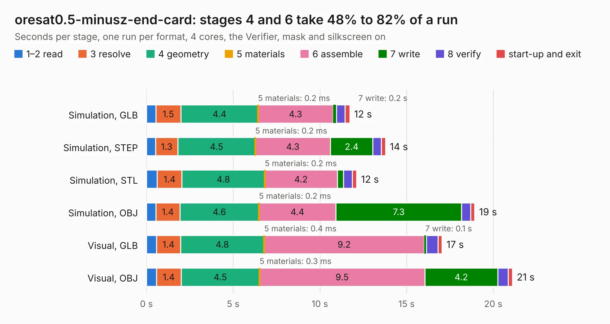

# 2141. oresat0.5-minusz-end-card

Board 2,141 of the 3,107 of [Corpus Testing](../Corpus-Testing.md), on [Corpus Page 20](../CorpusTestingPages/Corpus-Testing-20.md#2141-oresat05-minusz-end-card).

| Mode and format | 1–2 read | 3 resolve | 4 geometry | 5 materials | 6 assemble | 7 write | 8 verify | start-up and exit | Total |
|---|---:|---:|---:|---:|---:|---:|---:|---:|---:|
| Simulation, GLB | 0.5 | 1.5 | 4.4 | 0.2&nbsp;ms | 4.3 | 0.2 | 0.5 | 0.3 | 11.7 |
| Simulation, STEP | 0.5 | 1.3 | 4.5 | 0.2&nbsp;ms | 4.3 | 2.4 | 0.5 | 0.2 | 13.8 |
| Simulation, STL | 0.6 | 1.4 | 4.8 | 0.2&nbsp;ms | 4.2 | 0.4 | 0.5 | 0.3 | 12.1 |
| Simulation, OBJ | 0.5 | 1.4 | 4.6 | 0.2&nbsp;ms | 4.4 | 7.3 | 0.5 | 0.2 | 18.9 |
| Visual, GLB | 0.6 | 1.4 | 4.8 | 0.4&nbsp;ms | 9.2 | 0.1 | 0.7 | 0.2 | 17.1 |
| Visual, OBJ | 0.6 | 1.4 | 4.5 | 0.3&nbsp;ms | 9.5 | 4.2 | 0.6 | 0.2 | 21.1 |

<table align="center"><tr><td valign="top">

| Board | Repo: [oresat/oresat-end-cards](https://github.com/oresat/oresat-end-cards) Board: `oresat0.5-minusz-end-card.kicad_pcb` |
|---|---|
| Folder | oresat0.5-minusz-end-card |
| Complexity | 335&nbsp;/&nbsp;1000 (size&nbsp;175, features&nbsp;160) |
| KESE&nbsp;features | through vias, slotted holes, custom pads, rounded, trapezoid or chamfered pads, drill offsets, arc tracks, filled zones, copper drawings, curved board outline, stack-up, dielectric εr and tanδ, copper finish |
| Tested | 9th November 2026 |
| Copper&nbsp;layers | 4 |
| File&nbsp;format | KiCad 8 (20240108) |
| Parts,&nbsp;tracks,&nbsp;vias | 10, 137, 350 |
| Triangles,&nbsp;simulation | 1,327,426 in 52 parts |
| Verifier | PASS in all six runs |

</td><td valign="top">

<table>
<tr><th>File type</th><th>File size</th><th>Peak memory used</th></tr>
<tr><th colspan="3" align="left">Simulation</th></tr>
<tr><td>GLB</td><td align="right">43&nbsp;MB</td><td align="right">577&nbsp;MB</td></tr>
<tr><td>STEP</td><td align="right">125&nbsp;MB</td><td align="right">638&nbsp;MB</td></tr>
<tr><td>STL</td><td align="right">66&nbsp;MB</td><td align="right">561&nbsp;MB</td></tr>
<tr><td>OBJ</td><td align="right">134&nbsp;MB</td><td align="right">925&nbsp;MB</td></tr>
<tr><th colspan="3" align="left">Visual</th></tr>
<tr><td>GLB</td><td align="right">24&nbsp;MB</td><td align="right">604&nbsp;MB</td></tr>
<tr><td>OBJ</td><td align="right">73&nbsp;MB</td><td align="right">604&nbsp;MB</td></tr>
</table>

</td></tr></table>

| Previous | Next |
|:---|---:|
| [2140. plusz-end-card-with-turnstile-mezzanine](b2140b_oresat-end-cards_plusz-end-card-with-turnstile-mezzanine.md) | [2142. oresat0.5-pluz-end-card](b2142b_oresat-end-cards_oresat0-5-pluz-end-card.md) |
