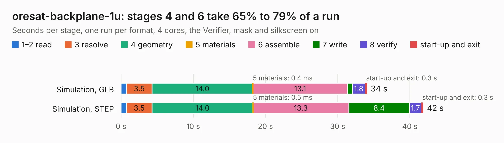

# 2143 oresat-backplane-1u

Board 2,143 of the 3,138 of [Corpus Testing](../Corpus-Testing.md), on [Corpus Page 20](../CorpusTestingPages/Corpus-Testing-20.md#2143-oresat-backplane-1u).

| Mode and format | 1–2 read | 3 resolve | 4 geometry | 5 materials | 6 assemble | 7 write | 8 verify | start-up and exit | Total |
|---|---:|---:|---:|---:|---:|---:|---:|---:|---:|
| Simulation, GLB | 0.8 | 3.5 | 14.0 | 0.4&nbsp;ms | 13.1 | 0.7 | 1.8 | 0.3 | 34.1 |
| Simulation, STEP | 0.8 | 3.5 | 14.0 | 0.5&nbsp;ms | 13.3 | 8.4 | 1.7 | 0.3 | 41.9 |
| Simulation, STL | 0.7 | 3.4 | 13.9 | 0.6&nbsp;ms | 13.4 | 1.4 | 1.7 | 0.3 | 34.7 |
| Simulation, OBJ | 0.8 | 3.5 | 14.7 | 0.5&nbsp;ms | 13.7 | 19.1 | 1.9 | 0.3 | 54.0 |
| Visual, GLB | 0.8 | 3.5 | 15.1 | 0.2&nbsp;ms | 28.1 | 0.3 | 2.9 | 0.3 | 50.9 |
| Visual, OBJ | 0.7 | 3.6 | 15.0 | 0.3&nbsp;ms | 27.9 | 8.2 | 3.3 | 0.3 | 59.0 |

<table align="center"><tr><td valign="top">

| Board | Repo: [oresat/oresat-backplane](https://github.com/oresat/oresat-backplane) Board: `oresat-backplane-1u.kicad_pcb` |
|---|---|
| Folder | 1U / KiCad / oresat-backplane-1u |
| Complexity | 292&nbsp;/&nbsp;1000 (size&nbsp;197, features&nbsp;95) |
| KESE&nbsp;features | through vias, rounded, trapezoid or chamfered pads, drill offsets, filled zones, curved board outline, stack-up, dielectric εr and tanδ |
| Tested | 9th November 2026 |
| Copper&nbsp;layers | 4 |
| File&nbsp;format | KiCad 6 (20211014) |
| Parts,&nbsp;tracks,&nbsp;vias | 45, 1,025, 224 |
| Triangles,&nbsp;simulation | 4,370,926 in 62 parts |
| Verifier | PASS in all six runs |

</td><td valign="top">

<table>
<tr><th>File type</th><th>File size</th><th>Peak memory used</th></tr>
<tr><th colspan="3" align="left">Simulation</th></tr>
<tr><td>GLB</td><td align="right">148&nbsp;MB</td><td align="right">1.2&nbsp;GB</td></tr>
<tr><td>STEP</td><td align="right">648&nbsp;MB</td><td align="right">1.5&nbsp;GB</td></tr>
<tr><td>STL</td><td align="right">219&nbsp;MB</td><td align="right">1.2&nbsp;GB</td></tr>
<tr><td>OBJ</td><td align="right">467&nbsp;MB</td><td align="right">2.8&nbsp;GB</td></tr>
<tr><th colspan="3" align="left">Visual</th></tr>
<tr><td>GLB</td><td align="right">69&nbsp;MB</td><td align="right">1.3&nbsp;GB</td></tr>
<tr><td>OBJ</td><td align="right">216&nbsp;MB</td><td align="right">1.6&nbsp;GB</td></tr>
</table>

</td></tr></table>

| Previous | Next |
|:---|---:|
| [2142 oresat-rw-card](b2142b_oresat-adcs-hardware_oresat-rw-card.md) | [2144 oresat0-1u-backplane](b2144b_oresat-backplane_oresat0-1u-backplane.md) |
