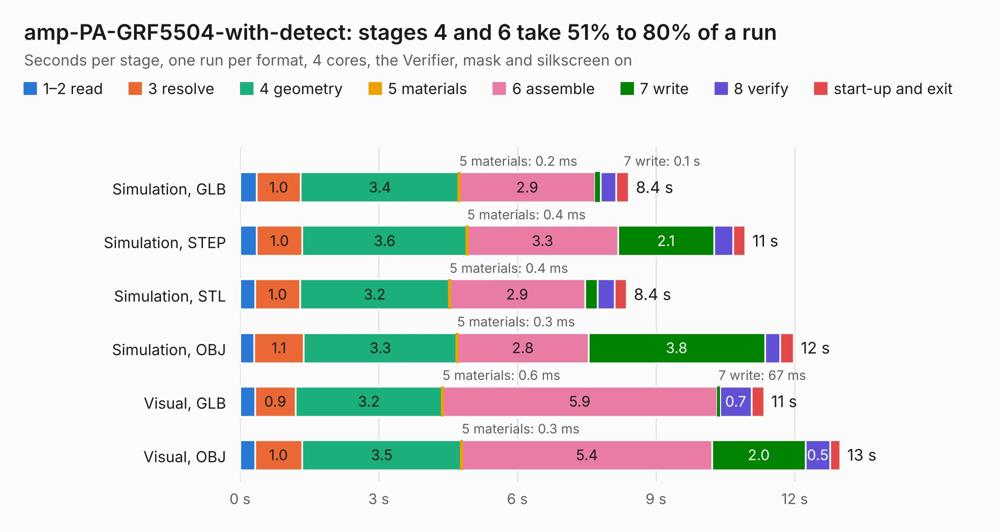

# 2143. amp-PA-GRF5504-with-detect

Board 2,143 of the 3,124 of [Corpus Testing](../Corpus-Testing.md), on [Corpus Page 20](../CorpusTestingPages/Corpus-Testing-20.md#2143-amp-pa-grf5504-with-detect).

| Mode and format | 1–2 read | 3 resolve | 4 geometry | 5 materials | 6 assemble | 7 write | 8 verify | start-up and exit | Total |
|---|---:|---:|---:|---:|---:|---:|---:|---:|---:|
| Simulation, GLB | 0.4 | 1.0 | 3.4 | 0.2&nbsp;ms | 2.9 | 0.1 | 0.3 | 0.3 | 8.4 |
| Simulation, STEP | 0.4 | 1.0 | 3.6 | 0.4&nbsp;ms | 3.3 | 2.1 | 0.4 | 0.3 | 10.9 |
| Simulation, STL | 0.3 | 1.0 | 3.2 | 0.4&nbsp;ms | 2.9 | 0.3 | 0.4 | 0.3 | 8.4 |
| Simulation, OBJ | 0.3 | 1.1 | 3.3 | 0.3&nbsp;ms | 2.8 | 3.8 | 0.3 | 0.3 | 12.0 |
| Visual, GLB | 0.3 | 0.9 | 3.2 | 0.6&nbsp;ms | 5.9 | 67&nbsp;ms | 0.7 | 0.3 | 11.3 |
| Visual, OBJ | 0.3 | 1.0 | 3.5 | 0.3&nbsp;ms | 5.4 | 2.0 | 0.5 | 0.2 | 13.0 |

<table align="center"><tr><td valign="top">

| Board | Repo: [oresat/oresat-c3-rf](https://github.com/oresat/oresat-c3-rf) Board: `amp-PA-GRF5504-with-detect.kicad_pcb` |
|---|---|
| Folder | KiCad |
| Complexity | 308&nbsp;/&nbsp;1000 (size&nbsp;188, features&nbsp;120) |
| KESE&nbsp;features | through vias, rounded, trapezoid or chamfered pads, arc tracks, filled zones, curved board outline, stack-up, dielectric εr and tanδ, copper finish, mask and silkscreen colours |
| Tested | 9th November 2026 |
| Copper&nbsp;layers | 4 |
| File&nbsp;format | KiCad 10 (20260206) |
| Parts,&nbsp;tracks,&nbsp;vias | 51, 247, 220 |
| Triangles,&nbsp;simulation | 840,424 in 46 parts |
| Verifier | PASS in all six runs |

</td><td valign="top">

<table>
<tr><th>File type</th><th>File size</th><th>Peak memory used</th></tr>
<tr><th colspan="3" align="left">Simulation</th></tr>
<tr><td>GLB</td><td align="right">29&nbsp;MB</td><td align="right">418&nbsp;MB</td></tr>
<tr><td>STEP</td><td align="right">96&nbsp;MB</td><td align="right">486&nbsp;MB</td></tr>
<tr><td>STL</td><td align="right">42&nbsp;MB</td><td align="right">410&nbsp;MB</td></tr>
<tr><td>OBJ</td><td align="right">86&nbsp;MB</td><td align="right">626&nbsp;MB</td></tr>
<tr><th colspan="3" align="left">Visual</th></tr>
<tr><td>GLB</td><td align="right">16&nbsp;MB</td><td align="right">418&nbsp;MB</td></tr>
<tr><td>OBJ</td><td align="right">48&nbsp;MB</td><td align="right">420&nbsp;MB</td></tr>
</table>

</td></tr></table>

| Previous | Next |
|:---|---:|
| [2142. oresat-c3](b2142b_oresat-c3-hardware_oresat-c3.md) | [2144. cfc_emulator](b2144b_oresat-cfc-hardware_cfc-emulator.md) |
