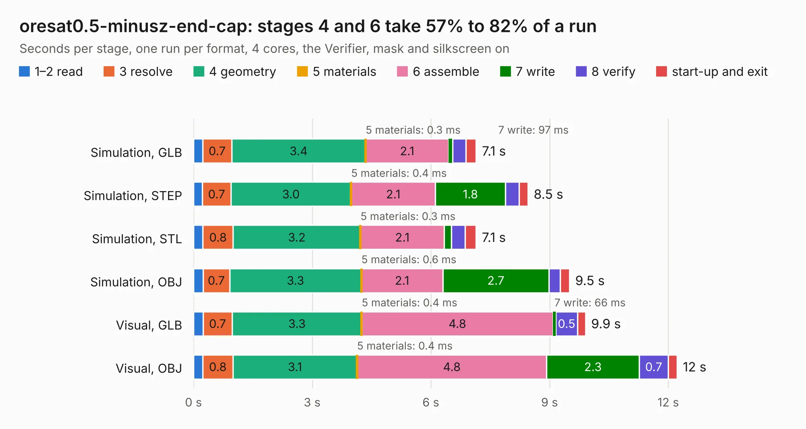

# 2143. oresat0.5-minusz-end-cap

Board 2,143 of the 3,102 of [Corpus Testing](../Corpus-Testing.md), on [Corpus Page 20](../CorpusTestingPages/Corpus-Testing-20.md#2143-oresat05-minusz-end-cap).

| Mode and format | 1–2 read | 3 resolve | 4 geometry | 5 materials | 6 assemble | 7 write | 8 verify | start-up and exit | Total |
|---|---:|---:|---:|---:|---:|---:|---:|---:|---:|
| Simulation, GLB | 0.2 | 0.7 | 3.4 | 0.3&nbsp;ms | 2.1 | 97&nbsp;ms | 0.3 | 0.3 | 7.1 |
| Simulation, STEP | 0.2 | 0.7 | 3.0 | 0.4&nbsp;ms | 2.1 | 1.8 | 0.3 | 0.2 | 8.5 |
| Simulation, STL | 0.2 | 0.8 | 3.2 | 0.3&nbsp;ms | 2.1 | 0.2 | 0.3 | 0.3 | 7.1 |
| Simulation, OBJ | 0.2 | 0.7 | 3.3 | 0.6&nbsp;ms | 2.1 | 2.7 | 0.3 | 0.2 | 9.5 |
| Visual, GLB | 0.2 | 0.7 | 3.3 | 0.4&nbsp;ms | 4.8 | 66&nbsp;ms | 0.5 | 0.2 | 9.9 |
| Visual, OBJ | 0.2 | 0.8 | 3.1 | 0.4&nbsp;ms | 4.8 | 2.3 | 0.7 | 0.2 | 12.2 |

<table align="center"><tr><td valign="top">

| Board | Repo: [oresat/oresat-endcaps](https://github.com/oresat/oresat-endcaps) Board: `oresat0.5-minusz-end-cap.kicad_pcb` |
|---|---|
| Folder | oresat0.5-minusz-end-cap |
| Complexity | 271&nbsp;/&nbsp;1000 (size&nbsp;166, features&nbsp;105) |
| KESE&nbsp;features | through vias, rounded, trapezoid or chamfered pads, filled zones, curved board outline, stack-up, dielectric εr and tanδ, copper finish, mask and silkscreen colours |
| Tested | 9th November 2026 |
| Copper&nbsp;layers | 2 |
| File&nbsp;format | KiCad 8 (20240108) |
| Parts,&nbsp;tracks,&nbsp;vias | 26, 249, 267 |
| Triangles,&nbsp;simulation | 651,044 in 51 parts |
| Verifier | PASS in all six runs |

</td><td valign="top">

<table>
<tr><th>File type</th><th>File size</th><th>Peak memory used</th></tr>
<tr><th colspan="3" align="left">Simulation</th></tr>
<tr><td>GLB</td><td align="right">23&nbsp;MB</td><td align="right">383&nbsp;MB</td></tr>
<tr><td>STEP</td><td align="right">86&nbsp;MB</td><td align="right">414&nbsp;MB</td></tr>
<tr><td>STL</td><td align="right">33&nbsp;MB</td><td align="right">398&nbsp;MB</td></tr>
<tr><td>OBJ</td><td align="right">66&nbsp;MB</td><td align="right">478&nbsp;MB</td></tr>
<tr><th colspan="3" align="left">Visual</th></tr>
<tr><td>GLB</td><td align="right">17&nbsp;MB</td><td align="right">414&nbsp;MB</td></tr>
<tr><td>OBJ</td><td align="right">51&nbsp;MB</td><td align="right">427&nbsp;MB</td></tr>
</table>

</td></tr></table>

| Previous | Next |
|:---|---:|
| [2142. oresat0-plusz-end-cap](b2142b_oresat-endcaps_oresat0-plusz-end-cap.md) | [2144. oresat0.5-plusz-end-cap](b2144b_oresat-endcaps_oresat0-5-plusz-end-cap.md) |
