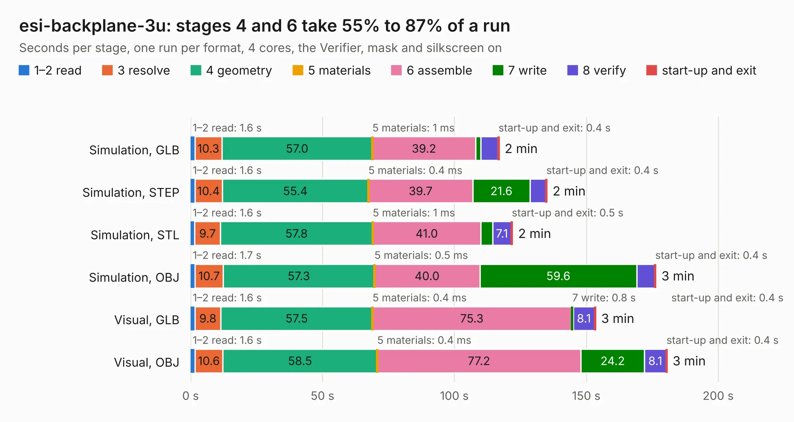

# 2144. esi-backplane-3u

Board 2,144 of the 3,132 of [Corpus Testing](../Corpus-Testing.md), on [Corpus Page 20](../CorpusTestingPages/Corpus-Testing-20.md#2144-esi-backplane-3u).

| Mode and format | 1–2 read | 3 resolve | 4 geometry | 5 materials | 6 assemble | 7 write | 8 verify | start-up and exit | Total |
|---|---:|---:|---:|---:|---:|---:|---:|---:|---:|
| Simulation, GLB | 1.6 | 10.3 | 57.0 | 1&nbsp;ms | 39.2 | 1.9 | 6.5 | 0.4 | 116.9 |
| Simulation, STEP | 1.6 | 10.4 | 55.4 | 0.4&nbsp;ms | 39.7 | 21.6 | 6.0 | 0.4 | 135.1 |
| Simulation, STL | 1.6 | 9.7 | 57.8 | 1&nbsp;ms | 41.0 | 4.5 | 7.1 | 0.5 | 122.0 |
| Simulation, OBJ | 1.7 | 10.7 | 57.3 | 0.5&nbsp;ms | 40.0 | 59.6 | 6.7 | 0.4 | 176.3 |
| Visual, GLB | 1.6 | 9.8 | 57.5 | 0.4&nbsp;ms | 75.3 | 0.8 | 8.1 | 0.4 | 153.5 |
| Visual, OBJ | 1.6 | 10.6 | 58.5 | 0.4&nbsp;ms | 77.2 | 24.2 | 8.1 | 0.4 | 180.6 |

<table align="center"><tr><td valign="top">

| Board | Repo: [oresat/oresat-backplane](https://github.com/oresat/oresat-backplane) Board: `esi-backplane-3u.kicad_pcb` |
|---|---|
| Folder | 3U / esi-backplane-3u |
| Complexity | 392&nbsp;/&nbsp;1000 (size&nbsp;222, features&nbsp;170) |
| KESE&nbsp;features | through vias, custom pads, rounded, trapezoid or chamfered pads, drill offsets, arc tracks, filled zones, copper drawings, curved board outline, tracks bare of mask, stack-up, dielectric εr and tanδ, copper finish, mask and silkscreen colours |
| Tested | 9th November 2026 |
| Copper&nbsp;layers | 4 |
| File&nbsp;format | KiCad 9 (20241229) |
| Parts,&nbsp;tracks,&nbsp;vias | 81, 2,165, 1,088 |
| Triangles,&nbsp;simulation | 10,799,048 in 46 parts |
| Verifier | PASS in all six runs |

</td><td valign="top">

<table>
<tr><th>File type</th><th>File size</th><th>Peak memory used</th></tr>
<tr><th colspan="3" align="left">Simulation</th></tr>
<tr><td>GLB</td><td align="right">369&nbsp;MB</td><td align="right">2.3&nbsp;GB</td></tr>
<tr><td>STEP</td><td align="right">1.4&nbsp;GB</td><td align="right">3.5&nbsp;GB</td></tr>
<tr><td>STL</td><td align="right">540&nbsp;MB</td><td align="right">2.4&nbsp;GB</td></tr>
<tr><td>OBJ</td><td align="right">1.2&nbsp;GB</td><td align="right">6.8&nbsp;GB</td></tr>
<tr><th colspan="3" align="left">Visual</th></tr>
<tr><td>GLB</td><td align="right">169&nbsp;MB</td><td align="right">2.9&nbsp;GB</td></tr>
<tr><td>OBJ</td><td align="right">548&nbsp;MB</td><td align="right">3.5&nbsp;GB</td></tr>
</table>

</td></tr></table>

| Previous | Next |
|:---|---:|
| [2143. oresat-backplane-2u](b2143b_oresat-backplane_2U-oresat1_oresat-backplane-2u.md) | [2145. oresat-backplane-3u](b2145b_oresat-backplane_oresat-backplane-3u.md) |
