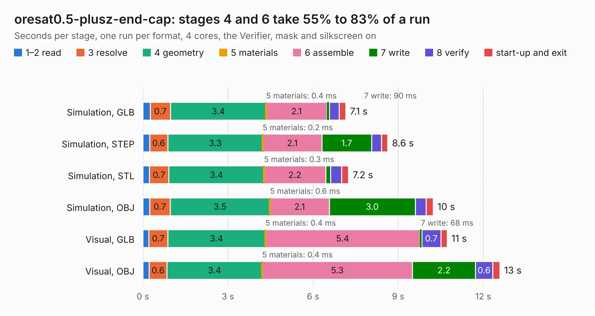

# 2146. oresat0.5-plusz-end-cap

Board 2,146 of the 3,104 of [Corpus Testing](../Corpus-Testing.md), on [Corpus Page 20](../CorpusTestingPages/Corpus-Testing-20.md#2146-oresat05-plusz-end-cap).

| Mode and format | 1–2 read | 3 resolve | 4 geometry | 5 materials | 6 assemble | 7 write | 8 verify | start-up and exit | Total |
|---|---:|---:|---:|---:|---:|---:|---:|---:|---:|
| Simulation, GLB | 0.3 | 0.7 | 3.4 | 0.4&nbsp;ms | 2.1 | 90&nbsp;ms | 0.3 | 0.2 | 7.1 |
| Simulation, STEP | 0.2 | 0.6 | 3.3 | 0.2&nbsp;ms | 2.1 | 1.7 | 0.4 | 0.2 | 8.6 |
| Simulation, STL | 0.2 | 0.7 | 3.4 | 0.3&nbsp;ms | 2.2 | 0.2 | 0.4 | 0.2 | 7.2 |
| Simulation, OBJ | 0.2 | 0.7 | 3.5 | 0.6&nbsp;ms | 2.1 | 3.0 | 0.4 | 0.3 | 10.2 |
| Visual, GLB | 0.2 | 0.7 | 3.4 | 0.4&nbsp;ms | 5.4 | 68&nbsp;ms | 0.7 | 0.2 | 10.7 |
| Visual, OBJ | 0.2 | 0.6 | 3.4 | 0.4&nbsp;ms | 5.3 | 2.2 | 0.6 | 0.3 | 12.6 |

<table align="center"><tr><td valign="top">

| Board | Repo: [oresat/oresat-endcaps](https://github.com/oresat/oresat-endcaps) Board: `oresat0.5-plusz-end-cap.kicad_pcb` |
|---|---|
| Folder | oresat0.5-plusz-end-cap |
| Complexity | 269&nbsp;/&nbsp;1000 (size&nbsp;164, features&nbsp;105) |
| KESE&nbsp;features | through vias, rounded, trapezoid or chamfered pads, filled zones, curved board outline, stack-up, dielectric εr and tanδ, copper finish, mask and silkscreen colours |
| Tested | 9th November 2026 |
| Copper&nbsp;layers | 2 |
| File&nbsp;format | KiCad 9 (20241229) |
| Parts,&nbsp;tracks,&nbsp;vias | 27, 254, 215 |
| Triangles,&nbsp;simulation | 616,052 in 48 parts |
| Verifier | PASS in all six runs |

</td><td valign="top">

<table>
<tr><th>File type</th><th>File size</th><th>Peak memory used</th></tr>
<tr><th colspan="3" align="left">Simulation</th></tr>
<tr><td>GLB</td><td align="right">22&nbsp;MB</td><td align="right">352&nbsp;MB</td></tr>
<tr><td>STEP</td><td align="right">90&nbsp;MB</td><td align="right">388&nbsp;MB</td></tr>
<tr><td>STL</td><td align="right">31&nbsp;MB</td><td align="right">378&nbsp;MB</td></tr>
<tr><td>OBJ</td><td align="right">63&nbsp;MB</td><td align="right">463&nbsp;MB</td></tr>
<tr><th colspan="3" align="left">Visual</th></tr>
<tr><td>GLB</td><td align="right">16&nbsp;MB</td><td align="right">395&nbsp;MB</td></tr>
<tr><td>OBJ</td><td align="right">49&nbsp;MB</td><td align="right">406&nbsp;MB</td></tr>
</table>

</td></tr></table>

| Previous | Next |
|:---|---:|
| [2145. oresat0.5-minusz-end-cap](b2145b_oresat-endcaps_oresat0-5-minusz-end-cap.md) | [2147. oresat1-minusZ-end-cap](b2147b_oresat-endcaps_oresat1-minusZ-end-cap.md) |
