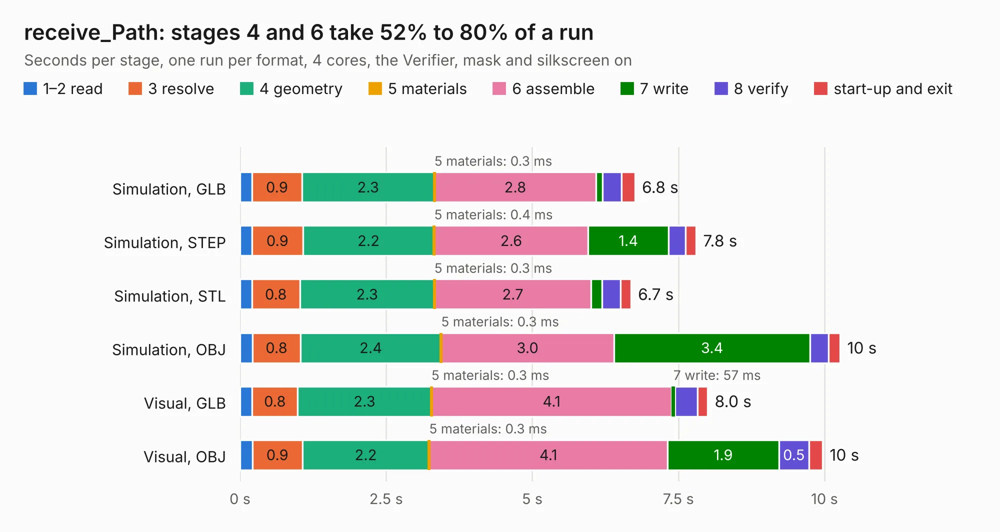

# 2147. receive_Path

Board 2,147 of the 3,119 of [Corpus Testing](../Corpus-Testing.md), on [Corpus Page 20](../CorpusTestingPages/Corpus-Testing-20.md#2147-receive_path).

| Mode and format | 1–2 read | 3 resolve | 4 geometry | 5 materials | 6 assemble | 7 write | 8 verify | start-up and exit | Total |
|---|---:|---:|---:|---:|---:|---:|---:|---:|---:|
| Simulation, GLB | 0.2 | 0.9 | 2.3 | 0.3&nbsp;ms | 2.8 | 0.1 | 0.3 | 0.2 | 6.8 |
| Simulation, STEP | 0.2 | 0.9 | 2.2 | 0.4&nbsp;ms | 2.6 | 1.4 | 0.3 | 0.2 | 7.8 |
| Simulation, STL | 0.2 | 0.8 | 2.3 | 0.3&nbsp;ms | 2.7 | 0.2 | 0.3 | 0.2 | 6.7 |
| Simulation, OBJ | 0.2 | 0.8 | 2.4 | 0.3&nbsp;ms | 3.0 | 3.4 | 0.3 | 0.2 | 10.3 |
| Visual, GLB | 0.2 | 0.8 | 2.3 | 0.3&nbsp;ms | 4.1 | 57&nbsp;ms | 0.4 | 0.2 | 8.0 |
| Visual, OBJ | 0.2 | 0.9 | 2.2 | 0.3&nbsp;ms | 4.1 | 1.9 | 0.5 | 0.2 | 10.0 |

<table align="center"><tr><td valign="top">

| Board | Repo: [oresat/oresat-dxwifi-hardware](https://github.com/oresat/oresat-dxwifi-hardware) Board: `receive_Path.kicad_pcb` |
|---|---|
| Folder | rf-receive-test |
| Complexity | 291&nbsp;/&nbsp;1000 (size&nbsp;186, features&nbsp;105) |
| KESE&nbsp;features | through vias, rounded, trapezoid or chamfered pads, filled zones, curved board outline, stack-up, dielectric εr and tanδ, copper finish, mask and silkscreen colours |
| Tested | 9th November 2026 |
| Copper&nbsp;layers | 4 |
| File&nbsp;format | KiCad 8 (20240108) |
| Parts,&nbsp;tracks,&nbsp;vias | 34, 120, 317 |
| Triangles,&nbsp;simulation | 849,594 in 45 parts |
| Verifier | PASS in all six runs |

</td><td valign="top">

<table>
<tr><th>File type</th><th>File size</th><th>Peak memory used</th></tr>
<tr><th colspan="3" align="left">Simulation</th></tr>
<tr><td>GLB</td><td align="right">29&nbsp;MB</td><td align="right">448&nbsp;MB</td></tr>
<tr><td>STEP</td><td align="right">64&nbsp;MB</td><td align="right">523&nbsp;MB</td></tr>
<tr><td>STL</td><td align="right">42&nbsp;MB</td><td align="right">436&nbsp;MB</td></tr>
<tr><td>OBJ</td><td align="right">86&nbsp;MB</td><td align="right">625&nbsp;MB</td></tr>
<tr><th colspan="3" align="left">Visual</th></tr>
<tr><td>GLB</td><td align="right">15&nbsp;MB</td><td align="right">451&nbsp;MB</td></tr>
<tr><td>OBJ</td><td align="right">47&nbsp;MB</td><td align="right">422&nbsp;MB</td></tr>
</table>

</td></tr></table>

| Previous | Next |
|:---|---:|
| [2146. oresat-live-card](b2146b_oresat-dxwifi-hardware_oresat-live-card.md) | [2148. balun-eval-board](b2148b_oresat-end-cards_balun-eval-board.md) |
