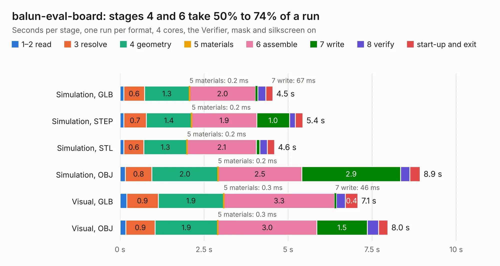

# 2147. balun-eval-board

Board 2,147 of the 3,118 of [Corpus Testing](../Corpus-Testing.md), on [Corpus Page 20](../CorpusTestingPages/Corpus-Testing-20.md#2147-balun-eval-board).

| Mode and format | 1–2 read | 3 resolve | 4 geometry | 5 materials | 6 assemble | 7 write | 8 verify | start-up and exit | Total |
|---|---:|---:|---:|---:|---:|---:|---:|---:|---:|
| Simulation, GLB | 0.1 | 0.6 | 1.3 | 0.2&nbsp;ms | 2.0 | 67&nbsp;ms | 0.2 | 0.2 | 4.5 |
| Simulation, STEP | 0.1 | 0.7 | 1.4 | 0.2&nbsp;ms | 1.9 | 1.0 | 0.2 | 0.2 | 5.4 |
| Simulation, STL | 0.1 | 0.6 | 1.3 | 0.2&nbsp;ms | 2.1 | 0.1 | 0.2 | 0.2 | 4.6 |
| Simulation, OBJ | 0.2 | 0.8 | 2.0 | 0.2&nbsp;ms | 2.5 | 2.9 | 0.3 | 0.3 | 8.9 |
| Visual, GLB | 0.2 | 0.9 | 1.9 | 0.3&nbsp;ms | 3.3 | 46&nbsp;ms | 0.3 | 0.4 | 7.1 |
| Visual, OBJ | 0.2 | 0.9 | 1.9 | 0.3&nbsp;ms | 3.0 | 1.5 | 0.3 | 0.3 | 8.0 |

<table align="center"><tr><td valign="top">

| Board | Repo: [oresat/oresat-end-cards](https://github.com/oresat/oresat-end-cards) Board: `balun-eval-board.kicad_pcb` |
|---|---|
| Folder | dev-boards / BalUn-eval-board |
| Complexity | 266&nbsp;/&nbsp;1000 (size&nbsp;161, features&nbsp;105) |
| KESE&nbsp;features | through vias, rounded, trapezoid or chamfered pads, filled zones, copper drawings, stack-up, dielectric εr and tanδ, copper finish, mask and silkscreen colours |
| Tested | 9th November 2026 |
| Copper&nbsp;layers | 4 |
| File&nbsp;format | KiCad 10 (20260206) |
| Parts,&nbsp;tracks,&nbsp;vias | 5, 14, 239 |
| Triangles,&nbsp;simulation | 450,516 in 18 parts |
| Verifier | PASS in all six runs |

</td><td valign="top">

<table>
<tr><th>File type</th><th>File size</th><th>Peak memory used</th></tr>
<tr><th colspan="3" align="left">Simulation</th></tr>
<tr><td>GLB</td><td align="right">15&nbsp;MB</td><td align="right">319&nbsp;MB</td></tr>
<tr><td>STEP</td><td align="right">19&nbsp;MB</td><td align="right">355&nbsp;MB</td></tr>
<tr><td>STL</td><td align="right">23&nbsp;MB</td><td align="right">327&nbsp;MB</td></tr>
<tr><td>OBJ</td><td align="right">45&nbsp;MB</td><td align="right">342&nbsp;MB</td></tr>
<tr><th colspan="3" align="left">Visual</th></tr>
<tr><td>GLB</td><td align="right">8.2&nbsp;MB</td><td align="right">285&nbsp;MB</td></tr>
<tr><td>OBJ</td><td align="right">25&nbsp;MB</td><td align="right">291&nbsp;MB</td></tr>
</table>

</td></tr></table>

| Previous | Next |
|:---|---:|
| [2146. receive_Path](b2146b_oresat-dxwifi-hardware_receive-Path.md) | [2148. esi-minusz-end-card](b2148b_oresat-end-cards_esi-minusz-end-card.md) |
