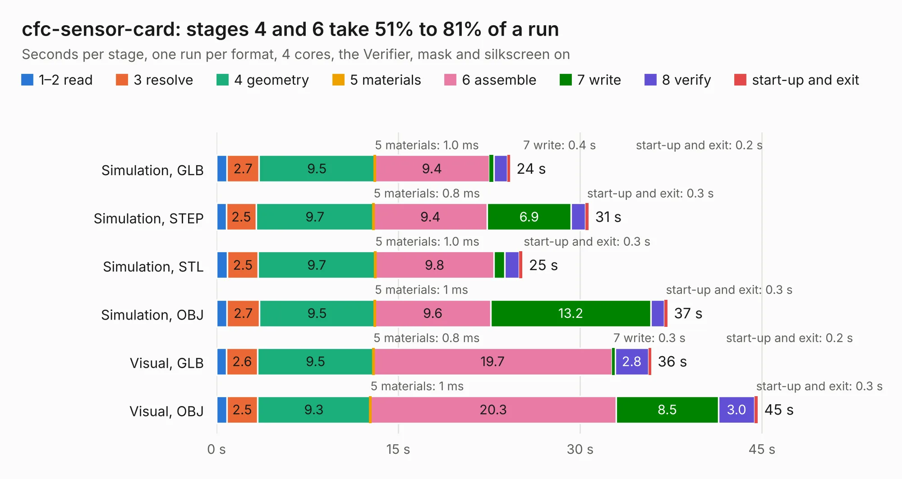

# 2148. cfc-sensor-card

Board 2,148 of the 3,126 of [Corpus Testing](../Corpus-Testing.md), on [Corpus Page 20](../CorpusTestingPages/Corpus-Testing-20.md#2148-cfc-sensor-card).

| Mode and format | 1–2 read | 3 resolve | 4 geometry | 5 materials | 6 assemble | 7 write | 8 verify | start-up and exit | Total |
|---|---:|---:|---:|---:|---:|---:|---:|---:|---:|
| Simulation, GLB | 0.9 | 2.7 | 9.5 | 1.0&nbsp;ms | 9.4 | 0.4 | 1.1 | 0.2 | 24.2 |
| Simulation, STEP | 0.8 | 2.5 | 9.7 | 0.8&nbsp;ms | 9.4 | 6.9 | 1.2 | 0.3 | 30.7 |
| Simulation, STL | 0.9 | 2.5 | 9.7 | 1.0&nbsp;ms | 9.8 | 0.9 | 1.2 | 0.3 | 25.2 |
| Simulation, OBJ | 0.9 | 2.7 | 9.5 | 1&nbsp;ms | 9.6 | 13.2 | 1.1 | 0.3 | 37.2 |
| Visual, GLB | 0.8 | 2.6 | 9.5 | 0.8&nbsp;ms | 19.7 | 0.3 | 2.8 | 0.2 | 35.9 |
| Visual, OBJ | 0.9 | 2.5 | 9.3 | 1&nbsp;ms | 20.3 | 8.5 | 3.0 | 0.3 | 44.6 |

<table align="center"><tr><td valign="top">

| Board | Repo: [oresat/oresat-cfc-hardware](https://github.com/oresat/oresat-cfc-hardware) Board: `cfc-sensor-card.kicad_pcb` |
|---|---|
| Folder | cfc-sensor-card-v2 |
| Complexity | 330&nbsp;/&nbsp;1000 (size&nbsp;215, features&nbsp;115) |
| KESE&nbsp;features | through vias, rounded, trapezoid or chamfered pads, drill offsets, arc tracks, filled zones, stack-up, dielectric εr and tanδ, copper finish |
| Tested | 9th November 2026 |
| Copper&nbsp;layers | 4 |
| File&nbsp;format | KiCad 10 (20260206) |
| Parts,&nbsp;tracks,&nbsp;vias | 149, 1,151, 404 |
| Triangles,&nbsp;simulation | 3,117,614 in 170 parts |
| Verifier | PASS in all six runs |

</td><td valign="top">

<table>
<tr><th>File type</th><th>File size</th><th>Peak memory used</th></tr>
<tr><th colspan="3" align="left">Simulation</th></tr>
<tr><td>GLB</td><td align="right">105&nbsp;MB</td><td align="right">984&nbsp;MB</td></tr>
<tr><td>STEP</td><td align="right">434&nbsp;MB</td><td align="right">1.3&nbsp;GB</td></tr>
<tr><td>STL</td><td align="right">156&nbsp;MB</td><td align="right">1.0&nbsp;GB</td></tr>
<tr><td>OBJ</td><td align="right">331&nbsp;MB</td><td align="right">2.1&nbsp;GB</td></tr>
<tr><th colspan="3" align="left">Visual</th></tr>
<tr><td>GLB</td><td align="right">65&nbsp;MB</td><td align="right">1.3&nbsp;GB</td></tr>
<tr><td>OBJ</td><td align="right">206&nbsp;MB</td><td align="right">1.5&nbsp;GB</td></tr>
</table>

</td></tr></table>

| Previous | Next |
|:---|---:|
| [2147. cfc-processor](b2147b_oresat-cfc-hardware_cfc-processor.md) | [2149. oresat-diode-test-card](b2149b_oresat-diode-test-card_oresat-diode-test-card.md) |
