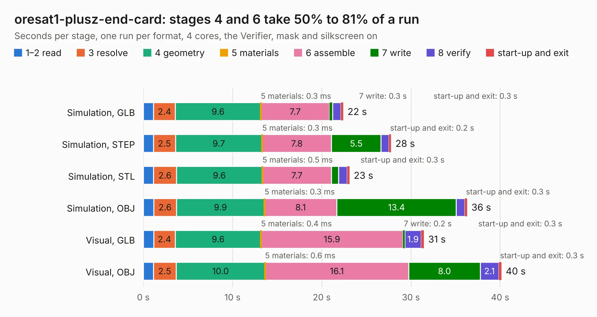

# 2148. oresat1-plusz-end-card

Board 2,148 of the 3,111 of [Corpus Testing](../Corpus-Testing.md), on [Corpus Page 20](../CorpusTestingPages/Corpus-Testing-20.md#2148-oresat1-plusz-end-card).

| Mode and format | 1–2 read | 3 resolve | 4 geometry | 5 materials | 6 assemble | 7 write | 8 verify | start-up and exit | Total |
|---|---:|---:|---:|---:|---:|---:|---:|---:|---:|
| Simulation, GLB | 1.2 | 2.4 | 9.6 | 0.3&nbsp;ms | 7.7 | 0.3 | 0.9 | 0.3 | 22.4 |
| Simulation, STEP | 1.1 | 2.5 | 9.7 | 0.3&nbsp;ms | 7.8 | 5.5 | 0.9 | 0.2 | 27.8 |
| Simulation, STL | 1.1 | 2.6 | 9.6 | 0.5&nbsp;ms | 7.7 | 0.8 | 1.0 | 0.3 | 23.1 |
| Simulation, OBJ | 1.2 | 2.6 | 9.9 | 0.3&nbsp;ms | 8.1 | 13.4 | 1.0 | 0.3 | 36.3 |
| Visual, GLB | 1.2 | 2.4 | 9.6 | 0.4&nbsp;ms | 15.9 | 0.2 | 1.9 | 0.3 | 31.5 |
| Visual, OBJ | 1.1 | 2.5 | 10.0 | 0.6&nbsp;ms | 16.1 | 8.0 | 2.1 | 0.3 | 40.2 |

<table align="center"><tr><td valign="top">

| Board | Repo: [oresat/oresat-end-cards](https://github.com/oresat/oresat-end-cards) Board: `oresat1-plusz-end-card.kicad_pcb` |
|---|---|
| Folder | oresat1-plusz-end-card |
| Complexity | 375&nbsp;/&nbsp;1000 (size&nbsp;205, features&nbsp;170) |
| KESE&nbsp;features | through vias, custom pads, rounded, trapezoid or chamfered pads, drill offsets, arc tracks, filled zones, copper drawings, curved board outline, tracks bare of mask, stack-up, dielectric εr and tanδ, copper finish, mask and silkscreen colours |
| Tested | 9th November 2026 |
| Copper&nbsp;layers | 4 |
| File&nbsp;format | KiCad 10 (20260206) |
| Parts,&nbsp;tracks,&nbsp;vias | 74, 731, 445 |
| Triangles,&nbsp;simulation | 2,233,472 in 89 parts |
| Verifier | PASS in all six runs |

</td><td valign="top">

<table>
<tr><th>File type</th><th>File size</th><th>Peak memory used</th></tr>
<tr><th colspan="3" align="left">Simulation</th></tr>
<tr><td>GLB</td><td align="right">76&nbsp;MB</td><td align="right">866&nbsp;MB</td></tr>
<tr><td>STEP</td><td align="right">280&nbsp;MB</td><td align="right">959&nbsp;MB</td></tr>
<tr><td>STL</td><td align="right">112&nbsp;MB</td><td align="right">849&nbsp;MB</td></tr>
<tr><td>OBJ</td><td align="right">236&nbsp;MB</td><td align="right">1.5&nbsp;GB</td></tr>
<tr><th colspan="3" align="left">Visual</th></tr>
<tr><td>GLB</td><td align="right">45&nbsp;MB</td><td align="right">892&nbsp;MB</td></tr>
<tr><td>OBJ</td><td align="right">141&nbsp;MB</td><td align="right">1.1&nbsp;GB</td></tr>
</table>

</td></tr></table>

| Previous | Next |
|:---|---:|
| [2147. oresat1-minusz-end-card](b2147b_oresat-end-cards_oresat1-minusz-end-card.md) | [2149. esi-minusZ-end-cap](b2149b_oresat-endcaps_esi-minusZ-end-cap.md) |
