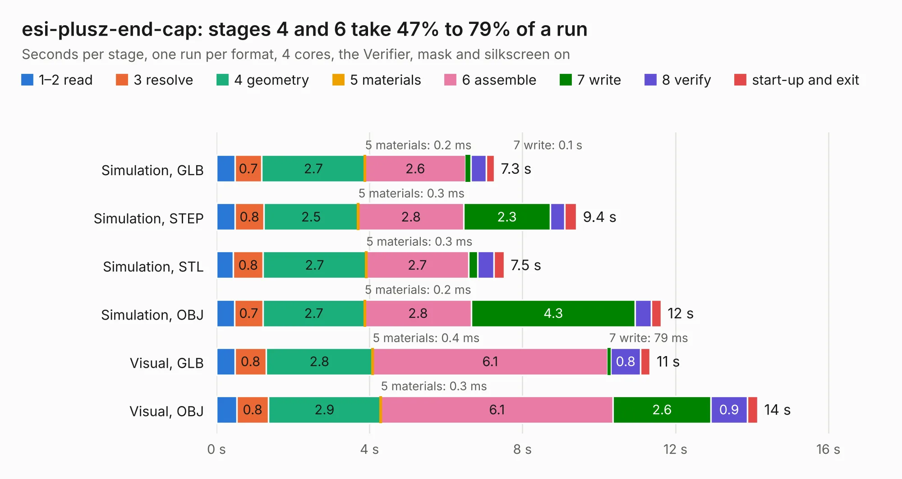

# 2148. esi-plusz-end-cap

Board 2,148 of the 3,109 of [Corpus Testing](../Corpus-Testing.md), on [Corpus Page 20](../CorpusTestingPages/Corpus-Testing-20.md#2148-esi-plusz-end-cap).

| Mode and format | 1–2 read | 3 resolve | 4 geometry | 5 materials | 6 assemble | 7 write | 8 verify | start-up and exit | Total |
|---|---:|---:|---:|---:|---:|---:|---:|---:|---:|
| Simulation, GLB | 0.5 | 0.7 | 2.7 | 0.2&nbsp;ms | 2.6 | 0.1 | 0.4 | 0.2 | 7.3 |
| Simulation, STEP | 0.5 | 0.8 | 2.5 | 0.3&nbsp;ms | 2.8 | 2.3 | 0.4 | 0.3 | 9.4 |
| Simulation, STL | 0.4 | 0.8 | 2.7 | 0.3&nbsp;ms | 2.7 | 0.2 | 0.4 | 0.3 | 7.5 |
| Simulation, OBJ | 0.5 | 0.7 | 2.7 | 0.2&nbsp;ms | 2.8 | 4.3 | 0.4 | 0.3 | 11.6 |
| Visual, GLB | 0.5 | 0.8 | 2.8 | 0.4&nbsp;ms | 6.1 | 79&nbsp;ms | 0.8 | 0.3 | 11.3 |
| Visual, OBJ | 0.5 | 0.8 | 2.9 | 0.3&nbsp;ms | 6.1 | 2.6 | 0.9 | 0.3 | 14.2 |

<table align="center"><tr><td valign="top">

| Board | Repo: [oresat/oresat-endcaps](https://github.com/oresat/oresat-endcaps) Board: `esi-plusz-end-cap.kicad_pcb` |
|---|---|
| Folder | esi-plusz-end-cap |
| Complexity | 285&nbsp;/&nbsp;1000 (size&nbsp;180, features&nbsp;105) |
| KESE&nbsp;features | through vias, rounded, trapezoid or chamfered pads, filled zones, curved board outline, stack-up, dielectric εr and tanδ, copper finish, mask and silkscreen colours |
| Tested | 9th November 2026 |
| Copper&nbsp;layers | 4 |
| File&nbsp;format | KiCad 10 (20260206) |
| Parts,&nbsp;tracks,&nbsp;vias | 34, 273, 146 |
| Triangles,&nbsp;simulation | 829,900 in 56 parts |
| Verifier | PASS in all six runs |

</td><td valign="top">

<table>
<tr><th>File type</th><th>File size</th><th>Peak memory used</th></tr>
<tr><th colspan="3" align="left">Simulation</th></tr>
<tr><td>GLB</td><td align="right">28&nbsp;MB</td><td align="right">439&nbsp;MB</td></tr>
<tr><td>STEP</td><td align="right">105&nbsp;MB</td><td align="right">450&nbsp;MB</td></tr>
<tr><td>STL</td><td align="right">41&nbsp;MB</td><td align="right">443&nbsp;MB</td></tr>
<tr><td>OBJ</td><td align="right">85&nbsp;MB</td><td align="right">611&nbsp;MB</td></tr>
<tr><th colspan="3" align="left">Visual</th></tr>
<tr><td>GLB</td><td align="right">17&nbsp;MB</td><td align="right">480&nbsp;MB</td></tr>
<tr><td>OBJ</td><td align="right">53&nbsp;MB</td><td align="right">447&nbsp;MB</td></tr>
</table>

</td></tr></table>

| Previous | Next |
|:---|---:|
| [2147. esi-minusZ-end-cap](b2147b_oresat-endcaps_esi-minusZ-end-cap.md) | [2149. oresat0-plusz-end-cap](b2149b_oresat-endcaps_oresat0-plusz-end-cap.md) |
