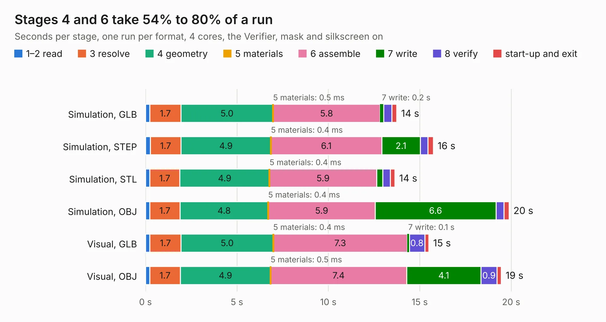

# 2150. plusz-end-card-with-turnstile-mezzanine

Board 2,150 of the 3,117 of [Corpus Testing](../Corpus-Testing.md), on [Corpus Page 20](../CorpusTestingPages/Corpus-Testing-20.md#2150-plusz-end-card-with-turnstile-mezzanine).

| Mode and format | 1–2 read | 3 resolve | 4 geometry | 5 materials | 6 assemble | 7 write | 8 verify | start-up and exit | Total |
|---|---:|---:|---:|---:|---:|---:|---:|---:|---:|
| Simulation, GLB | 0.2 | 1.7 | 5.0 | 0.5&nbsp;ms | 5.8 | 0.2 | 0.4 | 0.3 | 13.7 |
| Simulation, STEP | 0.3 | 1.7 | 4.9 | 0.4&nbsp;ms | 6.1 | 2.1 | 0.4 | 0.3 | 15.7 |
| Simulation, STL | 0.2 | 1.7 | 4.9 | 0.4&nbsp;ms | 5.9 | 0.3 | 0.4 | 0.2 | 13.6 |
| Simulation, OBJ | 0.2 | 1.7 | 4.8 | 0.4&nbsp;ms | 5.9 | 6.6 | 0.4 | 0.3 | 19.9 |
| Visual, GLB | 0.2 | 1.7 | 5.0 | 0.4&nbsp;ms | 7.3 | 0.1 | 0.8 | 0.2 | 15.5 |
| Visual, OBJ | 0.2 | 1.7 | 4.9 | 0.5&nbsp;ms | 7.4 | 4.1 | 0.9 | 0.2 | 19.5 |

<table align="center"><tr><td valign="top">

| Board | Repo: [oresat/oresat-end-cards](https://github.com/oresat/oresat-end-cards) Board: `plusz-end-card-with-turnstile-mezzanine.kicad_pcb` |
|---|---|
| Folder | oresat0-plusz-end-card / mezzanine |
| Complexity | 260&nbsp;/&nbsp;1000 (size&nbsp;190, features&nbsp;70) |
| KESE&nbsp;features | through vias, rounded, trapezoid or chamfered pads, arc tracks, filled zones, curved board outline |
| Tested | 9th November 2026 |
| Copper&nbsp;layers | 4 |
| File&nbsp;format | KiCad 10 (20260206) |
| Parts,&nbsp;tracks,&nbsp;vias | 22, 143, 536 |
| Triangles,&nbsp;simulation | 1,165,586 in 37 parts |
| Verifier | PASS in all six runs |

</td><td valign="top">

<table>
<tr><th>File type</th><th>File size</th><th>Peak memory used</th></tr>
<tr><th colspan="3" align="left">Simulation</th></tr>
<tr><td>GLB</td><td align="right">37&nbsp;MB</td><td align="right">542&nbsp;MB</td></tr>
<tr><td>STEP</td><td align="right">75&nbsp;MB</td><td align="right">629&nbsp;MB</td></tr>
<tr><td>STL</td><td align="right">58&nbsp;MB</td><td align="right">580&nbsp;MB</td></tr>
<tr><td>OBJ</td><td align="right">116&nbsp;MB</td><td align="right">784&nbsp;MB</td></tr>
<tr><th colspan="3" align="left">Visual</th></tr>
<tr><td>GLB</td><td align="right">23&nbsp;MB</td><td align="right">659&nbsp;MB</td></tr>
<tr><td>OBJ</td><td align="right">71&nbsp;MB</td><td align="right">605&nbsp;MB</td></tr>
</table>

</td></tr></table>

| Previous | Next |
|:---|---:|
| [2149. plusz-end-card-with-turnstile](b2149b_oresat-end-cards_plusz-end-card-with-turnstile.md) | [2151. oresat0.5-minusz-end-card](b2151b_oresat-end-cards_oresat0-5-minusz-end-card.md) |
