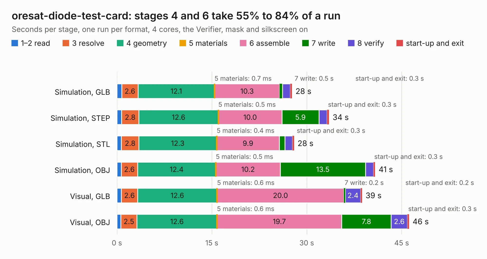

# 2152. oresat-diode-test-card

Board 2,152 of the 3,131 of [Corpus Testing](../Corpus-Testing.md), on [Corpus Page 20](../CorpusTestingPages/Corpus-Testing-20.md#2152-oresat-diode-test-card).

| Mode and format | 1–2 read | 3 resolve | 4 geometry | 5 materials | 6 assemble | 7 write | 8 verify | start-up and exit | Total |
|---|---:|---:|---:|---:|---:|---:|---:|---:|---:|
| Simulation, GLB | 0.8 | 2.6 | 12.1 | 0.7&nbsp;ms | 10.3 | 0.5 | 1.2 | 0.3 | 27.7 |
| Simulation, STEP | 0.7 | 2.8 | 12.6 | 0.5&nbsp;ms | 10.0 | 5.9 | 1.3 | 0.3 | 33.5 |
| Simulation, STL | 0.7 | 2.8 | 12.3 | 0.4&nbsp;ms | 9.9 | 0.9 | 1.2 | 0.3 | 28.0 |
| Simulation, OBJ | 0.7 | 2.6 | 12.4 | 0.5&nbsp;ms | 10.2 | 13.5 | 1.3 | 0.3 | 40.8 |
| Visual, GLB | 0.7 | 2.6 | 12.6 | 0.6&nbsp;ms | 20.0 | 0.2 | 2.4 | 0.2 | 38.8 |
| Visual, OBJ | 0.6 | 2.5 | 12.6 | 0.6&nbsp;ms | 19.7 | 7.8 | 2.6 | 0.3 | 46.2 |

<table align="center"><tr><td valign="top">

| Board | Repo: [oresat/oresat-diode-test-card](https://github.com/oresat/oresat-diode-test-card) Board: `oresat-diode-test-card.kicad_pcb` |
|---|---|
| Folder | oresat-diode-test-card |
| Complexity | 301&nbsp;/&nbsp;1000 (size&nbsp;211, features&nbsp;90) |
| KESE&nbsp;features | through vias, rounded, trapezoid or chamfered pads, drill offsets, filled zones, stack-up, dielectric εr and tanδ, mask and silkscreen colours |
| Tested | 9th November 2026 |
| Copper&nbsp;layers | 4 |
| File&nbsp;format | KiCad 8 (20240108) |
| Parts,&nbsp;tracks,&nbsp;vias | 116, 1,047, 362 |
| Triangles,&nbsp;simulation | 2,723,040 in 151 parts |
| Verifier | PASS in all six runs |

</td><td valign="top">

<table>
<tr><th>File type</th><th>File size</th><th>Peak memory used</th></tr>
<tr><th colspan="3" align="left">Simulation</th></tr>
<tr><td>GLB</td><td align="right">94&nbsp;MB</td><td align="right">872&nbsp;MB</td></tr>
<tr><td>STEP</td><td align="right">377&nbsp;MB</td><td align="right">1.1&nbsp;GB</td></tr>
<tr><td>STL</td><td align="right">136&nbsp;MB</td><td align="right">878&nbsp;MB</td></tr>
<tr><td>OBJ</td><td align="right">291&nbsp;MB</td><td align="right">1.8&nbsp;GB</td></tr>
<tr><th colspan="3" align="left">Visual</th></tr>
<tr><td>GLB</td><td align="right">55&nbsp;MB</td><td align="right">1.1&nbsp;GB</td></tr>
<tr><td>OBJ</td><td align="right">173&nbsp;MB</td><td align="right">1.3&nbsp;GB</td></tr>
</table>

</td></tr></table>

| Previous | Next |
|:---|---:|
| [2151. cfc-sensor-card](b2151b_oresat-cfc-hardware_cfc-sensor-card.md) | [2153. AR9271_eval](b2153b_oresat-dxwifi-hardware_AR9271-eval.md) |
