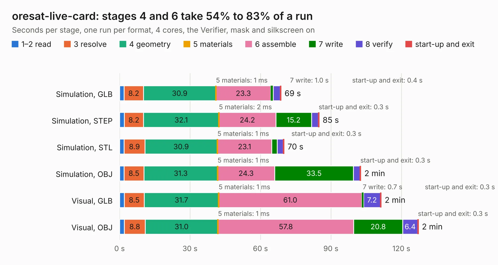

# 2156. oresat-live-card

Board 2,156 of the 3,132 of [Corpus Testing](../Corpus-Testing.md), on [Corpus Page 20](../CorpusTestingPages/Corpus-Testing-20.md#2156-oresat-live-card).

| Mode and format | 1–2 read | 3 resolve | 4 geometry | 5 materials | 6 assemble | 7 write | 8 verify | start-up and exit | Total |
|---|---:|---:|---:|---:|---:|---:|---:|---:|---:|
| Simulation, GLB | 1.9 | 8.2 | 30.9 | 1&nbsp;ms | 23.3 | 1.0 | 2.9 | 0.4 | 68.8 |
| Simulation, STEP | 2.0 | 8.2 | 32.1 | 2&nbsp;ms | 24.2 | 15.2 | 2.9 | 0.3 | 85.0 |
| Simulation, STL | 1.9 | 8.9 | 30.9 | 1&nbsp;ms | 23.1 | 2.3 | 2.6 | 0.3 | 70.0 |
| Simulation, OBJ | 1.9 | 8.5 | 31.3 | 1&nbsp;ms | 24.3 | 33.5 | 2.8 | 0.3 | 102.7 |
| Visual, GLB | 2.0 | 8.5 | 31.7 | 1&nbsp;ms | 61.0 | 0.7 | 7.2 | 0.3 | 111.4 |
| Visual, OBJ | 2.1 | 8.8 | 31.0 | 1&nbsp;ms | 57.8 | 20.8 | 6.4 | 0.3 | 127.2 |

<table align="center"><tr><td valign="top">

| Board | Repo: [oresat/oresat-dxwifi-hardware](https://github.com/oresat/oresat-dxwifi-hardware) Board: `oresat-live-card.kicad_pcb` |
|---|---|
| Folder | oresat-live-card |
| Complexity | 472&nbsp;/&nbsp;1000 (size&nbsp;302, features&nbsp;170) |
| KESE&nbsp;features | through vias, custom pads, rounded, trapezoid or chamfered pads, drill offsets, arc tracks, filled zones, copper drawings, curved board outline, tracks bare of mask, stack-up, dielectric εr and tanδ, copper finish, mask and silkscreen colours |
| Tested | 9th November 2026 |
| Copper&nbsp;layers | 4 |
| File&nbsp;format | KiCad 10 (20260206) |
| Parts,&nbsp;tracks,&nbsp;vias | 313, 3,611, 1,249 |
| Triangles,&nbsp;simulation | 6,616,224 in 533 parts |
| Verifier | PASS in all six runs |

</td><td valign="top">

<table>
<tr><th>File type</th><th>File size</th><th>Peak memory used</th></tr>
<tr><th colspan="3" align="left">Simulation</th></tr>
<tr><td>GLB</td><td align="right">225&nbsp;MB</td><td align="right">1.8&nbsp;GB</td></tr>
<tr><td>STEP</td><td align="right">911&nbsp;MB</td><td align="right">2.5&nbsp;GB</td></tr>
<tr><td>STL</td><td align="right">331&nbsp;MB</td><td align="right">2.0&nbsp;GB</td></tr>
<tr><td>OBJ</td><td align="right">713&nbsp;MB</td><td align="right">4.2&nbsp;GB</td></tr>
<tr><th colspan="3" align="left">Visual</th></tr>
<tr><td>GLB</td><td align="right">144&nbsp;MB</td><td align="right">2.3&nbsp;GB</td></tr>
<tr><td>OBJ</td><td align="right">470&nbsp;MB</td><td align="right">3.1&nbsp;GB</td></tr>
</table>

</td></tr></table>

| Previous | Next |
|:---|---:|
| [2155. Bidirectional_Amp](b2155b_oresat-dxwifi-hardware_Bidirectional-Amp.md) | [2157. receive_Path](b2157b_oresat-dxwifi-hardware_receive-Path.md) |
