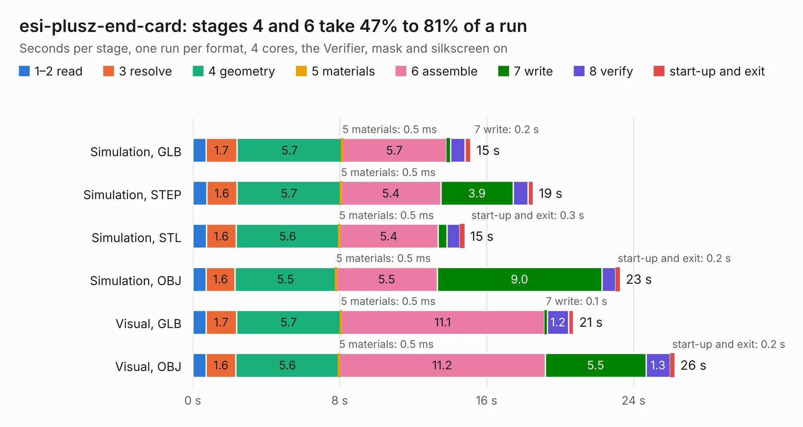

# 2156. esi-plusz-end-card

Board 2,156 of the 3,128 of [Corpus Testing](../Corpus-Testing.md), on [Corpus Page 20](../CorpusTestingPages/Corpus-Testing-20.md#2156-esi-plusz-end-card).

| Mode and format | 1–2 read | 3 resolve | 4 geometry | 5 materials | 6 assemble | 7 write | 8 verify | start-up and exit | Total |
|---|---:|---:|---:|---:|---:|---:|---:|---:|---:|
| Simulation, GLB | 0.7 | 1.7 | 5.7 | 0.5&nbsp;ms | 5.7 | 0.2 | 0.8 | 0.3 | 15.1 |
| Simulation, STEP | 0.8 | 1.6 | 5.7 | 0.5&nbsp;ms | 5.4 | 3.9 | 0.8 | 0.3 | 18.5 |
| Simulation, STL | 0.7 | 1.6 | 5.6 | 0.5&nbsp;ms | 5.4 | 0.5 | 0.7 | 0.3 | 14.8 |
| Simulation, OBJ | 0.7 | 1.6 | 5.5 | 0.5&nbsp;ms | 5.5 | 9.0 | 0.7 | 0.2 | 23.3 |
| Visual, GLB | 0.7 | 1.7 | 5.7 | 0.5&nbsp;ms | 11.1 | 0.1 | 1.2 | 0.3 | 20.7 |
| Visual, OBJ | 0.7 | 1.6 | 5.6 | 0.5&nbsp;ms | 11.2 | 5.5 | 1.3 | 0.2 | 26.2 |

<table align="center"><tr><td valign="top">

| Board | Repo: [oresat/oresat-end-cards](https://github.com/oresat/oresat-end-cards) Board: `esi-plusz-end-card.kicad_pcb` |
|---|---|
| Folder | esi-plusz-end-card |
| Complexity | 321&nbsp;/&nbsp;1000 (size&nbsp;196, features&nbsp;125) |
| KESE&nbsp;features | through vias, custom pads, rounded, trapezoid or chamfered pads, drill offsets, filled zones, copper drawings, curved board outline, stack-up, dielectric εr and tanδ, mask and silkscreen colours |
| Tested | 9th November 2026 |
| Copper&nbsp;layers | 4 |
| File&nbsp;format | KiCad 10 (20260206) |
| Parts,&nbsp;tracks,&nbsp;vias | 50, 692, 275 |
| Triangles,&nbsp;simulation | 1,500,644 in 78 parts |
| Verifier | PASS in all six runs |

</td><td valign="top">

<table>
<tr><th>File type</th><th>File size</th><th>Peak memory used</th></tr>
<tr><th colspan="3" align="left">Simulation</th></tr>
<tr><td>GLB</td><td align="right">50&nbsp;MB</td><td align="right">571&nbsp;MB</td></tr>
<tr><td>STEP</td><td align="right">192&nbsp;MB</td><td align="right">710&nbsp;MB</td></tr>
<tr><td>STL</td><td align="right">75&nbsp;MB</td><td align="right">595&nbsp;MB</td></tr>
<tr><td>OBJ</td><td align="right">155&nbsp;MB</td><td align="right">1.0&nbsp;GB</td></tr>
<tr><th colspan="3" align="left">Visual</th></tr>
<tr><td>GLB</td><td align="right">32&nbsp;MB</td><td align="right">740&nbsp;MB</td></tr>
<tr><td>OBJ</td><td align="right">96&nbsp;MB</td><td align="right">716&nbsp;MB</td></tr>
</table>

</td></tr></table>

| Previous | Next |
|:---|---:|
| [2155. esi-minusz-end-card](b2155b_oresat-end-cards_esi-minusz-end-card.md) | [2157. plusz-end-card-with-turnstile](b2157b_oresat-end-cards_plusz-end-card-with-turnstile.md) |
