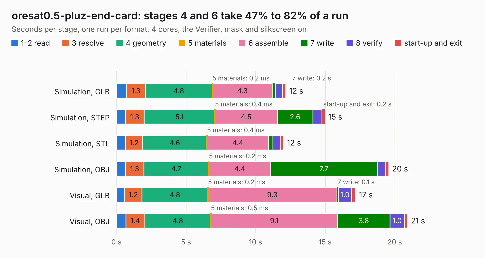

# 2156. oresat0.5-pluz-end-card

Board 2,156 of the 3,121 of [Corpus Testing](../Corpus-Testing.md), on [Corpus Page 20](../CorpusTestingPages/Corpus-Testing-20.md#2156-oresat05-pluz-end-card).

| Mode and format | 1–2 read | 3 resolve | 4 geometry | 5 materials | 6 assemble | 7 write | 8 verify | start-up and exit | Total |
|---|---:|---:|---:|---:|---:|---:|---:|---:|---:|
| Simulation, GLB | 0.7 | 1.3 | 4.8 | 0.2&nbsp;ms | 4.3 | 0.2 | 0.5 | 0.2 | 12.2 |
| Simulation, STEP | 0.7 | 1.3 | 5.1 | 0.4&nbsp;ms | 4.5 | 2.6 | 0.6 | 0.2 | 15.0 |
| Simulation, STL | 0.7 | 1.2 | 4.6 | 0.4&nbsp;ms | 4.4 | 0.3 | 0.5 | 0.2 | 12.0 |
| Simulation, OBJ | 0.6 | 1.3 | 4.7 | 0.2&nbsp;ms | 4.4 | 7.7 | 0.6 | 0.2 | 19.6 |
| Visual, GLB | 0.6 | 1.2 | 4.8 | 0.2&nbsp;ms | 9.3 | 0.1 | 1.0 | 0.3 | 17.2 |
| Visual, OBJ | 0.7 | 1.4 | 4.8 | 0.5&nbsp;ms | 9.1 | 3.8 | 1.0 | 0.2 | 20.9 |

<table align="center"><tr><td valign="top">

| Board | Repo: [oresat/oresat-end-cards](https://github.com/oresat/oresat-end-cards) Board: `oresat0.5-pluz-end-card.kicad_pcb` |
|---|---|
| Folder | oresat0.5-plusz-end-card |
| Complexity | 319&nbsp;/&nbsp;1000 (size&nbsp;179, features&nbsp;140) |
| KESE&nbsp;features | through vias, custom pads, rounded, trapezoid or chamfered pads, drill offsets, arc tracks, filled zones, copper drawings, curved board outline, stack-up, dielectric εr and tanδ, mask and silkscreen colours |
| Tested | 9th November 2026 |
| Copper&nbsp;layers | 4 |
| File&nbsp;format | KiCad 8 (20240108) |
| Parts,&nbsp;tracks,&nbsp;vias | 14, 190, 328 |
| Triangles,&nbsp;simulation | 1,392,812 in 52 parts |
| Verifier | PASS in all six runs |

</td><td valign="top">

<table>
<tr><th>File type</th><th>File size</th><th>Peak memory used</th></tr>
<tr><th colspan="3" align="left">Simulation</th></tr>
<tr><td>GLB</td><td align="right">46&nbsp;MB</td><td align="right">595&nbsp;MB</td></tr>
<tr><td>STEP</td><td align="right">150&nbsp;MB</td><td align="right">626&nbsp;MB</td></tr>
<tr><td>STL</td><td align="right">70&nbsp;MB</td><td align="right">615&nbsp;MB</td></tr>
<tr><td>OBJ</td><td align="right">142&nbsp;MB</td><td align="right">942&nbsp;MB</td></tr>
<tr><th colspan="3" align="left">Visual</th></tr>
<tr><td>GLB</td><td align="right">26&nbsp;MB</td><td align="right">621&nbsp;MB</td></tr>
<tr><td>OBJ</td><td align="right">78&nbsp;MB</td><td align="right">606&nbsp;MB</td></tr>
</table>

</td></tr></table>

| Previous | Next |
|:---|---:|
| [2155. oresat0.5-minusz-end-card](b2155b_oresat-end-cards_oresat0-5-minusz-end-card.md) | [2157. oresat1-minusz-end-card](b2157b_oresat-end-cards_oresat1-minusz-end-card.md) |
