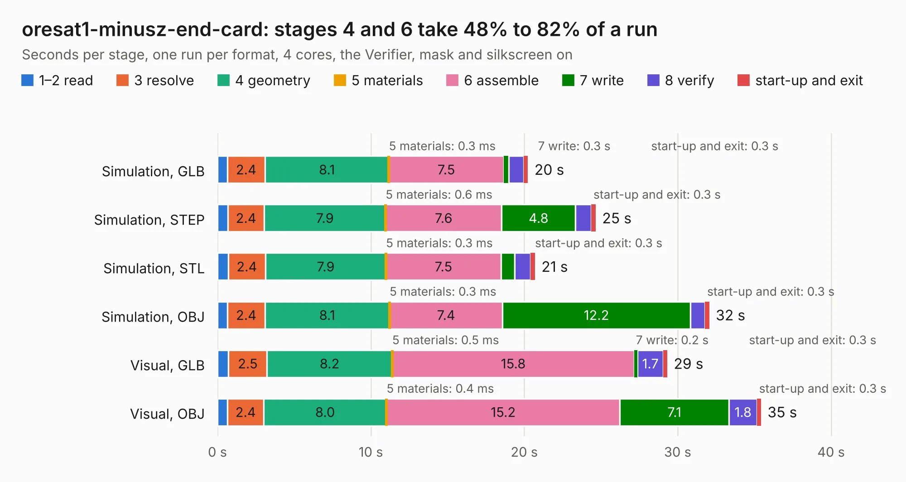

# 2157. oresat1-minusz-end-card

Board 2,157 of the 3,121 of [Corpus Testing](../Corpus-Testing.md), on [Corpus Page 20](../CorpusTestingPages/Corpus-Testing-20.md#2157-oresat1-minusz-end-card).

| Mode and format | 1–2 read | 3 resolve | 4 geometry | 5 materials | 6 assemble | 7 write | 8 verify | start-up and exit | Total |
|---|---:|---:|---:|---:|---:|---:|---:|---:|---:|
| Simulation, GLB | 0.6 | 2.4 | 8.1 | 0.3&nbsp;ms | 7.5 | 0.3 | 1.0 | 0.3 | 20.2 |
| Simulation, STEP | 0.7 | 2.4 | 7.9 | 0.6&nbsp;ms | 7.6 | 4.8 | 1.0 | 0.3 | 24.7 |
| Simulation, STL | 0.7 | 2.4 | 7.9 | 0.3&nbsp;ms | 7.5 | 0.9 | 1.1 | 0.3 | 20.7 |
| Simulation, OBJ | 0.7 | 2.4 | 8.1 | 0.3&nbsp;ms | 7.4 | 12.2 | 1.0 | 0.3 | 32.1 |
| Visual, GLB | 0.7 | 2.5 | 8.2 | 0.5&nbsp;ms | 15.8 | 0.2 | 1.7 | 0.3 | 29.3 |
| Visual, OBJ | 0.7 | 2.4 | 8.0 | 0.4&nbsp;ms | 15.2 | 7.1 | 1.8 | 0.3 | 35.4 |

<table align="center"><tr><td valign="top">

| Board | Repo: [oresat/oresat-end-cards](https://github.com/oresat/oresat-end-cards) Board: `oresat1-minusz-end-card.kicad_pcb` |
|---|---|
| Folder | oresat1-minusz-end-card |
| Complexity | 394&nbsp;/&nbsp;1000 (size&nbsp;204, features&nbsp;190) |
| KESE&nbsp;features | through vias, slotted holes, custom pads, rounded, trapezoid or chamfered pads, drill offsets, arc tracks, filled zones, copper drawings, copper text, curved board outline, tracks bare of mask, stack-up, dielectric εr and tanδ, copper finish, mask and silkscreen colours |
| Tested | 9th November 2026 |
| Copper&nbsp;layers | 4 |
| File&nbsp;format | KiCad 10 (20260206) |
| Parts,&nbsp;tracks,&nbsp;vias | 65, 682, 477 |
| Triangles,&nbsp;simulation | 2,062,236 in 87 parts |
| Verifier | PASS in all six runs |

</td><td valign="top">

<table>
<tr><th>File type</th><th>File size</th><th>Peak memory used</th></tr>
<tr><th colspan="3" align="left">Simulation</th></tr>
<tr><td>GLB</td><td align="right">70&nbsp;MB</td><td align="right">785&nbsp;MB</td></tr>
<tr><td>STEP</td><td align="right">235&nbsp;MB</td><td align="right">933&nbsp;MB</td></tr>
<tr><td>STL</td><td align="right">103&nbsp;MB</td><td align="right">746&nbsp;MB</td></tr>
<tr><td>OBJ</td><td align="right">216&nbsp;MB</td><td align="right">1.4&nbsp;GB</td></tr>
<tr><th colspan="3" align="left">Visual</th></tr>
<tr><td>GLB</td><td align="right">42&nbsp;MB</td><td align="right">843&nbsp;MB</td></tr>
<tr><td>OBJ</td><td align="right">130&nbsp;MB</td><td align="right">973&nbsp;MB</td></tr>
</table>

</td></tr></table>

| Previous | Next |
|:---|---:|
| [2156. oresat0.5-pluz-end-card](b2156b_oresat-end-cards_oresat0-5-pluz-end-card.md) | [2158. oresat1-plusz-end-card](b2158b_oresat-end-cards_oresat1-plusz-end-card.md) |
